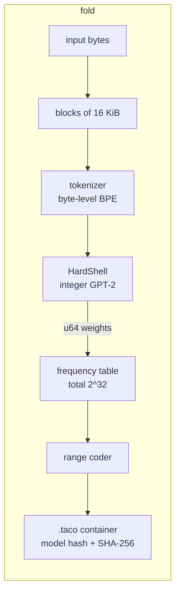
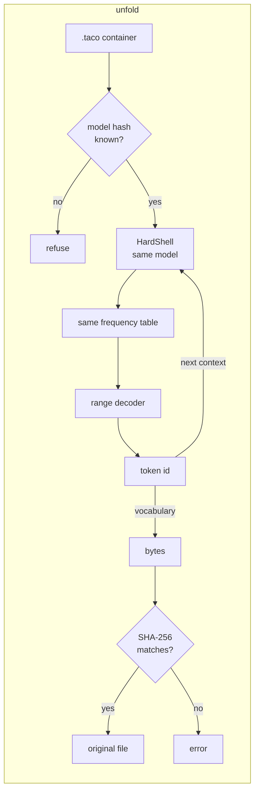
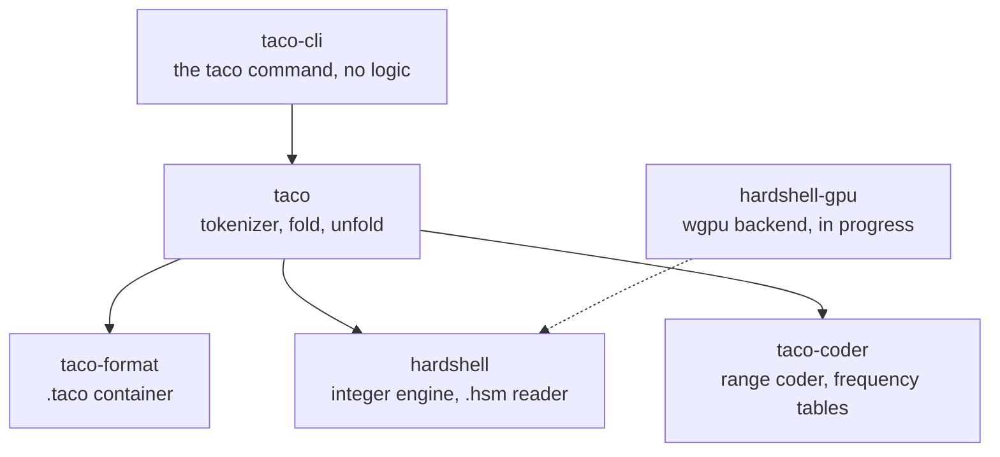

# Taco

*Hard shell. No floats. Same taco on every machine.*

Taco is a lossless compressor that uses a language model. The model predicts the next piece of
the data, and a range coder stores only what the model did not predict. HardShell, the engine
of Taco, runs the model with **integer arithmetic only**. Thus every machine calculates the
same predictions, bit for bit, and a file that one machine compresses ("folds") decompresses
("unfolds") on every other machine.

```bash
taco fold notes.txt          # makes notes.txt.taco
taco unfold notes.txt.taco   # restores notes.txt, byte for byte
```

> **Status: research prototype (2026-10-19).** Fold and unfold work and are bit-exact between
> an Apple M2 Mac and an x86 Linux machine. The file format is not frozen yet, so do not keep
> important data only in `.taco` files. Speed work (CPU SIMD, GPU) is in progress.

---

## Contents

1. [Results](#1-results)
2. [How it works](#2-how-it-works)
3. [Architecture](#3-architecture)
4. [Local setup](#4-local-setup)
5. [Usage](#5-usage)
6. [Development](#6-development)
7. [Roadmap](#7-roadmap)
8. [Documents](#8-documents)
9. [Licence](#9-licence)

---

## 1. Results

All numbers are measured on 2026-10-18. Details are in `docs/research/`.

### Size against other compressors

Real files, folded and unfolded with `taco` and the integer model `gpt2.hsm`. Every file came
back byte for byte.

| File | Original | **Taco** | xz -9e | zstd -19 | Taco against xz |
|---|---:|---:|---:|---:|---:|
| English book (32 KiB) | 32,768 | **8,432** | 12,400 | 12,463 | 32% smaller |
| HTML page | 24,603 | **4,759** | 7,652 | 7,713 | 38% smaller |
| English (4 KiB) | 4,096 | **1,237** | 1,684 | 1,599 | 27% smaller |
| Server log (16 KiB) | 16,384 | **3,129** | 3,164 | 3,139 | about the same |
| Excel file (binary) | 8,192 | 8,285 (stored raw) | **1,672** | 2,097 | xz is better |

On 16 text files of the quality corpus (32 KiB each), float GPT-2 with the Taco coder gives 1.99
bits per byte; bzip2 gives 2.36, xz 2.51 and zstd 2.52.

### Integer model against the float model

| Model | Bits per byte (first 1,024 tokens of 16 held-out text files) |
|---|---:|
| GPT-2 small, float | 1.867 |
| GPT-2 small, integer (`gpt2.hsm`) | 1.871 (+0.2%) |

### Same bits on different machines

| Check | Result |
|---|---|
| Tests on x86 Linux with the hashes that the ARM Mac recorded | 234 of 234 pass |
| Mac folds, Linux unfolds (`scripts/xcheck`, 12 inputs) | 12 of 12 restored |
| Linux folds, Mac unfolds | 12 of 12 restored |
| Same input on both machines | 12 of 12 `.taco` files identical |
| Native Windows x86 against the Mac (`scripts/wcheck`) | 9 of 9 `.taco` files identical, 9 of 9 restored |
| CUDA, wgpu (Metal, GL) and CPU | the same bytes (overlap note, 14 of 14 GPU cases) |

For comparison, a float model fails: when the encoder and the decoder used two float code
paths on the same Mac, 269 of 270 windows did not decode.

### Speed (the weak point today)

| Engine | Tokens per second |
|---|---:|
| CPU reference, one thread (Apple M2) | 135 |
| CPU prefill path, one thread (in progress) | 345 |
| Portable GPU path, RTX 3060 through OpenGL on DirectX 12 (in progress) | 1,311 (batch 32) |

One token is about 3 to 4 bytes of text. The target for the CUDA path is 10,000 tokens per
second or more (`docs/design/product-v1.md` §3).

---

## 2. How it works

### Prediction is compression

A symbol that the model expects with probability *p* costs about −log₂(*p*) bits. A good guess
is nearly free. A bad guess costs more bits, but it never makes the output wrong.

The model does not make one guess. For each position it gives a probability to every one of
the 50,257 tokens of GPT-2. The range coder divides a number range in proportion to these
probabilities, and narrows the range to the slice of the actual token. The decoder runs the
same model, divides the range in the same way, and finds the slice that contains the stored
number. That slice identifies the token.

### Why integers

The decoder must calculate **exactly** the same probabilities as the encoder. If one frequency
is different by one unit, the decoder can select a wrong token. After that token, all output is
wrong. Floating-point results change with the order of additions, the chip, the math library
and the batch size. Integer results do not change.

So HardShell uses `i8` weights, `i32` and `i64` sums, one fixed rounding rule, and tables for
GELU, `exp` and LayerNorm constants. A tool makes the model file one time, with floats. Every
decoder then loads that same file and uses only integers.

### Fold and unfold





- **Blocks** are independent. Many blocks can run in parallel, and damage stays in one block.
- A block that does not become smaller is stored **raw**. The worst-case growth is 104 bytes of
  header plus 5 bytes for each block (container version 2, ADR 0011 §8).
- The decoder **never tokenizes**. It only changes token ids to bytes.
- The container stores the **SHA-256 of the model file** and of the original data. A wrong model
  or a damaged file gives an error, never a silent wrong output.

### The `.taco` file (version 1)

```
"TACO" | version | flags | model hash (32 B) | original length | SHA-256 of original (32 B)
       | block size | block count | block table (kind + length per block) | block payloads
```

A coded block holds the token count (LEB128) and the range-coder bytes (ADR 0007). The full
layout is in ADR 0006.

### The `.hsm` model file (version 1)

A header in JSON (integers only), the vocabulary, the optional BPE merges, the `i8` weights,
the rescale constants (an integer multiplier and a shift), and the tables. The model hash is
the SHA-256 of the whole file. Details: ADR 0004.

---

## 3. Architecture

### Crates



| Crate | Job | Rules |
|---|---|---|
| `taco-coder` | Range coder (`u128` low, `u64` range, totals up to 2^32), binary coder, frequency tables | Kernel crate: no floats, no I/O |
| `hardshell` | Integer helpers, kernels, LayerNorm, GELU, softmax, the `.hsm` reader and writer, the integer GPT-2 | Kernel crate: no floats, no I/O |
| `taco-format` | The `.taco` container: header, block table, checksums, raw fallback | Strict parser for untrusted input |
| `taco` | The library: tokenizer, `fold`, `unfold` | Connects the parts |
| `taco-cli` | The `taco` command | Translates arguments only |

`taco-coder` and `hardshell` do not depend on each other. A kernel crate has no floats in
`src/` (a lint and `scripts/check-no-floats.sh` enforce it), no clock, no randomness and no
global state.

### Tools (Python, run before publication)

| Tool | Job |
|---|---|
| `tools/baseline` | Downloads GPT-2 and the corpus (with SHA-256 checks), a float NumPy GPT-2, a Python BPE and coder, the phase 0 and 1 measurements |
| `tools/convert` | Float GPT-2 to `gpt2.hsm`: `i8` weights, calibrated scales (recipe `clip`), tables, merges. Also the tiny conformance model |

Tools may use floats. Nothing in `crates/` calls a tool at run time.

### Repository layout

```
taco/
├── crates/
│   ├── taco-coder/        range coder and frequency tables
│   ├── hardshell/         integer engine and model-file reader
│   ├── hardshell-cuda/    NVIDIA backend (precompiled PTX)
│   ├── hardshell-gpu/     portable GPU backend (wgpu: Vulkan, Metal, DX12, GL)
│   ├── taco-match/        match model and mixer (profile logs)
│   ├── taco-format/       .taco container
│   ├── taco/              tokenizer, fold, unfold
│   └── taco-cli/          the taco command
├── tools/                 Python tools (uv project)
│   ├── baseline/          downloads, float GPT-2, measurements
│   └── convert/           model conversion and the tiny model
├── conformance/           tiny.hsm and its hash (conformance vectors)
├── scripts/               dx (devbox), mx (Mac), check.sh, xcheck, wcheck, conformance/, release/
├── docs/
│   ├── design/            plan.md, anymodel.md, product-v1.md
│   ├── adr/               decisions (ADRs)
│   ├── research/          measurements
│   └── STYLE.md           how to write documents (ASD-STE100)
├── CLAUDE.md              working rules
└── HANDOFF.md             current state and next steps
```

---

## 4. Local setup

### What you need

| Item | Version | Why |
|---|---|---|
| macOS (Apple Silicon or x86), Linux (x86 or ARM) or Windows x86 | — | Windows: tested natively (`docs/research/2026-10-19-windows.md`) |
| [rustup](https://rustup.rs) | any | `rust-toolchain.toml` selects Rust 1.99.0 automatically |
| [uv](https://docs.astral.sh/uv/) | a recent version | runs the Python tools (Python 3.12) |
| Disk | about 1.5 GB | GPT-2 weights (548 MB), corpus, `gpt2.hsm` (127 MB), build output |
| Memory | 8 GB | enough for GPT-2 small |

No GPU is necessary.

### Steps

1. Get the code.

   ```bash
   git clone https://github.com/tac0mania/taco.git
   cd taco
   ```

2. Download the GPT-2 weights and the corpus. The tool checks the SHA-256 of every file.

   ```bash
   uv run --project tools python -m baseline.fetch
   ```

3. Make the integer model file. This takes about 1 minute.

   ```bash
   uv run --project tools python -m convert.gpt2
   ```

4. Check the model hash. It must be the same on every machine.

   ```bash
   shasum -a 256 tools/data/out/gpt2.hsm
   ```

   The expected value is
   `aaa03eb96e9ad7957432168c8ac6b4a99ed55d57e637e4786a664b51001ba5c2`.
   If your hash is different, do not use the file: your `.taco` files will not decode on other
   machines.

5. Build the `taco` command.

   ```bash
   cargo build --release -p taco-cli
   ```

6. Tell `taco` where the model is.

   ```bash
   export TACO_MODEL="$PWD/tools/data/out/gpt2.hsm"
   ```

7. Try it.

   ```bash
   ./target/release/taco fold README.md -o /tmp/readme.taco
   ./target/release/taco unfold /tmp/readme.taco -o /tmp/readme.md
   cmp README.md /tmp/readme.md && echo "restored byte for byte"
   ```

To install the command in `~/.cargo/bin`:

```bash
cargo install --path crates/taco-cli
```

---

## 5. Usage

```
taco fold <input> [-o <output>] [--model <path.hsm>] [--block-size <bytes>] [--threads <n>] [-f]
taco unfold <input.taco> [-o <output>] [--model <path.hsm>] [--threads <n>] [-f]
```

| Option | Meaning |
|---|---|
| `-o, --output` | The output file. Default: `<input>.taco` for fold, the name without `.taco` for unfold |
| `-m, --model` | The model file. Default: the `TACO_MODEL` environment variable |
| `--block-size` | Bytes in each block, fold only. Default: 16,384 |
| `--threads` | Worker threads. Default: all CPUs. The output does not change with this value |
| `-f, --force` | Replace an output file that exists |

Each run prints one line on stderr: sizes, ratio, bits per byte and time.

**Use Taco for** text: prose, documents, HTML, source code. **Do not use it for** photos,
video, music or files that are already compressed: Taco stores them raw.

---

## 6. Development

Read `CLAUDE.md` before you change code. It has the rules that keep Taco bit-exact. The most
important rule: **no floating-point arithmetic in the prediction path.**

### Tests

```bash
cargo test --workspace --release
```

```bash
scripts/check.sh
```

`scripts/check.sh` runs the tag check, the no-floats check, `cargo fmt --check`,
`cargo clippy -D warnings` and all tests.

### Conformance and the cross-machine check

Golden tests hold the SHA-256 of fixed outputs: the coder stream, the HardShell output of the
tiny model, the container, and a full `taco` container. They must pass unchanged on every
machine.

`scripts/xcheck` folds 12 inputs on the Mac, unfolds them on devbox, folds them on devbox, unfolds
those on the Mac, and compares all `.taco` files. Run it after every change to HardShell, the
coder, the tokenizer or the container. It takes about 40 minutes with the reference engine.

### Build machines

| Script | Machine | Use |
|---|---|---|
| `scripts/dx <lane> <command>` | devbox (Linux x86, RTX 3060) | Builds, benchmarks, GPU work. It copies the tree to the server and runs there at low priority. It refuses to run if the Windows disk has less than 15 GB free |
| `scripts/mx <command>` | the Mac | Light builds and the ARM half of the cross-machine check, one command at a time |

`scripts/dx` and `scripts/xcheck` need the `devbox` SSH host. On a machine without it, use
`cargo test` directly.

### Changing a format

A change to the coder, the model file, the tables or the container changes the bytes of
`.taco` files. It needs a new format version, a reader for the old version, new conformance
vectors, and an ADR. See `CLAUDE.md` §1 and §8.

---

## 7. Roadmap

| Phase | Work | State |
|---|---|---|
| 0, 1 | Float baseline and float drift measurement | Done |
| 2 | Reference implementation, bit-exact on two machines | **Done (gate passed)** |
| 3 | Quality: integer model within 0.2% of float | Done for text |
| 4 | Speed: CPU SIMD, CUDA (gate: 10,000 tokens/s on the RTX 3060), portable GPU (AMD, Intel, Apple) | Gate passed: 20,472 tokens/s at 95 W (`docs/research/2026-10-19-full-power.md`) |
| 5 | Two profiles: `text` (GPT-2) and `logs` (log model, match model, mixer, skip rule, speculative decoding) | In progress (ADR 0012) |
| 6 | Container version 2 (profiles, zstd blocks, context overlap), streaming, builds for macOS, Linux and Windows, release | Container version 2 built; CI and release scripts built; streaming and the release planned |
| 7 | Other models with an automatic converter | Designed (`docs/design/anymodel.md`) |

---

## 8. Documents

| Document | Contents |
|---|---|
| `docs/design/plan.md` | The design, with § numbers |
| `docs/design/product-v1.md` | Version 1: production requirements, work items, speed gates |
| `docs/design/anymodel.md` | A model graph and an automatic converter for other models |
| `docs/ARCHITECTURE.md` | Crates, tools and permitted dependencies |
| `docs/adr/` | Decisions: names, integer-only path, coder, numerics, model choice, container, coded-block payload, model graph (proposed), two profiles |
| `docs/research/` | Verification, phase 0, integer GPT-2, cross-machine check |
| `CLAUDE.md` | Working rules |
| `HANDOFF.md` | Current state and next steps |

---

## 9. Licence

Apache-2.0. See `LICENSE`.

GPT-2 weights are from OpenAI (MIT licence) and are not in this repository. `tools/baseline`
downloads them.
