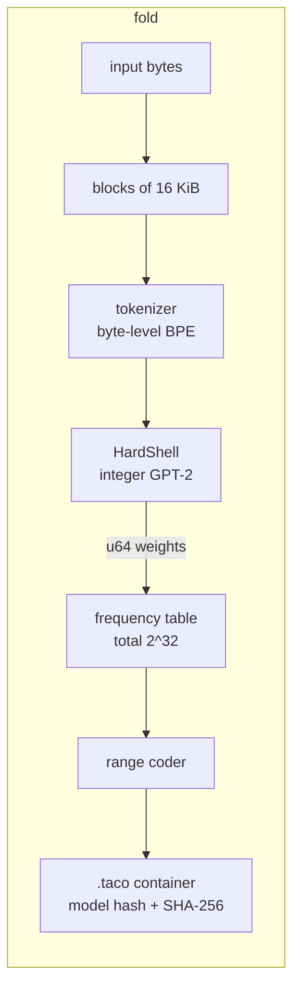
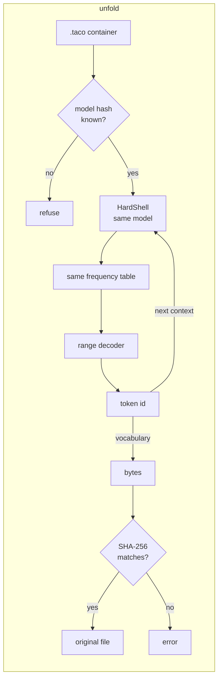
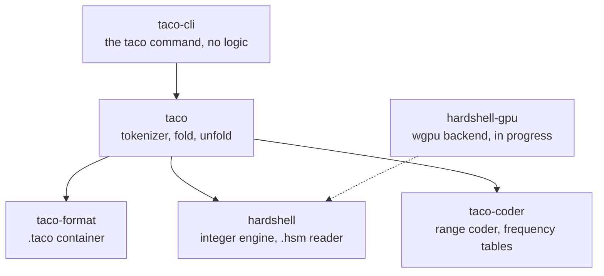

# Taco

*Hard shell. No floats. Same taco on every machine.*

Taco is a lossless compressor that uses a language model. The model predicts the next piece of
the data, and a range coder stores only what the model did not predict. HardShell, the engine
of Taco, runs the model with **integer arithmetic only**. Thus every machine calculates the
same predictions, bit for bit, and a file that one machine compresses ("folds") decompresses
("unfolds") on every other machine.

```bash
taco fold notes.txt          # makes notes.txt.taco
taco unfold notes.txt.taco   # restores notes.txt, byte for byte
```

> **Status: pre-release (2026-10-19).** Fold and unfold work and are bit-exact on every machine
> that we tested: macOS ARM, Linux x86 and ARM, Windows x86, and NVIDIA, Apple and AMD GPUs.
> The container format (version 2) is frozen: later versions of Taco read the files that this
> version makes. This is a pre-release, so keep a second copy of important data. The goal of
> the beta is bit-exact results on every machine, not speed (see
> [Planned speed-ups](#planned-speed-ups-after-the-beta)). Read
> [Hardware support and limits](#2-hardware-support-and-limits) before you use Taco.

---

## Contents

1. [Results](#1-results)
2. [Hardware support and limits](#2-hardware-support-and-limits)
3. [How it works](#3-how-it-works)
4. [Architecture](#4-architecture)
5. [Local setup](#5-local-setup)
6. [Usage](#6-usage)
7. [Development](#7-development)
8. [Roadmap](#8-roadmap)
9. [Documents](#9-documents)
10. [Licence](#10-licence)

---

## 1. Results

All numbers are measured on 2026-10-18. Details are in `docs/research/`.

### Size against other compressors

Real files, folded and unfolded with `taco` and the integer model `gpt2.hsm`. Every file came
back byte for byte.

| File | Original | **Taco** | xz -9e | zstd -19 | Taco against xz |
|---|---:|---:|---:|---:|---:|
| English book (32 KiB) | 32,768 | **8,432** | 12,400 | 12,463 | 32% smaller |
| HTML page | 24,603 | **4,759** | 7,652 | 7,713 | 38% smaller |
| English (4 KiB) | 4,096 | **1,237** | 1,684 | 1,599 | 27% smaller |
| Server log (16 KiB) | 16,384 | **3,129** | 3,164 | 3,139 | about the same |
| Excel file (binary) | 8,192 | 8,285 (stored raw) | **1,672** | 2,097 | xz is better |

On 16 text files of the quality corpus (32 KiB each), float GPT-2 with the Taco coder gives 1.99
bits per byte; bzip2 gives 2.36, xz 2.51 and zstd 2.52.

The sizes do not include the model file (`gpt2.hsm`, 127 MB). Both machines must have the same
model file. This is the usual method for compressors with a language model, but it means that
Taco saves storage and transfer only when the model file is already on both machines.

**Against other compressors with a language model.** On the whole `alice29.txt` (152,089
bytes), Taco gives 38,939 bytes (2.05 bits per byte, measured). `ts_zip` gives 21,713 bytes
(1.14 bits per byte, published), 44% smaller. `ts_zip` uses a larger and newer model (RWKV,
169M parameters, against GPT-2 small, 124M), and the profile `text` of Taco codes blocks of
16 KiB with no context from the block before. The `ts_zip` page also states that its result
does not depend on the GPU or the CPU. Thus Taco is not the only compressor with a language
model whose files decompress on other machines (`docs/research/2026-10-19-benchmark.md` §8).
What Taco adds is the combination: an open specification with integer operations only, an
exact and repeatable model conversion, conformance vectors, and CPU, CUDA and portable GPU
implementations (AMD, Apple, Intel, NVIDIA) that tests show give the same bits.

### Integer model against the float model

| Model | Bits per byte (first 1,024 tokens of 16 held-out text files) |
|---|---:|
| GPT-2 small, float | 1.867 |
| GPT-2 small, integer (`gpt2.hsm`) | 1.871 (+0.2%) |

The +0.2% is the total of 42,256 bytes of text. Single files change from −9.0% to +6.6%
(`xargs.1`). The conversion recipe (`clip`) saturates large activations, and this changes the
predictions: against a float model with the same saturation, the integer model is 2.3% larger
(measured). Thus +0.2% is a result on these files, not a bound for other data
(`docs/research/2026-10-18-integer-gpt2.md` §6).

### Same bits on different machines

| Check | Result |
|---|---|
| Tests on x86 Linux with the hashes that the ARM Mac recorded | 234 of 234 pass |
| Mac folds, Linux unfolds (`scripts/xcheck`, 12 inputs) | 12 of 12 restored |
| Linux folds, Mac unfolds | 12 of 12 restored |
| Same input on both machines | 12 of 12 `.taco` files identical |
| Native Windows x86 against the Mac (`scripts/wcheck`) | 9 of 9 `.taco` files identical, 9 of 9 restored |
| CUDA, wgpu (Metal, GL) and CPU | the same bytes (overlap note, 14 of 14 GPU cases) |

For comparison, a float model fails: when the encoder and the decoder used two float code
paths on the same Mac, 269 of 270 windows did not decode.

### Speed (the weak point today)

Measured on an RTX 3060 Laptop GPU at 95 W (`docs/research/2026-10-19-full-power.md`):

| What | Speed |
|---|---:|
| Engine, decode over a full 1,024-token window (batch 224) | 20,472 tokens/s |
| Engine, prefill (8 x 1,024 tokens) | 50,203 tokens/s |
| `taco fold`, English text, whole files | 85 to 129 KB/s |
| `taco unfold`, English text, whole files | 26 to 31 KB/s |
| `taco fold` and `unfold` on the CPU only | about 0.3 to 2 KB/s |

One token is about 3 to 4 bytes of English. For comparison, `zstd -3` compresses at hundreds of
MB/s and `xz -9e` at about 0.7 MB/s (measured). Taco is much slower than these tools. It makes
smaller files, and its files decompress on every machine.

### Planned speed-ups (after the beta)

The beta is about one property: the same bits on every machine. These items make Taco faster
or smaller. None of them changes that property, and files from the beta stay readable.

| Item | What it changes | Expected gain | Source |
|---|---|---|---|
| Speculative decoding in `taco unfold` | A draft pass predicts several tokens, and one model step checks them all. The output bytes do not change. | Unfold 1.8 to 3.7 times faster (est., from a simulation) | ADR 0017, `docs/research/2026-10-19-speculative.md` |
| Skip rule (mixer rule 2) for the profile `logs` | The match model codes tokens that it predicts with high confidence, and the language model is skipped for them. | Logs 4.8 to 7.3 % smaller (est., simulation on 18 log files) | ADR 0017 |
| Smaller blocks for small text files | More blocks decode in parallel. | Unfold of a 25 KB file 13.7 s to 4.7 s, for 1 to 2 % more bytes (measured) | gpucli trace, 2026-10-19 |
| Range coder on the GPU | Removes one CPU-GPU round trip for each token. | Not measured | — |
| CUDA path for older NVIDIA GPUs (compute capability 6.1 and 7.5) | These GPUs use the CUDA backend instead of the portable GPU backend or the CPU. Bits do not change. | Not measured | ADR 0008 |

---

## 2. Hardware support and limits

This section says what works, what does not work, and what we did not test. All numbers are
measured unless they are labelled "est.".

### What is guaranteed

- **No floating-point arithmetic in compression or decompression.** The engine, the coder and
  the mixer use integers only. The GPU kernels (CUDA C++ and WGSL) use integers only too.
  `scripts/check-no-floats.sh` refuses a float type in all of them, and CI runs it on each push.
- **Integer results do not depend on the machine, when each operation is fully specified.**
  Integers alone are not sufficient. Taco also needs these conditions, and it makes them rules
  (`CLAUDE.md` §1): every sum has an accumulator wide enough for its largest value, with the
  bound written in the code (`INVARIANT:`), or it wraps on overflow in a defined way; every
  rounding and every clamp has one written rule in one place (ADR 0004); signed division uses
  floor-division helpers. When these conditions hold, `7 x 3 = 21` on every CPU and GPU, and an
  integer sum has the same result in every order, so a GPU can add in parallel in any order.
  A compiler, an optimisation level, a CPU type or a GPU driver then has no freedom to change a
  result. Tests check the conditions (conformance vectors, the cross-machine check, fuzzing),
  but tests cannot prove that the code obeys them everywhere.
- **The model file is the same on every machine.** The converter reads each float32 weight
  exactly as `mantissa x 2^exponent` and calculates with exact fractions (ADR 0014). It runs
  one time, before publication. The Mac and Linux make the same `gpt2.hsm`, byte for byte.
- **A wrong result is never silent.** Each `.taco` file stores the SHA-256 of the original
  data. `taco unfold` checks it. If a result is wrong, `taco unfold` stops with an error.
- **The checksum finds an error. It cannot repair one.** If the error is in the decoder (for
  example a GPU fault during `taco unfold`), decompress the file again with `--backend cpu` or
  on a different machine. If the error happened during `taco fold` (a bug or a hardware fault
  on the machine that folded), the `.taco` file is damaged, and no decoder can restore it.
  Thus keep the original until you have unfolded the `.taco` file one time, if possible on a
  different machine or with `--backend cpu`.

### What can still go wrong

The float problem cannot occur. These other problems can occur, as in every program:

- **A bug in our code**, for example in one SIMD or GPU kernel. Each fast path is tested
  against the reference path, with conformance vectors, a cross-machine check and fuzzing. Tests
  cannot prove that a bug does not exist.
- **A bug in a GPU driver or its shader compiler.** Taco runs a self-test before it uses a GPU.
  If the self-test fails, Taco uses the next backend.
- **A hardware fault**, for example a memory bit flip or an unstable overclock.

In each case the SHA-256 check finds the error.

### Tested hardware

| Hardware | Backend | Result |
|---|---|---|
| Apple M2 (macOS) | CPU (NEON) | bit-exact |
| Apple M2 (macOS) | GPU: wgpu on Metal | bit-exact |
| AMD Ryzen 7 5800H (Linux in WSL2, and native Windows) | CPU (AVX2) | bit-exact |
| NVIDIA RTX 3060 Laptop | CUDA | bit-exact |
| NVIDIA RTX 3060 Laptop | wgpu on OpenGL (WSL2) and DX12 with DXC (native Windows) | bit-exact, all GPU tests and the conformance model |
| NVIDIA RTX 3060 Laptop, AMD Radeon iGPU (Ryzen 7 5800H) | wgpu on Vulkan (native Windows) | the 4 op tests pass, bit-exact; the full model tests did not run on Vulkan yet |
| AMD Radeon iGPU (Ryzen 7 5800H), native Windows | wgpu on DX12 with DXC | bit-exact, all GPU tests and the conformance model |
| GitHub Actions: Linux x86-64 and Linux ARM64 | CPU, conformance program (50 hashes) | the same hashes on each push |

The macOS ARM64 and Windows x86-64 jobs of CI run each week; they did not run yet.

### Not tested yet

- Intel GPUs (integrated or Arc).
- AMD GPUs on Linux (the RADV or AMDGPU driver), and AMD discrete GPUs.
- NVIDIA GPUs older than compute capability 8.0 (before the RTX 30 series and A100). The CUDA
  backend needs 8.0 or more; older NVIDIA GPUs use the portable wgpu backend.
- macOS on Intel, big-endian CPUs, 32-bit systems, phones and browsers.

They are expected to work, because the code has no part that is specific to one vendor. We do
not call them supported before a test passes.

### Known limits

- **AMD and Intel GPUs need no special code.** They use the portable backend (wgpu with Vulkan,
  DX12 or Metal) and the normal GPU driver. Nothing else must be installed.
- **Windows DX12 with the old FXC compiler does not work.** FXC (`d3dcompiler_47.dll`, shader
  model 5.1) cannot compile 7 of the 14 GPU kernels: it cannot write to a vector element at a
  run-time index, it stops on long loops that it tries to unroll, and it crashes on the large
  `switch` of the self-test. The kernels that it can compile take 43 to 97 s each. Vulkan,
  Metal and DX12 with DXC (`dxcompiler.dll`) compile all kernels and give the CPU bits. On
  Windows, use Vulkan (`docs/research/2026-10-19-windows.md` §8.2).
- **Inside WSL2, the AMD iGPU crashes** in the Mesa OpenGL-on-D3D12 driver at the first compute
  dispatch. On native Windows the same GPU works. The Microsoft software renderer (WARP) also
  crashes.
- **The GPU speed differs by vendor.** CUDA uses the int8 tensor cores of NVIDIA. The portable
  backend uses 32-bit integers and is slower. The speed on AMD and Intel GPUs is not measured.
- **The CPU alone is very slow** (about 0.3 to 2 KB/s). A GPU is strongly recommended.
- **Small files decompress slowly.** One block decodes one token after the other, so a file
  cannot decompress faster than its largest block: about 10 to 13 s for a 16 KiB block on the
  RTX 3060 (est. from the measured `cp.html` and `textwrap.py` times). Speculative decoding
  comes after the beta ([Planned speed-ups](#planned-speed-ups-after-the-beta)).
- **English only.** GPT-2 is an English model. On German and French, Taco is larger than PPMd;
  on Chinese it is larger than gzip (measured). Binary data is stored with zstd or raw.
- **Logs:** the profile `logs` is smaller than xz, but paq8px is still smaller (measured).
- **Memory:** `taco fold` and `taco unfold` stream the data (ADR 0018). A 200 MB file folded
  with 254 MiB of memory and unfolded with 38 MiB (measured).
- **Untrusted input:** the readers were fuzzed with millions of damaged inputs and 0 failures
  (measured). `docs/security.md` lists the findings and their state. One is still open: a model
  file can state a very large KV cache (F6). Do not load `.hsm` model files from sources that
  you do not trust.
- **The file format (container version 2) is frozen.** Later versions of Taco read the files
  that this version makes.
- **Mixer rule 2 (the skip rule) is reserved, not used.** The format accepts it, but this
  version does not write it, and its decoder refuses it. It comes after the beta.
- **The wide model files (model-file version 2)** run on the CPU and with CUDA. The portable
  GPU backend does not run them yet. The default model, `gpt2.hsm`, is version 1 and runs
  everywhere.
- **The model file** (`gpt2.hsm`, 127 MB) is not distributed yet. Make it with the steps in
  [Local setup](#5-local-setup).

---

## 3. How it works

### Prediction is compression

A symbol that the model expects with probability *p* costs about −log₂(*p*) bits. A good guess
is nearly free. A bad guess costs more bits, but it never makes the output wrong.

The model does not make one guess. For each position it gives a probability to every one of
the 50,257 tokens of GPT-2. The range coder divides a number range in proportion to these
probabilities, and narrows the range to the slice of the actual token. The decoder runs the
same model, divides the range in the same way, and finds the slice that contains the stored
number. That slice identifies the token.

### Why integers

The decoder must calculate **exactly** the same probabilities as the encoder. If one frequency
is different by one unit, the decoder can select a wrong token. After that token, all output is
wrong. Floating-point results change with the order of additions, the chip, the math library
and the batch size. Integer results do not change.

So HardShell uses `i8` weights, `i32` and `i64` sums, one fixed rounding rule, and tables for
GELU, `exp` and LayerNorm constants. A tool makes the model file one time, with floats. Every
decoder then loads that same file and uses only integers.

### Fold and unfold





- **Blocks** are independent. Many blocks can run in parallel, and damage stays in one block.
- A block that does not become smaller is stored **raw**. The worst-case growth is 104 bytes of
  header plus 5 bytes for each block (container version 2, ADR 0011 §8).
- The decoder **never tokenizes**. It only changes token ids to bytes.
- The container stores the **SHA-256 of the model file** and of the original data. A wrong model
  or a damaged file gives an error, never a silent wrong output.

### The `.taco` file (version 2)

```
"TACO" | version | flags | model hash (32 B) | original length | SHA-256 of original (32 B)
       | block size | block count | profile | coding parts | coding parameters (104 B header)
       | block table (kind + length per block) | block payloads
```

A block is raw, zstd, coded (GPT-2) or mixed (GPT-2, the match model and the mixer). A coded
block holds the token count (LEB128) and the range-coder bytes (ADR 0007). The coding parts
name the mixer and the context overlap `K` (ADR 0011, 0015). Version 1 files still unfold. The
full layout is in ADR 0006 and ADR 0011.

### The `.hsm` model file (version 1)

A header in JSON (integers only), the vocabulary, the optional BPE merges, the `i8` weights,
the rescale constants (an integer multiplier and a shift), and the tables. The model hash is
the SHA-256 of the whole file. Details: ADR 0004.

---

## 4. Architecture

### Crates



| Crate | Job | Rules |
|---|---|---|
| `taco-coder` | Range coder (`u128` low, `u64` range, totals up to 2^32), binary coder, frequency tables | Kernel crate: no floats, no I/O |
| `hardshell` | Integer helpers, kernels, LayerNorm, GELU, softmax, the `.hsm` reader and writer, the integer GPT-2 | Kernel crate: no floats, no I/O |
| `taco-format` | The `.taco` container: header, block table, checksums, raw fallback | Strict parser for untrusted input |
| `taco` | The library: tokenizer, `fold`, `unfold` | Connects the parts |
| `taco-cli` | The `taco` command | Translates arguments only |

`taco-coder` and `hardshell` do not depend on each other. A kernel crate has no floats in
`src/` (a lint and `scripts/check-no-floats.sh` enforce it), no clock, no randomness and no
global state.

### Tools (Python, run before publication)

| Tool | Job |
|---|---|
| `tools/baseline` | Downloads GPT-2 and the corpus (with SHA-256 checks), a float NumPy GPT-2, a Python BPE and coder, the phase 0 and 1 measurements |
| `tools/convert` | Float GPT-2 to `gpt2.hsm`: `i8` weights, calibrated scales (recipe `clip`), tables, merges. Also the tiny conformance model |

Tools may use floats. Nothing in `crates/` calls a tool at run time.

### Repository layout

```
taco/
├── crates/
│   ├── taco-coder/        range coder and frequency tables
│   ├── hardshell/         integer engine and model-file reader
│   ├── hardshell-cuda/    NVIDIA backend (precompiled PTX)
│   ├── hardshell-gpu/     portable GPU backend (wgpu: Vulkan, Metal, DX12, GL)
│   ├── taco-match/        match model and mixer (profile logs)
│   ├── taco-format/       .taco container
│   ├── taco/              tokenizer, fold, unfold
│   └── taco-cli/          the taco command
├── tools/                 Python tools (uv project)
│   ├── baseline/          downloads, float GPT-2, measurements
│   └── convert/           model conversion and the tiny model
├── conformance/           tiny.hsm and its hash (conformance vectors)
├── scripts/               dx (devbox), mx (Mac), check.sh, xcheck, wcheck, conformance/, release/
├── docs/
│   ├── design/            plan.md, anymodel.md, product-v1.md
│   ├── adr/               decisions (ADRs)
│   ├── research/          measurements
│   └── STYLE.md           how to write documents (ASD-STE100)
├── CLAUDE.md              working rules
└── HANDOFF.md             current state and next steps
```

---

## 5. Local setup

### What you need

| Item | Version | Why |
|---|---|---|
| macOS (Apple Silicon or x86), Linux (x86 or ARM) or Windows x86 | — | Windows: tested natively (`docs/research/2026-10-19-windows.md`) |
| [rustup](https://rustup.rs) | any | `rust-toolchain.toml` selects Rust 1.99.0 automatically |
| [uv](https://docs.astral.sh/uv/) | a recent version | runs the Python tools (Python 3.12) |
| Disk | about 1.5 GB | GPT-2 weights (548 MB), corpus, `gpt2.hsm` (127 MB), build output |
| Memory | 8 GB | enough for GPT-2 small |

No GPU is necessary.

### Steps

1. Get the code.

   ```bash
   git clone https://github.com/tac0mania/taco.git
   cd taco
   ```

2. Download the GPT-2 weights and the corpus. The tool checks the SHA-256 of every file.

   ```bash
   uv run --project tools python -m baseline.fetch
   ```

3. Make the integer model file. This takes about 1 minute.

   ```bash
   uv run --project tools python -m convert.gpt2
   ```

4. Check the model hash. It must be the same on every machine.

   ```bash
   shasum -a 256 tools/data/out/gpt2.hsm
   ```

   The expected value is
   `aaa03eb96e9ad7957432168c8ac6b4a99ed55d57e637e4786a664b51001ba5c2`.
   If your hash is different, do not use the file: your `.taco` files will not decode on other
   machines.

5. Build the `taco` command.

   ```bash
   cargo build --release -p taco-cli
   ```

6. Tell `taco` where the model is.

   ```bash
   export TACO_MODEL="$PWD/tools/data/out/gpt2.hsm"
   ```

7. Try it.

   ```bash
   ./target/release/taco fold README.md -o /tmp/readme.taco
   ./target/release/taco unfold /tmp/readme.taco -o /tmp/readme.md
   cmp README.md /tmp/readme.md && echo "restored byte for byte"
   ```

To install the command in `~/.cargo/bin`:

```bash
cargo install --path crates/taco-cli
```

---

## 6. Usage

```
taco fold <input> [-o <output>] [--model <path.hsm>] [--block-size <bytes>] [--threads <n>] [-f]
taco unfold <input.taco> [-o <output>] [--model <path.hsm>] [--threads <n>] [-f]
```

| Option | Meaning |
|---|---|
| `-o, --output` | The output file. Default: `<input>.taco` for fold, the name without `.taco` for unfold |
| `-m, --model` | The model file. Default: the `TACO_MODEL` environment variable |
| `--block-size` | Bytes in each block, fold only. Default: 16,384 |
| `--threads` | Worker threads. Default: all CPUs. The output does not change with this value |
| `-f, --force` | Replace an output file that exists |

Each run prints one line on stderr: sizes, ratio, bits per byte and time.

**Use Taco for** text: prose, documents, HTML, source code. **Do not use it for** photos,
video, music or files that are already compressed: Taco stores them raw.

---

## 7. Development

Read `CLAUDE.md` before you change code. It has the rules that keep Taco bit-exact. The most
important rule: **no floating-point arithmetic in the prediction path.**

### Tests

```bash
cargo test --workspace --release
```

```bash
scripts/check.sh
```

`scripts/check.sh` runs the tag check, the no-floats check, `cargo fmt --check`,
`cargo clippy -D warnings` and all tests.

### Conformance and the cross-machine check

Golden tests hold the SHA-256 of fixed outputs: the coder stream, the HardShell output of the
tiny model, the container, and a full `taco` container. They must pass unchanged on every
machine.

`scripts/xcheck` folds 12 inputs on the Mac, unfolds them on devbox, folds them on devbox, unfolds
those on the Mac, and compares all `.taco` files. Run it after every change to HardShell, the
coder, the tokenizer or the container. It takes about 40 minutes with the reference engine.

### Build machines

| Script | Machine | Use |
|---|---|---|
| `scripts/dx <lane> <command>` | devbox (Linux x86, RTX 3060) | Builds, benchmarks, GPU work. It copies the tree to the server and runs there at low priority. It refuses to run if the Windows disk has less than 15 GB free |
| `scripts/mx <command>` | the Mac | Light builds and the ARM half of the cross-machine check, one command at a time |

`scripts/dx` and `scripts/xcheck` need the `devbox` SSH host. On a machine without it, use
`cargo test` directly.

### Changing a format

A change to the coder, the model file, the tables or the container changes the bytes of
`.taco` files. It needs a new format version, a reader for the old version, new conformance
vectors, and an ADR. See `CLAUDE.md` §1 and §8.

---

## 8. Roadmap

| Phase | Work | State |
|---|---|---|
| 0, 1 | Float baseline and float drift measurement | Done |
| 2 | Reference implementation, bit-exact on two machines | **Done (gate passed)** |
| 3 | Quality: integer model within 0.2% of float | Done for text |
| 4 | Speed: CPU SIMD, CUDA (gate: 10,000 tokens/s on the RTX 3060), portable GPU (AMD, Intel, Apple) | Gate passed: 20,472 tokens/s at 95 W (`docs/research/2026-10-19-full-power.md`) |
| 5 | Two profiles: `text` (GPT-2) and `logs` (GPT-2, match model, mixer) | Done. Skip rule and speculative decoding: after the beta (ADR 0017) |
| 6 | Container version 2 (profiles, zstd blocks, context overlap), streaming, builds for macOS, Linux and Windows, release | Container version 2 frozen; streaming done (ADR 0018); CI and release scripts built; private beta next |
| 7 | Other models with an automatic converter | Designed (`docs/design/anymodel.md`) |

---

## 9. Documents

| Document | Contents |
|---|---|
| `docs/design/plan.md` | The design, with § numbers |
| `docs/design/product-v1.md` | Version 1: production requirements, work items, speed gates |
| `docs/design/anymodel.md` | A model graph and an automatic converter for other models |
| `docs/ARCHITECTURE.md` | Crates, tools and permitted dependencies |
| `docs/adr/` | Decisions: names, integer-only path, coder, numerics, model choice, container, coded-block payload, model graph (proposed), two profiles |
| `docs/research/` | Verification, phase 0, integer GPT-2, cross-machine check |
| `CLAUDE.md` | Working rules |
| `HANDOFF.md` | Current state and next steps |

---

## 10. Licence

Apache-2.0. See `LICENSE`.

GPT-2 weights are from OpenAI (MIT licence) and are not in this repository. `tools/baseline`
downloads them.
