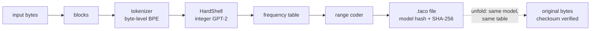

# Taco

*Hard shell. No floats. Same taco on every machine.*

Taco is a lossless compressor that uses a language model (GPT-2). The model predicts the next
piece of the data, and a range coder stores only what the model did not predict. The engine of
Taco, **HardShell**, runs the model with **integer arithmetic only**. Thus every CPU and GPU
calculates the same predictions, bit for bit. A file that one machine compresses ("folds")
decompresses ("unfolds") on every other machine.

```bash
taco fold notes.txt          # makes notes.txt.taco
taco unfold notes.txt.taco   # restores notes.txt, byte for byte
```

> [!WARNING]
> **Alpha: a proof of concept (version 0.1.0, 2026-10-19).** Taco is an experiment. It is
> slow, and it is not a replacement for zstd or xz. Keep a second copy of data that you fold. Read
> [Limits](#limits) before you use it.

> [!NOTE]
> **How this code was written.** Most of the code, the tests and the documents in this
> repository were written by Claude (an AI model by Anthropic) with Claude Code, under the
> direction of the author, to get to results faster. The author made the design decisions.
> Trust the code only as far as the tests show: conformance vectors, the cross-machine check,
> fuzzing and the comparison of every fast path with the reference path.

## Contents

- [Try it](#try-it)
- [What Taco is, and what it is not](#what-taco-is-and-what-it-is-not)
- [Results](#results)
- [What is guaranteed](#what-is-guaranteed)
- [Hardware](#hardware)
- [Limits](#limits)
- [How it works](#how-it-works)
- [Build from source](#build-from-source)
- [Usage](#usage)
- [Roadmap](#roadmap)
- [Development](#development)
- [Licence](#licence)

---

## Try it

You need no compiler, no Python and no download other than one zip. A GPU is optional.

**1. Get the demo zip.** Download `taco-demo-0.1.0.zip` (about 120 MB) from the
[Releases page](https://github.com/tac0mania/taco/releases) of this repository, or from the
link that you received. It holds the programs for macOS (Apple Silicon), Linux (x86-64) and
Windows (x86-64), and the model file.

**2. Unpack it, and open a terminal in the unpacked folder.**

| System | Do this |
|---|---|
| macOS | Double-click the zip. Open the Terminal app. Type `cd ~/Downloads/taco-demo-0.1.0` and press Return. |
| Linux | `unzip taco-demo-0.1.0.zip && cd taco-demo-0.1.0` |
| Windows | Right-click the zip, select **Extract All**, then open the folder. Click the address bar, type `cmd`, and press Enter. |

**3. Run the demo.**

| System | Type |
|---|---|
| macOS, Linux | `./try` |
| Windows | `try.cmd` |

The demo folds and unfolds a short English text (3,672 bytes). It takes about 15 s to 1 minute.
The end of the output looks like this:

```
PASS: the file came back byte for byte.
Original: 3672 bytes. Folded: 648 bytes.
Fold: 6 s. Unfold: 9 s.
SHA-256 of the .taco file: EXPECTED_SAMPLE_HASH
```

**4. Compare the hash.** The SHA-256 must be the value above, on every machine and every backend.
Run the demo on a second computer (another processor, another GPU) and compare. This is the
main property of Taco.

**5. Try your own files** in the same terminal:

```bash
./taco fold notes.txt            # Windows: taco.cmd fold notes.txt
./taco unfold notes.txt.taco     # Windows: taco.cmd unfold notes.txt.taco
```

> [!CAUTION]
> Taco is slow. With a GPU, it folds text at about 85 to 129 KB/s and unfolds at about 26 to
> 31 KB/s. With the CPU only, it folds at about 0.3 to 2 KB/s and unfolds at about 0.1 to
> 0.5 KB/s (measured). Start with a file of a few KB. More details and troubleshooting: [`demo/README.md`](demo/README.md).

---

## What Taco is, and what it is not

**Taco is** a compressor whose output does not depend on the machine. Its parts are:

- an open specification of integer-only GPT-2 inference (`docs/adr/0004-hardshell-numerics.md`);
- an exact converter: it reads each float32 weight as `mantissa x 2^exponent` and calculates
  with exact fractions, so every machine makes the same model file (ADR 0014);
- implementations for the CPU (NEON, AVX2), NVIDIA GPUs (CUDA) and other GPUs (wgpu: Vulkan,
  Metal, DX12), which tests show give the same bits;
- conformance vectors that connect the model to the bytes of real `.taco` files.

**Taco is not** the first or the best compressor with a language model:

- [ts_zip](https://bellard.org/ts_zip/) (Fabrice Bellard) makes smaller files and is faster.
  Its page also states that its result does not depend on the GPU or the CPU.
- The ideas under Taco have earlier work: language models with entropy coders
  ([LLMZip](https://arxiv.org/abs/2306.04050)), integer networks for compression that decode
  the same on every platform
  ([Ballé et al., 2019](https://research.google/pubs/integer-networks-for-data-compression-with-latent-variable-models/)),
  and integer-only Transformers ([I-BERT](https://proceedings.mlr.press/v139/kim21d.html)).

What Taco adds is the combination: an inspectable integer specification, a repeatable model
conversion, several independent implementations, and tests that show they agree.

---

## Results

All numbers are measured unless they are labelled "published" or "est.". Details are in
`docs/research/`. The sizes do not include the model file (127 MB), which both machines must
have.

### Size

| File | Original | **Taco** | xz -9e | zstd -19 |
|---|---:|---:|---:|---:|
| English book (32 KiB) | 32,768 | **8,432** | 12,400 | 12,463 |
| HTML page | 24,603 | **4,759** | 7,652 | 7,713 |
| English (4 KiB) | 4,096 | **1,237** | 1,684 | 1,599 |
| Server log (16 KiB) | 16,384 | **3,129** | 3,164 | 3,139 |
| Excel file (binary) | 8,192 | 8,285 (stored raw) | **1,672** | 2,097 |

Against another compressor with a language model, on the whole `alice29.txt` (152,089 bytes):

| Compressor | Bytes | Bits per byte |
|---|---:|---:|
| xz -9e | 48,492 (published) | 2.55 |
| **Taco** | **38,939** | **2.05** |
| ts_zip | **21,713** (published) | **1.14** |

ts_zip is 44% smaller. It uses a larger and newer model (RWKV, 169M parameters; GPT-2 small
has 124M), and Taco's profile `text` restarts the model context at each 16 KiB block.

### Integer model against the float model

| Model | Bits per byte (16 text files, 42,256 bytes) |
|---|---:|
| GPT-2 small, float | 1.867 |
| GPT-2 small, integer (`gpt2.hsm`) | 1.871 (+0.2%) |

The +0.2% is a total. Single files change from −9.0% to +6.6%. The conversion saturates large
activations, which changes the predictions; against a float model with the same saturation,
the integer model is 2.3% larger (`docs/research/2026-10-18-integer-gpt2.md` §6).

### Speed (RTX 3060 Laptop GPU, 95 W)

| What | Speed |
|---|---:|
| Engine, decode over a full 1,024-token window | 20,472 tokens/s |
| `taco fold`, English text | 85 to 129 KB/s |
| `taco unfold`, English text | 26 to 31 KB/s |
| `taco fold`, CPU only | about 0.3 to 2 KB/s |
| `taco unfold`, CPU only | about 0.1 to 0.5 KB/s |

For comparison, `zstd -3` compresses at hundreds of MB/s and `xz -9e` at about 0.7 MB/s.
ts_zip states "up to 1 MB/s" on an RTX 4090 (published, a different GPU).

### Large files (streaming): a memory test, not a speed test

This test checks that the memory does not grow with the file (ADR 0018). It used 200,000,000
bytes of random words and the small test model, on the devbox CPU.

| Run | Largest memory (RSS) |
|---|---:|
| fold, file to file | 254 MiB |
| fold, stdin to stdout | 276 MiB |
| unfold, file to file | 38 MiB |
| unfold, stdin to stdout | 35 MiB |

Both unfolds restored the input byte for byte. **Its times say nothing about Taco's speed:**
the test model has random weights, so every block was stored with zstd or raw, and unfold ran
no model step. The real speed is in the table above. The largest files folded with GPT-2 so
far are 2.4 to 2.7 MB (measured).

### Same bits on different machines

| Check | Result |
|---|---|
| Mac (ARM) folds, Linux (x86) unfolds, and the reverse (`scripts/xcheck`, 12 inputs) | 12 of 12 restored each way; 12 of 12 `.taco` files identical |
| Native Windows x86 against the Mac (`scripts/wcheck`) | 9 of 9 `.taco` files identical, 9 of 9 restored |
| CPU, CUDA and wgpu (Metal, GL) | the same bytes, 14 of 14 GPU cases |
| CI on each push: Linux x86-64 and Linux ARM64 | the same 50 conformance hashes |
| Fuzzing: damaged containers, coder streams and model files | millions of cases, 0 failures (`docs/security.md`) |

---

## What is guaranteed

- **No floating-point arithmetic in fold or unfold.** The engine, the coder, the mixer and the
  GPU kernels use integers only. `scripts/check-no-floats.sh` checks this on each push.
- **The same result on every machine, when each operation is fully specified.** Integers alone
  are not sufficient. Taco makes these conditions rules (`CLAUDE.md` §1):
  - every sum has an accumulator that is wide enough, with the bound written in the code, or
    it wraps on overflow in a defined way;
  - every rounding and every clamp has one written rule (ADR 0004);
  - signed division uses floor-division helpers.

  Then a compiler, a CPU type or a GPU driver has no freedom to change a result. Tests check
  these conditions. Tests cannot prove that the code obeys them everywhere.
- **The model file is the same on every machine.** The Mac and Linux make the same `gpt2.hsm`,
  byte for byte. Its SHA-256 is
  `aaa03eb96e9ad7957432168c8ac6b4a99ed55d57e637e4786a664b51001ba5c2`.
- **A wrong result is never silent.** Each `.taco` file stores the SHA-256 of the original
  data, and `taco unfold` checks it.

> [!IMPORTANT]
> **The checksum finds an error. It cannot repair one.** If `taco unfold` fails, try again with
> `--backend cpu` or on a different machine. If the error happened during `taco fold` (a bug
> or a hardware fault on that machine), no decoder can restore the file. Keep the original
> until you have unfolded the `.taco` file one time.

These problems can still occur, as in every program: a bug in our code, a bug in a GPU driver
(Taco runs a self-test before it uses a GPU, and uses the next backend if the test fails), or
a hardware fault. In each case the SHA-256 check finds the error.

---

## Hardware

| Hardware | Backend | Result |
|---|---|---|
| Apple M2 (macOS) | CPU (NEON), GPU (wgpu on Metal) | bit-exact |
| AMD Ryzen 7 5800H (Linux, native Windows) | CPU (AVX2) | bit-exact |
| NVIDIA RTX 3060 Laptop | CUDA | bit-exact |
| NVIDIA RTX 3060 Laptop | wgpu on OpenGL (Linux), DX12 with DXC (Windows) | bit-exact |
| AMD Radeon iGPU (Ryzen 7 5800H), native Windows | wgpu on DX12 with DXC | bit-exact |
| NVIDIA RTX 3060, AMD Radeon iGPU, native Windows | wgpu on Vulkan | bit-exact (4 op tests; the full model tests did not run yet) |
| GitHub Actions: Linux x86-64, Linux ARM64 | CPU | the same 50 conformance hashes |

**Not tested yet:** Intel GPUs; AMD GPUs on Linux; AMD discrete GPUs; macOS on Intel;
big-endian and 32-bit CPUs; phones and browsers.

**GPU notes:**

- AMD and Intel GPUs need no special code. They use wgpu and the normal GPU driver.
- The CUDA backend needs compute capability 8.0 or more (RTX 30 series, A100 and later).
  Older NVIDIA GPUs use wgpu or the CPU. The bits are the same; only the speed changes.
- On Windows, DX12 with the old FXC shader compiler cannot compile 7 of the 14 kernels. The
  self-test then fails, and Taco uses the next backend. Vulkan, Metal and DX12 with DXC work.

---

## Limits

| Limit | Details |
|---|---|
| **Slow** | See [Speed](#speed-rtx-3060-laptop-gpu-95-w). A GPU is strongly recommended. |
| **Small files unfold slowly** | One block decodes one token after the other: about 10 to 13 s for a 16 KiB block on the RTX 3060 (est. from measured times). |
| **English only** | GPT-2 is an English model. On German and French, Taco is larger than PPMd; on Chinese, larger than gzip (measured). |
| **Binary data** | Photos, video, archives and other binary files are stored with zstd or raw. Use zstd for them. |
| **Logs** | The profile `logs` is smaller than xz, but paq8px is smaller still (measured). |
| **The model file** | 127 MB. Both machines must have the same file. The release does not download it yet. |
| **Untrusted model files** | A model file can state a very large KV cache (finding F6, open). Load only the published `gpt2.hsm`. |
| **Wide models** | Model-file version 2 runs on the CPU and with CUDA, not on wgpu yet. The default `gpt2.hsm` is version 1 and runs everywhere. |
| **Format** | Container version 2 is frozen: later versions of Taco read the files of this version. |

---

## How it works

A symbol that the model expects with probability *p* costs about −log₂(*p*) bits. For each
position, the model gives a probability to each of the 50,257 GPT-2 tokens. The range coder
divides a number range in proportion to these probabilities. The decoder runs the same model,
divides the range in the same way, and finds the token.

The decoder must calculate **exactly** the same probabilities as the encoder. If one frequency
is different by one unit, the decoder can select a wrong token, and all output after it is
wrong. Floating-point results can change with the order of additions, the chip, the math
library and the batch size. Specified integer results do not change. Thus HardShell uses `i8`
weights, `i32` and `i64` sums, one rounding rule, and tables for GELU and `exp` that are stored
in the model file.



- **Blocks** are independent, so they run in parallel, and damage stays in one block.
- A block that does not become smaller is stored **zstd or raw**. The worst-case growth is the
  104-byte header and 5 bytes for each block.
- The profile **`logs`** adds a match model and a mixer for repeated lines. The profile
  **`auto`** (the default) selects the smaller result for each block.
- The file format is in ADR 0006 and ADR 0011. The model file format is in ADR 0004.

**The full explanation** of every part, with the measurements and the reasons for each
decision, is in [`docs/core-architecture.md`](docs/core-architecture.md). If you are new to
compression or machine learning, start with [`docs/primer.md`](docs/primer.md): it explains
IEEE 754 floating point, entropy, range coding, transformers and quantisation from the start.

---

## Build from source

**You need:** [rustup](https://rustup.rs) (it installs Rust 1.99.0 from
`rust-toolchain.toml`), [uv](https://docs.astral.sh/uv/) for the Python tools, a C compiler (for
zstd), about 1.5 GB of disk and 8 GB of memory. A GPU is optional.

1. Get the code.

   ```bash
   git clone https://github.com/tac0mania/taco.git && cd taco
   ```

2. Download the GPT-2 weights. The tool checks the SHA-256 of each file.

   ```bash
   uv run --project tools python -m baseline.fetch
   ```

3. Make the integer model file (about 1 minute).

   ```bash
   uv run --project tools python -m convert.gpt2
   ```

4. Check the model hash.

   ```bash
   shasum -a 256 tools/data/out/gpt2.hsm
   ```

   It must be `aaa03eb96e9ad7957432168c8ac6b4a99ed55d57e637e4786a664b51001ba5c2`. If it is
   different, do not use the file: its `.taco` files do not decode on other machines.

5. Build and try.

   ```bash
   cargo build --release -p taco-cli
   export TACO_MODEL="$PWD/tools/data/out/gpt2.hsm"
   ./target/release/taco fold README.md -o /tmp/readme.taco
   ./target/release/taco unfold /tmp/readme.taco -o /tmp/readme.md
   cmp README.md /tmp/readme.md && echo "restored byte for byte"
   ```

---

## Usage

```
taco fold   <input>      [-o <output>] [-c] [--profile text|logs|auto] [--backend auto|cuda|gpu|cpu]
taco unfold <input.taco> [-o <output>] [-c] [--backend auto|cuda|gpu|cpu]
```

| Option | Meaning |
|---|---|
| `-o <path>`, `-c` | The output file, or stdout. The input `-` is stdin. |
| `-m <path.hsm>` | The model file. Default: the `TACO_MODEL` environment variable. |
| `--profile` | Fold only. `text` (GPT-2), `logs` (GPT-2, match model, mixer) or `auto` (default). |
| `--backend` | `cuda`, `gpu` (wgpu), `cpu` or `auto` (default: the first that passes a self-test). The output is the same on every backend. |
| `--block-size`, `--overlap` | Fold only. Block size (default 16 KiB for `text`, 64 KiB for `logs` and `auto`) and context overlap. |
| `--threads <n>` | Worker threads. The output does not change. |
| `-f`, `-q`, `-V` | Replace an output file; no progress output; show the version. |

Files of any size stream with bounded memory ([Large files](#large-files-streaming-a-memory-test-not-a-speed-test)). `taco --help` and `docs/man/taco.1` have all the details.

---

## Roadmap

The alpha shows one property: the same bits on every machine. These items come later. None
of them changes that property, and files from the alpha stay readable.

| Item | Expected gain |
|---|---|
| Speculative decoding in `taco unfold` (ADR 0017) | Unfold 1.8 to 3.7 times faster (est., simulation) |
| Skip rule (mixer rule 2) for the profile `logs` | Logs 4.8 to 7.3% smaller (est., simulation on 18 log files) |
| Smaller blocks for small text files | Unfold of a 25 KB file from 13.7 s to 4.7 s, for 2.3% more bytes; a 427 KB file from 17.7 s to 10.7 s, for 1.0% more (measured) |
| More context for the profile `text` | Smaller files (not measured) |
| Range coder on the GPU | Removes one CPU-GPU round trip for each token (not measured) |
| CUDA for compute capability 6.1 and 7.5 | Faster on older NVIDIA GPUs (not measured) |
| Model download in `taco` (`docs/design/model-distribution.md`) | No manual model setup |
| Other models with an automatic converter (`docs/design/anymodel.md`) | Designed |

---

## Development

Read [`CLAUDE.md`](CLAUDE.md) before you change code. It has the rules that keep Taco
bit-exact. The most important rule: **no floating-point arithmetic in the prediction path.**

| Document | Contents |
|---|---|
| [`docs/core-architecture.md`](docs/core-architecture.md) | How Taco works, end to end, with the measurements |
| [`docs/primer.md`](docs/primer.md) | The background: floating point, compression, language models |
| [`HANDOFF.md`](HANDOFF.md) | The current state and the next steps |
| [`docs/ARCHITECTURE.md`](docs/ARCHITECTURE.md) | The code map: crates, tools and permitted dependencies |
| [`docs/design/plan.md`](docs/design/plan.md) | The design |
| [`docs/adr/`](docs/adr/) | The decisions |
| [`docs/research/`](docs/research/) | The measurements |
| [`docs/security.md`](docs/security.md) | The threat model and the fuzzing results |
| [`docs/ci.md`](docs/ci.md) | CI and the cross-machine conformance check |

```bash
scripts/check.sh   # tags, no floats, fmt, clippy -D warnings, all tests
scripts/xcheck     # the cross-machine check: Mac (ARM) and devbox (x86), 12 inputs
```

A change to the coder, the model file, the tables or the container changes the bytes of
`.taco` files. It needs a new format version, a reader for the old version, new conformance
vectors and an ADR (`CLAUDE.md` §1 and §8).

---

## Licence

Apache-2.0. See [`LICENSE`](LICENSE).

The GPT-2 weights are from OpenAI (modified MIT licence) and are not in this repository.
`tools/baseline` downloads them.
