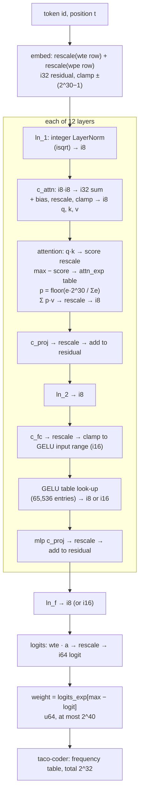
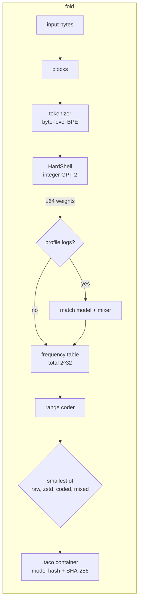
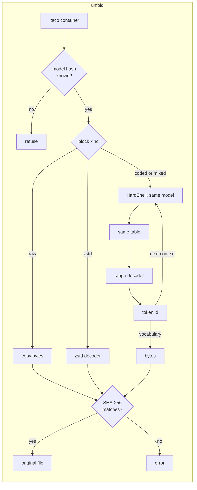
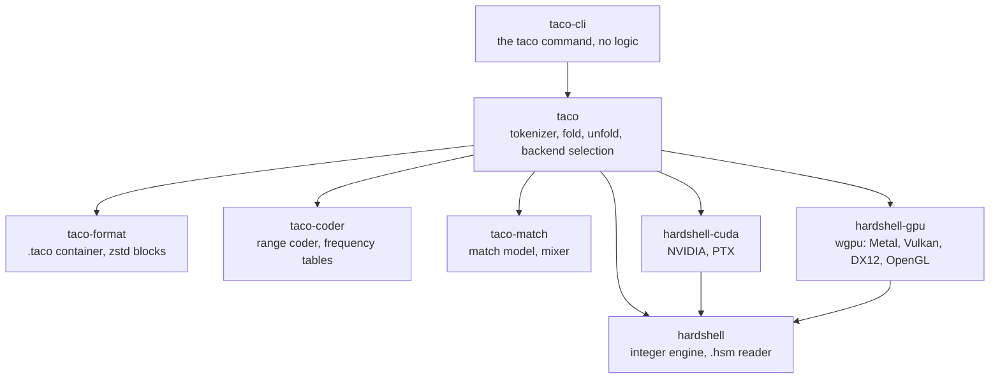

# Taco core architecture: how it works

Date: 2026-10-19. Status: alpha (proof of concept), version 0.1.0.

This document is the complete technical description of Taco: what each part does, why it is
built this way, how it was tested, and what it measured. Nothing is held back. It is the one
place that explains how the whole system works, with links to the decisions (ADRs) and the
measurements (research notes).

> **How this document was written.** Most of the code, the tests and the documents of this
> repository were written by Claude (an AI model by Anthropic) with Claude Code, under the
> direction of the author, to get to results faster. The author made the design decisions.
> The tests are the evidence, not the authorship: conformance vectors, the cross-machine
> check, fuzzing and the comparison of every fast path with the reference path (see
> [§7](#7-implementation)).

Background for a reader who is new to compression or machine learning is in the companion
document [`primer.md`](primer.md). This document links to the parts of the primer and does not
repeat them. The project summary, the build steps and the demo are in
[`../README.md`](../README.md).

**How to read the numbers.** Each number has one of three labels. *Measured*: a Taco
measurement, with the source document in `docs/`. *Published*: a number that another person
published, with a reference. *Est.*: an estimate. In a table, the caption gives the label of
all cells. "bpb" is bits per byte (8 bpb is no compression). "KB" is 1,000 bytes and "KiB" is
1,024 bytes. Every measurement in this document was made between 2026-10-18 and 2026-10-19.

---

## Summary

A language model predicts the next part of a text. A range coder can change good predictions
into few bits, so a language model is a strong compressor. But the decoder must compute
exactly the same probabilities as the encoder. If one probability differs by one unit, the
decoder selects a wrong symbol, and all later output is wrong. Floating-point results change
with the processor, the math library, the thread count and the batch shape. In our
measurements, a float GPT-2 encoder on an Apple M2 and a float decoder on an x86 PC decoded 0
of 4 windows, although the file sizes agreed within 1 byte (measured). Taco is a lossless
compressor that removes this failure. Its engine, HardShell, runs GPT-2 small with integer
arithmetic only: `i8` weights, `i32` and `i64` sums, one written rounding rule, and tables for
the non-linear functions. A converter that uses exact rational arithmetic makes the integer
model file, and it makes the same file on every machine. On 16 text files, the integer model
loses 0.2 % against the float model (measured). Files that one machine folds unfold on every
other machine that we tested: ARM macOS, x86 Linux, x86 Windows, CUDA, Metal, DX12 and OpenGL
(all measured).

The guarantee is conditional. Integer results are the same on every machine only when every
operation is fully specified: a wide enough accumulator with a written bound (or a defined
wrap), one rounding and clamp rule, and floor division. Tests check these conditions. Tests
cannot prove that the code obeys them everywhere. The checksum in each file finds a wrong
result. It cannot repair a fold that was wrong (§4.12).

On 32 KiB samples of English, code and HTML, Taco is smaller than every general compressor in
our test on 9 of 10 samples; on whole English books it is near PPMd (measured). Taco is
smaller than xz on most logs and larger than paq8px on every log. Taco is slow. On an RTX 3060
Laptop GPU at 95 W, it folds English text at 85 to 129 KB/s and unfolds it at 26 to 31 KB/s
(measured). It is not the first language-model compressor that decodes on other machines:
ts_zip states the same property and makes smaller files than Taco (§1.5, §8.2). What Taco adds
is a combination: an open integer specification, an exact and repeatable model conversion,
several implementations that give the same bits, and conformance vectors that connect them.

---

## 1 Introduction

### 1.1 Prediction is compression

A lossless compressor makes a file smaller, and its decompressor restores the file exactly,
byte for byte. Most compressors that people use every day (gzip, xz, zstd) find repeated
strings and replace them with short references. A different family of compressors predicts
each symbol and gives a short code to a symbol that it expects. Shannon showed that the best
average code length for a symbol of probability *p* is −log₂ *p* bits [Shannon 1948]. A range
coder (or an arithmetic coder) reaches this length within a very small loss [Rissanen 1976;
Rissanen and Langdon 1979; Martin 1979; Witten et al. 1987]. Statistical compressors such as
PPM [Cleary and Witten 1984; Shkarin 2002] predict each byte from the bytes before it. Thus a better predictor gives a smaller file. The primer
explains these ideas from zero ([§2](primer.md#2-compression-from-zero),
[§3](primer.md#3-information-theory), [§4](primer.md#4-arithmetic-and-range-coding)).

A large language model (LLM) is a very good predictor of text. Delétang et al. showed that a
language model with arithmetic coding compresses text far better than general compressors
[Delétang et al. 2023]. Other systems use the same principle: NNCP and ts_zip [Bellard 2019;
Bellard 2021; Bellard ts_zip], LLMZip [Valmeekam et al. 2023], and the context-mixing
compressors PAQ, paq8px and cmix [Mahoney 2005; Knoll and de Freitas 2012; paq8px; Knoll cmix].

### 1.2 The problem: the decoder must compute the same numbers

The range decoder must divide its number range in exactly the same way as the encoder. Thus
the decoder must compute exactly the same probabilities, bit for bit, at every step. The
decoder computes them with the same model, but on the receiver's machine. Most LLMs run with
floating-point arithmetic (IEEE 754 [IEEE 754-2019]). Floating-point addition is not
associative: `(a + b) + c` can differ from `a + (b + c)` in the last bit [Goldberg 1991]. A
matrix library on one processor adds the products in one order. A library on another
processor, or with another thread count, adds them in another order. The primer explains this
in [§7](primer.md#7-numbers-inside-computers-and-ieee-754) and
[§8](primer.md#8-why-floats-break-llm-compression-and-the-integer-fix).

A difference in the last bit is very small. But the frequency table of Taco has a total of
2^32, so one unit is a probability of about 2.3 × 10^-10. A probability difference of 10^-5
changes many table entries. When one entry changes, the decoder can select a wrong token.
After a wrong token, the context of the model is wrong, and every later token is wrong. No
error occurs: the output is silently wrong. Section 3 gives our measurements of this failure.

A compressor whose files decode only on the machine that made them is of little use. A user
compresses an archive on a laptop and restores it years later on a server. Thus we set this
goal (plan §1): a file that one machine compresses must decompress on every other machine.

### 1.3 The approach

Taco makes the prediction path integer-only. The *prediction path* is all the code from the
model weights to the frequency table that the coder receives (plan §2). Integer addition and
multiplication have one result in any order. If every operation has one defined result, every
machine computes the same table. Ballé, Johnston and Minnen used the same principle for image
compression [Ballé et al. 2019]. Integer-only inference of neural networks is also known
[Jacob et al. 2018; Kim et al. 2021]. Taco applies these ideas to a language-model
compressor, specifies every rule, and tests the result across processors, operating systems
and GPUs.

The condition "every operation has one defined result" is the whole guarantee, and it is a
condition, not a fact that comes from the integer types. Integers alone are not enough. A sum
needs an accumulator that is wide enough, with a written bound, or a defined wrap. A rounding
needs one written rule. A division of signed values needs one rounding direction. §4.12 states
what the tests show and what they cannot show.

Taco has two operations: `taco fold` (compress) and `taco unfold` (decompress). HardShell is
its integer engine. The model of version 1 is GPT-2 small (124M parameters) [Radford et al.
2019] ([ADR 0005](adr/0005-gpt2-is-the-model-of-version-1.md)). The owner decisions of
2026-10-19 limit the scope of version 1 ([`design/product-v1.md`](design/product-v1.md) §4):

- Taco is for **English** text. Non-English text is not a goal.
- **Fine-tuned models are frozen.** Route A (a model fine-tuned on logs), per-customer
  fine-tunes and a `taco train` command get no more work and do not ship in version 1. The
  measurements stay in this document (§8.6) and in `docs/research/`.
- The main goal is **cross-hardware bit-exactness**: a file that one machine folds unfolds on
  every other supported machine. Work that proves or extends this has priority.

### 1.4 What Taco consists of

This document describes and measures these parts:

1. **HardShell**, an integer-only GPT-2 engine with one written rule for each rounding,
   division, square root and table look-up (§4, Appendix A). Its integer model loses 0.2 %
   against the float model on 16 held-out text files (measured).
2. **An exact model converter.** It changes float weights into the integer model file with
   exact rational arithmetic, so that two different machines make the same file, byte for
   byte (§4.10, [ADR 0014](adr/0014-exact-model-conversion.md)).
3. **A tokenizer** that restores every byte string exactly (§5.5).
4. **A range coder and an integer frequency-table rule** with a total of 2^32, which give
   50,257 tokens a useful distribution at a measured overhead of 0.021 % (§5.1, §5.2).
5. **A container format** that stores the SHA-256 of the model and of the data, refuses
   every malformed input with a typed error, limits growth on data that does not compress,
   and is frozen at version 2 (§5.3, §5.4). Fold and unfold work as a stream with bounded
   memory (§5.7).
6. **Integer coding parts** for logs: a match model, a logistic mixer and a context overlap
   (§6). A skip rule and speculative decoding exist in the engine and are not yet used by the
   command (§6.5).
7. **Several implementations of one engine**: a reference path, CPU SIMD paths, CUDA and wgpu,
   with run-time selection and a self-test (§7).
8. **A test method.** One reference path is the oracle for every fast path. Conformance
   vectors, a conformance program in CI, a cross-machine check and fuzzing connect the
   implementations (§7.2, §7.6 to §7.9).
9. **Measurements** of size, integer loss, bit-exactness, speed and security against gzip,
   bzip2, xz, zstd, brotli, PPMd, paq8px and ts_zip (§8).

### 1.5 Related work: what is not new, and what Taco adds

We want to be exact about this.

- **The principles are not new.** Compression with a language model and a range coder
  [Delétang et al. 2023; Bellard 2021; Valmeekam et al. 2023]. Integer-only inference of
  transformers, including integer GELU, softmax and LayerNorm [Kim et al. 2021].
  Quantisation with an integer multiplier and shift [Jacob et al. 2018]. Integer networks for a
  decoder that works on every platform [Ballé et al. 2019]. Exact integer transforms that stop
  decoder drift in video coding [Malvar et al. 2003]. Match models and mixers [Mahoney 2005].
  LZMA-style range coders [Martin 1979].
- **Taco is not the first language-model compressor that decodes on other machines.** The
  ts_zip page says that its result "does not depend on the exact GPU or CPU model nor on the
  number of configured threads" (published, [Bellard ts_zip]). ts_zip uses an RWKV model with
  8-bit weights and BF16 floating-point arithmetic. It is distributed as a program. We found
  no written specification of its arithmetic that another implementation could follow.
- **Taco is not the best compressor with a language model.** On the whole `alice29.txt`
  (152,089 bytes), Taco gives 38,939 bytes (2.048 bpb, measured) and ts_zip gives 21,713 bytes
  (1.142 bpb, published). ts_zip is 44 % smaller. It uses a larger and newer model (169M
  parameters against 124M), and the profile `text` of Taco restarts the model context at each
  block of 16 KiB (§6.4, §8.2).
- **What Taco adds is the combination.** (1) An open, written specification of integer-only
  inference. (2) An exact conversion, so that anyone can make the identical model file again
  from the published float weights. (3) Several implementations (CPU ARM and x86, CUDA, wgpu)
  with one oracle that give the same bits. (4) Conformance vectors that connect the model to
  the bytes of real `.taco` files, and a test method for new implementations. A search of the
  literature on 2026-10-18 found no open system with all four parts
  ([verification note](research/2026-10-18-verification.md)). A search can miss work, so we
  state this with care. It is an engineering combination of known ideas.

Taco is also not a fast compressor. paq8px makes most of our test files smaller than Taco
does (§8.2). Taco is about 1,000 times slower than zstd (§8.5).

---

## 2 Background

This section is short. The primer gives the full background.

- **Bits and information.** A byte has 8 bits. Information content and entropy:
  [primer §1](primer.md#1-bits-bytes-and-information), [§3](primer.md#3-information-theory).
- **Compression.** Dictionary methods (gzip, xz, zstd) and statistical methods (PPM, PAQ):
  [primer §2](primer.md#2-compression-from-zero).
- **Range coding.** The coder keeps an interval and narrows it to the slice of each symbol.
  The slice width is proportional to the probability of the symbol:
  [primer §4](primer.md#4-arithmetic-and-range-coding).
- **Machine learning and language models.** A transformer reads tokens and gives a score
  (a *logit*) to every token of its vocabulary. A softmax changes the scores into
  probabilities: [primer §5](primer.md#5-machine-learning-from-zero),
  [§6](primer.md#6-language-models).
- **Numbers in computers.** Integers, floating-point numbers and IEEE 754:
  [primer §7](primer.md#7-numbers-inside-computers-and-ieee-754),
  [§8](primer.md#8-why-floats-break-llm-compression-and-the-integer-fix).
- **The parts of Taco and a glossary:** [primer §9](primer.md#9-the-parts-of-taco),
  [§10](primer.md#10-glossary).

Terms that this document uses often:

| Term | Meaning |
|---|---|
| Token | One unit of the model vocabulary. GPT-2 has 50,257 tokens. A token is 1 or more bytes. |
| Context | The tokens that the model sees before it predicts the next token. GPT-2 sees at most 1,024. |
| Logit | The integer score of one token at one step. |
| Weight (of a token) | A non-negative `u64` that HardShell makes from a logit. A larger weight means a more probable token. |
| Frequency table | One integer frequency for each token, with a total of 2^32. The coder uses it. |
| Block | A part of the input that Taco codes independently of other parts. |
| Container | The `.taco` file: header, block table, blocks. |
| Model file | The `.hsm` file: the integer weights, the tables and the vocabulary. |
| Model hash | The SHA-256 of the model file. |
| Quantisation | The change of a real number into a small integer and a scale. |
| Calibration | A run of the float model on sample text that records the range of each activation. |
| Oracle | The simple reference code that every fast path must equal. |
| Fold, unfold | The Taco names for compress and decompress. |
| Profile | A set of coding parts that the container names: `text`, `logs` or `auto` (§6.3). |
| Backend | The hardware and code that runs HardShell: CPU, CUDA or wgpu (§7.7). |
| Overlap `K` | The number of tokens that a context restart keeps (§6.4). |
| Conformance vector | An input with the SHA-256 of the exact output that a correct implementation must give (§5.4). |

---

## 3 The determinism problem

### 3.1 What must be equal

The theory is simple ([`docs/research/2026-10-18-verification.md`](research/2026-10-18-verification.md) §1). Decoding is lossless if
the encoder and the decoder have the same frequency table at every step, and every symbol has
a frequency of 1 or more. The quality of the model changes only the size. It never changes
the correctness. Thus the only requirement on the model is that both sides compute the same
table.

### 3.2 Measurements of float drift

We ran the float GPT-2 (NumPy, float32) of `tools/baseline` on two machines and on several
code paths of one machine. For each step, a tool made the frequency table of each path and
tried to decode the stream of one path with the tables of the other path.

**Table 1. Float drift. All values measured** ([`docs/research/2026-10-18-phase0-baseline.md`](research/2026-10-18-phase0-baseline.md)
§6 and §8; [`docs/research/2026-10-19-float-drift-machines.md`](research/2026-10-19-float-drift-machines.md) §4).

| Encoder path | Decoder path | Machines | Steps with a different table | Windows decoded |
|---|---|---|---:|---:|
| Full sequence | KV cache | one Mac (M2) | 99.90 % | 1 of 270 |
| KV cache, batch 4 | KV cache, batch 1 | one Mac | 100 % | 0 of 19 (each direction) |
| float32 | float64 | one Mac | 100 % | 0 of 19 (each direction) |
| BLAS threads: default | BLAS threads: 1 | one Mac | 0 % | 19 of 19 |
| Full sequence | Full sequence | Mac against x86 PC (devbox) | 100 % | 0 of 4 (each direction) |
| KV cache, batch 4 | KV cache, batch 4 | Mac against x86 PC | 100 % | 0 of 4 (each direction) |
| BLAS threads: default | BLAS threads: 1 | one x86 PC (OpenBLAS) | 100 % | 0 of 4 (each direction) |
| Same path, two runs | Same path | one x86 PC | 0 % | 4 of 4 |

The one window of the first row that decoded has only 2 tokens. The machines: an Apple M2
with Apple Accelerate, and an AMD Ryzen 7 5800H with OpenBLAS under WSL2.

Four facts follow from Table 1:

1. **The failure is immediate.** Across the two machines, the first table is already
   different at step 0, where the model input is only one token. The first wrong byte was byte
   0 or byte 2 of the window in all 16 cross decodes (measured).
2. **The differences are tiny.** The largest probability difference was 6.2 × 10^-5, and the
   largest logit difference 0.034 (measured).
3. **Size tests do not find the failure.** The two machines made coded streams of the same
   size within 1 byte (measured). A benchmark that measures only the size shows no problem.
4. **One path on one machine repeats.** The same program, path, batch shape, thread count and
   machine gave the same tables. Thus a float compressor works if, and only if, the decoder
   copies all of these.

At the level of one function, the Mac and the x86 PC gave different last bits for 347 of
200,000 `exp` results and 8,344 of 200,000 `sin` results (measured, [ADR 0002](adr/0002-integer-only-prediction-path.md)). An earlier
experiment with a small integer context model decoded 508 of 508 round trips, and gave the
same compressed bytes on both machines; a float32 version of its decoder failed 50 of 50
decodes (measured, [`docs/research/2026-10-18-verification.md`](research/2026-10-18-verification.md) §2).

Other people found the same failure. Adler and Tang computed Llama 3.1 logits on an Apple M2
Pro to encode and on an Apple M4 Max to decode: "No files were correctly decoded when using
arithmetic coding" (published, [Adler and Tang 2026], §5.2).

### 3.3 Possible answers

| Answer | Example | Limit |
|---|---|---|
| Decode on the same hardware and software | most research systems | The archive depends on one machine type. |
| Batch-invariant kernels | [He 2025] | Removes the batch effect on one setup, not across processors (verification note §3). |
| Tolerate a bounded mismatch | PMATIC [Adler and Tang 2026]; [Hu and Tang 2026] | A larger tolerance costs compression, and the guarantee holds only while the mismatch stays inside the stated bound. In the published M2 Pro to M4 Max test, PMATIC decoded all files only with its larger tolerance setting (published, [Adler and Tang 2026] §5.2). |
| Controlled floating point | ts_zip [Bellard ts_zip] | ts_zip states that its result does not depend on the machine (published). We found no written specification of its arithmetic for other implementations. |
| Integer arithmetic | [Ballé et al. 2019]; Taco | A small loss from quantisation; all non-linear functions need integer forms. |

Taco selects integer arithmetic ([ADR 0002](adr/0002-integer-only-prediction-path.md)). The cost is a small quality loss (§8.3), and a
large amount of engineering work: every operation of GPT-2 needs an integer form, and every
fast path must give the same bits.

---

## 4 Design of HardShell

HardShell is the integer engine. It reads the model file, keeps the context (a KV cache), and
for each token gives one `u64` weight for each of the 50,257 tokens. `taco-coder` changes the
weights into a frequency table (§5.2).

### 4.1 The integer rules

Ten rules in [`CLAUDE.md`](../CLAUDE.md) §1 govern all code. These parts of them define the arithmetic:

1. **No floating-point arithmetic in the prediction path.** The three kernel crates
   (`hardshell`, `taco-coder`, `taco-match`) deny the lint `clippy::float_arithmetic`. A
   script (`scripts/check-no-floats.sh`) refuses float types in their Rust source. It also
   refuses float types in the CUDA kernels (`crates/hardshell-cuda/kernels/*.cu`) and in the
   WGSL shaders (`crates/hardshell-gpu/src/shaders/*.wgsl`), because the GPU kernels are part
   of the prediction path. The script runs in CI on each push.
2. **Every integer operation has one defined result.** Rust gives defined `wrapping_*` and
   `checked_*` operations; overflow is never undefined ([ADR 0001](adr/0001-owner-decisions.md)). The code uses these, or
   writes an `INVARIANT:` comment that proves that overflow cannot occur.
3. **Only the rounding rules of plan §7.2.** Each rule is one function in
   `crates/hardshell/src/int.rs`:

   | Operation | Rule |
   |---|---|
   | Rescale | `rescale(x, m, s) = floor((x · m + 2^(s−1)) / 2^s)`: round half up. The product is in `i128`. |
   | Clamp | `clamp(x, lo, hi)`. The only saturating operation. |
   | Division | `floor_div(a, b)` with `b > 0`, as `div_euclid`. Never `/` on signed values. |
   | Square root | `isqrt(x) = floor(√x)`, digit by digit, integers only. |
   | Table look-up | The index is clamped to the table range first. |

4. **Tables of non-linear functions are data.** A tool calculates them one time, before
   publication. HardShell only reads them.

Why these choices: a right shift of a signed integer in Rust is an arithmetic shift, which is
a floor division by 2^s on every machine. A floor division by a positive divisor cannot
overflow. A rescale with an integer multiplier `m` and a shift `s` replaces a float scale
factor `m / 2^s` [Jacob et al. 2018]. Appendix A gives every rule with its bounds.

### 4.2 Number formats

| Value | Type | Rule |
|---|---|---|
| Weights | `i8` | Symmetric, one scale for each output row (plan §7.1). |
| Residual stream | `i32` | Clamped to ±(2^30 − 1) after each addition ([ADR 0004](adr/0004-hardshell-numerics.md) §1). |
| Activations | `i8`, −127 to 127 | One static scale for each tensor, from calibration. |
| Wide activations (model file version 2) | `i16`, −32,767 to 32,767 | At the GELU outputs and at the final LayerNorm (§4.8). |
| Accumulators | `i32` for `i8 × i8` dot products; `i64` for other products | Bound: every `i8` dot product of GPT-2 is below 2^30 ([ADR 0008](adr/0008-gpu-backend.md) §4). |
| Scales | integer multiplier `m` (`i32`) and shift `s` (`u8`) | The converter puts the largest `m` of a tensor in [2^30, 2^31) (ADR 0004 §6). |

### 4.3 The forward pass

GPT-2 is a stack of 12 transformer layers. Each layer has an attention part and an MLP part,
each with a LayerNorm before it and a residual addition after it. Figure 1 shows the integer
form of one step (`crates/hardshell/src/gpt2/mod.rs`).

**Figure 1. One HardShell step for one token.**



The residual stream stays `i32` with one scale for the whole model. Only the inputs of the
matrix products are `i8`.

### 4.4 LayerNorm with an integer square root

LayerNorm subtracts the mean of a row and divides by its standard deviation [Ba et al. 2016].
The division by a square root is the difficult part. HardShell does it with integers (plan
§7.3, `crates/hardshell/src/layernorm.rs`). For a row `x` of width `n`:

1. `mean = floor_div(Σx, n)`.
2. `var = floor(Σ(x − mean)² / n)`.
3. `inv = floor(2^K / isqrt(var · 2^(2J) + eps))`.
4. `y = clamp(rescale((x − mean) · inv · gamma, m, s) + beta, −127, 127)`.

The constants are `K = 48` and `J = 8` ([ADR 0004](adr/0004-hardshell-numerics.md) §2). `K = 48` is the largest value that keeps
the product `(x − mean) · inv · gamma` below 2^95 for every `i32` input. `J = 8` gives `isqrt`
enough bits when the standard deviation is small. The products are in `i128` and `u128`; the
module documentation proves each bound.

The error depends on the size of the residual. With a row standard deviation of 2^12 units,
the error is 0.501 LSB of the `i8` output, near the best possible value of 0.5 LSB (rounding).
At 2^4 units it is 0.991 LSB, because the integer mean can be wrong by one unit (measured, ADR
0004 §2; "LSB" is one unit of the output). Thus the converter selects the residual scale so
that a typical row has a standard deviation of 2^12 units or more. For GPT-2 the residual scale
is 1.664 × 10^-5; the smallest row standard deviation is then 2^12.50 units and the largest
value 2^27.45 units, below the clamp at 2^30 (measured,
[`docs/research/2026-10-18-integer-gpt2.md`](research/2026-10-18-integer-gpt2.md) §5).

### 4.5 GELU as a table

GELU is the activation function of the GPT-2 MLP [Hendrycks and Gimpel 2016]. HardShell does
no GELU arithmetic. The input of GELU is an `i16` value, so the table has 65,536 entries, one
for each possible input (plan §7.4). The converter calculates each entry one time. Against an
exact GELU, the `i16`-input table has a maximum error of 0.502 LSB; a table with `i8` inputs
(256 entries) has 1.008 LSB (measured, [ADR 0004](adr/0004-hardshell-numerics.md) §3). The `i16` tables cost 768 KiB for GPT-2
small (est., ADR 0004 §3).

### 4.6 Softmax in attention

Attention compares the query of the current token with the key of each earlier token and
makes a probability for each earlier token. The float form uses `exp`. HardShell uses a table
(plan §7.5, `crates/hardshell/src/softmax.rs`):

1. The scores are `i32` dot products of `q` and `k`, rescaled to units of 2^-8.
2. `d[j] = max(score) − score[j]`, so that `d[j] ≥ 0`.
3. `e[j] = attn_exp[clamp(d[j], 0, 8191)]`, with `attn_exp[i] = R(2^30 · exp(−i · 2^-8))`.
4. `p[j] = floor_div(e[j] · 2^30, Σe)`.
5. The output is `rescale(Σ p[j] · v[j], m, s)`, clamped to `i8`.

The subtraction of the maximum keeps every table index non-negative, and a very small
probability takes the last entry of the table. Against a float softmax, the mean KL divergence
of one row was 1.5 × 10^-6 bits for rows of 1,024 scores (measured, [ADR 0004](adr/0004-hardshell-numerics.md) §4). A precision
of `P = 24` lost mass in the floor division for long rows, so `P = 30` is the choice. The
bound `e < 2^31` and `P ≤ 30` keeps `e · 2^P` below 2^61.

### 4.7 From logits to a frequency table

The final logits are integers. HardShell changes them to weights with a second table (plan
§7.6, `crates/hardshell/src/logits.rs`):

`weight[v] = logits_exp[clamp(max(logit) − logit[v], 0, 8191)]`, with
`logits_exp[i] = R(2^40 · exp(−i · 2^-8))`.

Every entry is at most 2^40 and the vocabulary has at most 2^20 tokens, so the sum of the
weights is at most 2^60 and fits in a `u64`. The loader refuses a table that breaks this bound.
Against a float softmax over 50,257 tokens, the mean KL divergence was 5.9 × 10^-7 bits for
each token (measured, [ADR 0004](adr/0004-hardshell-numerics.md) §5). `taco-coder` then makes the frequency table (§5.2). Every
token gets a frequency of 1 or more, so every token can be coded.

### 4.8 Quantisation and calibration

The converter changes each float weight matrix to `i8` with one scale for each output row:
`scale = max|row| / 127`, `q = R(w / scale)`. Activations have static scales. A calibration
run of the float model on 11 windows (11,264 tokens of English, Spanish, C, Go and random
bytes) records the range of each activation (measured,
[`docs/research/2026-10-18-integer-gpt2.md`](research/2026-10-18-integer-gpt2.md) §4). No calibration file is in the evaluation set.

**Outlier channels.** The first rule mapped the largest calibration value of each tensor to
127. For GPT-2 this gave +67 % bits on held-out windows (measured). The cause: the final
LayerNorm (`ln_f`) has a few outlier channels with values up to 295, while the median channel
has a largest value of 2.25. With a range of 295, a typical channel used only one or two `i8`
levels (measured). The recipe `clip` takes the range of `ln_f` and of the GELU
outputs from the typical channel, and lets the few outlier channels saturate at the clamp.

**Beta correction.** HardShell adds the LayerNorm `beta` after the rounding step, so each
channel has a constant error of up to half a unit. The converter removes this error through
the bias of the next linear layer ([ADR 0004](adr/0004-hardshell-numerics.md) §7). On the calibration windows this changed the
integer size from 2.795 to 2.594 bpb (measured).

**Recipe `wide` (model file version 2).** A log model that we fine-tuned (§8.6; frozen and not shipped) lost 16.7 %
against float with `clip` on its training systems (measured). Two sites caused most of the
loss: the GELU outputs and the `ln_f` output. Model file version 2 adds three rules (ADR 0004
addendum B): `i16` outputs at `ln_f`, `i16` GELU tables, and a LayerNorm `beta` with 8 more
bits that HardShell adds *before* the one rounding (`ln_beta_frac = 8`). Then the matrix
product that reads an `i16` activation uses `i64` accumulators (bound `|acc| ≤ 2^38`). With
`wide`, the loss of the log model fell to +0.7 % on its training systems and −0.3 % on unseen
systems (measured, [`docs/research/2026-10-19-calibration.md`](research/2026-10-19-calibration.md)). For GPT-2, `wide` is worse than
`clip` (+1.7 % on the text files, measured), so `gpt2.hsm` stays version 1.

### 4.9 The model file (`.hsm`)

The model file holds everything that the decoder needs: the integer weights, the rescale
constants, the tables and the vocabulary (plan §8, [ADR 0004](adr/0004-hardshell-numerics.md)
§8). The module documentation of `crates/hardshell/src/hsm/mod.rs` is the full specification;
this section gives its main rules. All integers are little-endian.

```
magic "HSHLMDL\0" (8 bytes) | version (u32) | header_len (u32)
JSON header (integers only)
vocabulary (for each token: u16 length, bytes)
BPE merges (optional; pairs of u32 token ids, in rank order)
tensors and tables, each at a multiple of 64 bytes
```

The JSON header has four fields: `model` (the architecture `gpt2`, `n_layer`, `n_head`,
`d_model`, `d_ff`, `vocab_size`, `n_ctx`, `eot_token`, and the constants `ln_k`, `ln_j`,
`ln_eps`, `softmax_p`), `vocabulary` (offset and length), `merges` (optional) and `tensors`
(for each tensor: name, dtype `i8`, `i16`, `i32` or `u64`, shape, offset, length, and a
`shift` on a rescale tensor). A rescale `(m, s)` is an `i32` tensor of multipliers `m`, one for
each output row, with the shift `s` in the header. `Model::load` knows the tensor names of
GPT-2 (for example `h.0.attn.c_attn.w`, `h.0.mlp.gelu`, `attn_exp`, `logits_exp`) and refuses a
missing tensor, an extra tensor, a wrong type or a wrong shape.

Three rules make the file unambiguous:

1. **Integers only in the header.** A number with a fraction or an exponent is an error. Thus
   the reader never parses a float.
2. **A canonical layout.** The vocabulary and every tensor start at a multiple of 64 bytes at
   a computed offset; all gap bytes are zero; the file ends at the end of the last tensor;
   unknown, missing or duplicate fields are errors. Thus one model has exactly one file and
   one model hash.
3. **The vocabulary is in the file.** The model hash therefore also identifies the
   tokenizer. The merges are in the file too, so the hash covers them. The decoder never
   tokenizes: it changes token ids to bytes with the vocabulary only (plan §10). Only the
   encoder reads the merges (§5.5).

`gpt2.hsm` has 127,237,568 bytes and the SHA-256
`aaa03eb96e9ad7957432168c8ac6b4a99ed55d57e637e4786a664b51001ba5c2` (measured). The reader
refuses an out-of-range dimension (for example `vocab_size` above 2^20) and a table that breaks
the weight bound of §4.7 (security notes: §7.9).

**Format versions of the model file.** Version 1 has `i8` outputs at every activation site.
Version 2 adds exactly three things (the `wide` rules of §4.8): the optional header constant
`ln_f_bits = 16`, the optional constant `ln_beta_frac` (1 to 16), and an `i16` GELU table. A
file is version 2 if, and only if, it uses one of them, so every version 1 file keeps its
bytes and its meaning. The default `gpt2.hsm` is version 1 and runs on every backend. A
version 2 file runs on the CPU and with CUDA. `hardshell-gpu` (wgpu) refuses it for now.

NOTE: [ADR 0009](adr/0009-model-graph.md) (proposed) describes a later model file that holds a
graph of integer ops for other model families. It names that format version 3, because
version 2 is the `wide` format above. The graph format is design work and not built.

### 4.10 Exact conversion (ADR 0014)

The decoder never converts a model. It loads the published file and compares its SHA-256 with
the hash in the container. But the converter used floats to make that file. A weight on a
rounding border (for example 89.4999… on one machine and 89.5000… on another) can round to
two different integers, and the two files are then two different models.

The design requires that a person can make the identical model file again, on any machine,
from the published float weights. Thus the converter is exact
([ADR 0014](adr/0014-exact-model-conversion.md), `tools/convert/exact.py`):

1. **One tie rule.** Every rounding is `R`: the nearest integer, and the even integer for an
   exact tie.
2. **Weights from their bits.** A float32 weight is exactly `±m · 2^e`. The converter reads
   the bits and computes `R(127 · m / (m_max · 2^sh))` with 64-bit integer arrays.
3. **Rational arithmetic.** Scales, biases, multipliers, shifts and the LayerNorm epsilon are
   exact fractions (Python `Fraction`), then `R`. An irrational ratio such as √2 is never
   rounded directly: the converter compares squares.
4. **Tables at 50 decimal digits.** `exp` and GELU use Python `decimal` in one fixed context.
   Its operations are correctly rounded, so every machine gets the same digits. The
   converter stops if an entry is nearer than 10^-30 to a tie.
5. **Calibration statistics are data.** A committed file holds them. The converter reads it
   and refuses to run the float model.
6. **A self-check.** `tools/convert/expected.toml` holds the expected SHA-256 for each set of
   inputs. On a mismatch the converter stops and writes no file.
7. **No hidden variation.** The converter uses one thread and no float matrix product, so it
   uses no BLAS. NumPy is pinned in `tools/uv.lock`.

Result (measured, [exact-conversion note](research/2026-10-19-exact-conversion.md)): the Mac
(ARM, Python 3.12.11) and devbox (x86, Python 3.12.15) both made `gpt2.hsm` with the SHA-256
`aaa03eb9…a5c2`, the same file as the float converter of version 1. Both machines also made
`conformance/tiny.hsm` (`eb78b89a…18f8`). Of 124,337,664 GPT-2 weights, 4 are exact ties. The
float converter had rounded all 4 as `R` does, one of them by chance. The exact conversion
takes 70.7 s on the Mac and 48.1 s on devbox (measured).

For an archive, a user keeps the `.taco` files, the model file, and the Taco specification.
With exact conversion, the model file can also be made again from the published float
weights and the committed calibration file.

### 4.11 Self-checks at run time

- **Model hash.** The container stores the SHA-256 of the model file. The decoder refuses a
  container whose model hash it does not have (CLAUDE.md §1 rule 3).
- **Data checksum.** The container stores the SHA-256 of the original data. Unfold verifies
  it. A failure is an error, never a silent wrong output.
- **GPU self-test.** Before a GPU backend is used, it runs 6 steps of a block on the GPU and
  on the CPU. The full weights of step 1, the coder answers of every step (encode) and of
  three targets (decode: the first, one inside, the last) must be equal. A GPU that fails is
  not used, and Taco uses the next backend ([ADR 0016](adr/0016-backend-selection-and-coded-gpu-path.md)
  §1.4, §7.7).

### 4.12 What the guarantee means

The claim of Taco is: the same bytes in, the same bytes out, on every machine. Precisely:

1. **The condition.** Integer results are the same on every machine when every operation is
   fully specified: (a) every sum has an accumulator that is wide enough, with the bound written
   in the code, or it wraps in a defined way; (b) every rounding and every clamp has one
   written rule (§4.1); (c) signed division uses floor-division helpers. Then a compiler, a
   CPU type or a GPU driver has no freedom to change a result.
2. **What tests show.** Conformance vectors, the cross-machine check, the comparison of every
   fast path with the oracle, property tests of the integer kernels and fuzzing (§7) check
   these conditions on the machines that we have. Tests cannot prove that the code obeys the
   conditions everywhere, and a machine that is not in Table 5 is not tested.
3. **What the checksum does.** Each `.taco` file stores the SHA-256 of the original data, and
   unfold checks it. A wrong result is never silent. The checksum finds an error; it cannot
   repair one. If unfold fails, a retry with `--backend cpu` or on another machine can help
   when the error was in the decoder. If the error happened in fold (a bug or a hardware fault
   on that machine), no decoder can restore the file. A user keeps the original until the
   `.taco` file has been unfolded one time.
4. **What can still go wrong.** A bug in our code, a bug in a GPU driver (the self-test finds
   many of these before use), or a hardware fault. In each case the SHA-256 check finds the
   error at unfold.
5. **What the guarantee does not cover.** The model file must be the same on both machines (the
   model hash is checked). The guarantee is about the bytes, not about the speed or the size.
6. **How the rule is enforced.** Rust gives defined `wrapping_*` and `checked_*` operations.
   `scripts/check-no-floats.sh` refuses float types in the kernel crates, in the CUDA kernels
   and in the WGSL shaders. CLAUDE.md §1 rule 10 forbids a path that works differently on
   different machines.

---

## 5 The tokenizer, the coder and the container

### 5.1 The range coder

`taco-coder` is an LZMA-style range coder with byte output and carry propagation [Martin 1979]
([ADR 0003](adr/0003-range-coder.md)). Its window is wider than the 32-bit window of LZMA, so that a frequency table can
have a total of 2^32:

| Parameter | Value |
|---|---|
| `low` | `u128`, below 2^65 (bit 64 is the carry) |
| `range` | `u64`, start 2^64 − 1 |
| Renormalisation | while `range < 2^56`: shift 8 bits out |
| Table total `T` | 2^b with `b ≤ 32`; Taco uses `b = 32` |
| Division | `r = range >> b` (a shift); the decoder does one `u64` division `code / r` |
| Last symbol | receives the remainder `range − r · T`, so no part of the range is lost |
| Flush | writes the shortest value in the interval, then removes trailing zero bytes |

After a symbol, `range ≥ 2^56`, so `r ≥ 2^24`, and the integer division loses less than 2^-24
of the probability of a symbol (ADR 0003). The decoder reads zero bytes after the end of the
input, so the encoder need not write them. The coder writes no end mark; the token count is in
the block (§5.3).

Measured overhead: 0.68 bytes over the ideal size for 1,000,000 symbols of a 50,257-symbol
table (0.000047 %), and 80.6 bytes (0.021 %) for all 270 windows of the phase 0 corpus (both
measured, ADR 0003 and [`docs/research/2026-10-18-phase0-baseline.md`](research/2026-10-18-phase0-baseline.md) §5). The encoder coded
75 million symbols each second and the decoder 8.9 million (measured, ADR 0003, Mac). A
separate Python copy of the algorithm gave the same golden bytes (measured).

### 5.2 Frequency tables

The conversion from weights to frequencies is in the coder crate (plan §5.1). For `V` tokens,
weights `w[i]` and `T = 2^32`:

1. `W = Σ w[i]`, computed in `u128`. If `W = 0`, every weight is 1.
2. `f[i] = 1 + floor(w[i] · (T − V) / W)`, with the product in `u128`.
3. The remainder `T − Σ f` goes to the token with the largest weight (the lowest id on a tie).

Every step is an integer operation, so every machine makes the same table. Every frequency is
at least 1 (rule 5 of CLAUDE.md §1), so every token can be coded. The minimum costs less than
0.002 % of the probability mass (est., plan §5).

The minimum has a useful side effect. Float GPT-2 gives some tab and carriage-return tokens a
probability below 2^-32, up to 119 bits for one token (measured). The table limits the cost to
about 32 bits. This made the 16 text files 5.4 % smaller than the float ideal size (measured,
phase 0 note §5).

### 5.3 The container (`.taco`)

**Figure 2. Fold and unfold.**





The container has a fixed header, a block table and the stored bytes of each block
([ADR 0006](adr/0006-container-format.md), [ADR 0011](adr/0011-zstd-block-kind.md)). Version 2
is frozen (§5.4). All integers are little-endian.

| Offset | Size | Field |
|---|---|---|
| 0 | 4 | magic `TACO` |
| 4 | 2 | version (1 or 2), at this offset in every version |
| 6 | 2 | flags (0) |
| 8 | 32 | model hash (all zero: the raw-only mode, which needs no model) |
| 40 | 8 | original length |
| 48 | 32 | SHA-256 of the original data |
| 80 | 4 | block size, 1 to 67,108,864 (64 MiB) |
| 84 | 4 | block count = ceil(original length / block size) |
| 88 | 1 | profile (version 2): 0 text, 1 logs |
| 89 | 1 | reserved (0) |
| 90 | 2 | coding parts (version 2): bit 0 match model and mixer, bit 1 context overlap |
| 92 | 12 | coding parameters: byte 0 the mixer rule version (the writer writes 1; the value 2 is reserved, see §6.5); byte 1 zero; bytes 2 and 3 the overlap `K` (`u16`, 1 or more when bit 1 is set); bytes 4 to 11 zero |
| 104 | 5 × count | block table: kind (`u8`) and stored length (`u32`) for each block |

The header is 88 bytes in version 1 and 104 bytes in version 2.

**Blocks.** Each block is independent: it starts with a new context. Thus blocks can be coded
in parallel, and damage stays in one block. A coded block stores
`varint(token count) || range coder bytes` ([ADR 0007](adr/0007-coded-block-payload.md)). The token count tells the decoder when
to stop.

**Block kinds.** 0 raw, 1 coded (HardShell alone), 2 zstd [Collet and Kucherawy 2021], 3 mixed
(HardShell with the match model and the mixer, §6). The encoder stores the smallest form. On a
tie the order is raw, zstd, coded, mixed: zstd decodes without the model and much faster.
Every form except raw must be smaller than the original bytes; the reader refuses a coded,
zstd or mixed block that is not smaller. Thus a version 2 container is at most
`104 + 5 × block count + original length` bytes. This is the worst-case growth.

**The zstd block** exists because GPT-2 does not compress binary data. GPT-2 alone made
binary files larger: 22.3 bpb (measured, phase 0). The first 8,192 bytes of `kennedy.xls`
were stored raw in 8,285 bytes before zstd blocks, and in 2,206 bytes with a zstd block
(measured, [ADR 0011](adr/0011-zstd-block-kind.md)). The zstd encoder output depends on the library version, so the crate
pins zstd 1.5.7 (ADR 0011 §6). The zstd decoder output does not depend on the version.

**The stop rule.** The encoder stops the model when the coded form cannot win any more. It
stops when the varint and the coder bytes written so far, without their trailing zero bytes
(`Encoder::min_final_len`), reach the stop length: the smaller of the original length and the
zstd length. The final flush removes only trailing zero bytes, so the last non-zero byte
stays, and the final length cannot fall below this value. Thus the selected block does not
change. On the first 8,192 bytes of `kennedy.xls` this cut the fold time from 11.2 s to 4.5 s
(measured, [ADR 0007](adr/0007-coded-block-payload.md) §5.2).

The rule had an error that a review found on 2026-10-19. It counted all written bytes, and the
final flush can remove written zero bytes. 4,096 zero bytes code to 2 bytes with the tiny
model, but the encoder had stopped too early and selected an 18-byte zstd frame (measured).
Every output was valid. Only the encoder changed; the decoder, the format and the conformance
hashes did not change.

**Strict parsing.** The reader refuses every value that the format does not permit, with a
typed error: an unknown version, a non-zero flag or reserved byte, an unknown coding part or
mixer rule, a block size above 64 MiB, a wrong block count, a missing or an extra byte. The
frozen specification lists 23 refusals in a fixed order (ADR 0011, addendum §2). It checks lengths with checked arithmetic, and
it never allocates memory from an untrusted length before the data proves it. The checksum
covers the data, not the header; damage to the header gives a parser, model-hash, decoder or
checksum error.

Fault tests (measured): one bit flipped in each byte of a container of 315 bytes gave 315
errors and 0 wrong outputs (ADR 0007). Every bit flipped in each byte of a raw-only container
with 2 zstd blocks (2,760 cases) gave 2,731 errors, 29 outputs equal to the original, and 0
wrong outputs (ADR 0011).

### 5.4 Format versions, the freeze and conformance vectors

Each persisted shape has a version: the model file and the container. A change that changes
the compressed bytes needs a new version or new conformance vectors (CLAUDE.md §1 rule 8 and
§8). A *conformance vector* is an input with the SHA-256 of the exact output that a correct
implementation must give (plan §11).

**Container version 2 is frozen** (2026-10-19; [ADR 0011](adr/0011-zstd-block-kind.md), addendum "Version 2 is frozen", and
[ADR 0006](adr/0006-container-format.md), addendum). The addendum is the complete specification: the layout, the 23 ordered
refusals of the reader, the rules of the writer, and the conformance vectors. A reader that
obeys it accepts and refuses the same files as `taco-format`. From this date, a change to a
rule needs a new version, a reader for version 2 and a test. Later versions of Taco read the
files of this version. These rules belong to the freeze:

1. **The largest block size is 64 MiB.** The reader refuses a larger value before it reads the
   table, and the writer refuses to write it. The reason: the block size bounds the work and
   the memory of one block. A coded block has at most one token for each original byte, so a
   block costs at most 2^26 model steps. Before the rule, a container of 112 bytes could state
   2^32 − 1 steps (fuzz finding F5, §7.9). The largest block size in any test or measurement
   is 1 MiB. Version 1 gets the same rule; no version 1 file with a block size above 64 KiB
   exists.
2. **Mixer rule 2 is reserved.** Byte 0 of the coding parameters (offset 92) is the mixer rule
   version when bit 0 of the coding parts is set. The reader accepts the values 1 and 2 and
   refuses every other value (`UnknownMixerRule`). The writer of `taco` writes rule 1 only.
   The decoder of `taco` does not code or decode rule 2 yet, and refuses a rule 2 container
   with `UnknownMixerRule { rule: 2 }` before the first block. No reader decodes a rule 2 block
   with the rules of version 1. Rule 2 is the skip rule (§6.5); using it needs a decision of the
   owner, because it changes the bytes of the profile `logs`, and a rule 2 conformance vector.
3. **Version 1 stays readable** (the vector `conformance/taco-v1-tiny.taco`, 1,837 bytes, and the
   tests `golden_v1_container_still_unfolds` and `the_version_1_vector_still_unfolds`). The
   writer writes version 2 only. A version 1 reader refuses version 2 with a typed error,
   because the version field is at the same offset in every version.

**The vectors.** Examples (HANDOFF §2):

| Vector | SHA-256 (prefix) |
|---|---|
| Coder stream (15,689 bytes) | `91676cdc…` |
| HardShell tiny model output | `d4063522…` |
| Container vectors A (version 1), B, C (version 2) | `c1c07402…`, `18d7b8a9…`, `72dcd44f…` |
| Taco golden container, tiny model, version 2 | `0b0ba3f1…` |
| `gpt2.hsm` | `aaa03eb9…` |

`conformance/v2/` holds 17 more vectors: for each one an input and its container, folded with
`conformance/tiny.hsm`, with the profile, block size and `K` listed in `vectors.tsv`. They hold
all four block kinds, the profiles `text`, `logs` and `auto`, and `K = 0` and `K > 0`. The
weights of `tiny.hsm` are random, so most English input codes larger than zstd; the inputs
`predicted_*` and `all_kinds_*` are bytes that the tiny model itself predicts, so they give
coded and mixed blocks. `crates/taco-cli/tests/conformance.rs` folds each input again (in
memory and as a stream), compares the bytes, and unfolds each container (in memory and with
both stream readers). The Mac (ARM) and devbox (x86) pass it (measured).

### 5.5 The tokenizer

The encoder tokenizes each block alone. The decoder never tokenizes (plan §10, §4): it changes
token ids to bytes with the vocabulary of the model file. Only the encoder reads the merges of
the model file. `crates/taco/src/tokenizer` has three parts:

1. **Runs.** The tokenizer divides the input into maximal runs of well-formed UTF-8 and single
   bytes that are not part of well-formed UTF-8. A byte outside a UTF-8 run becomes its
   single-byte token. Thus every byte string has tokens, and the tokens of a run never cross
   an invalid byte.
2. **The pre-tokenizer.** A UTF-8 run goes through the GPT-2 pattern
   (`'s|'t|'re|'ve|'m|'ll|'d| ?\p{L}+| ?\p{N}+| ?[^\s\p{L}\p{N}]+|\s+(?!\S)|\s+`, published in
   the OpenAI GPT-2 code). The code applies the rules of this pattern without a regex engine. The
   character classes come from fixed tables in the source (`unicode_tables`), not from the
   Unicode version of the toolchain.
3. **Byte-pair merges.** Each piece starts as single-byte tokens. The tokenizer joins the pair
   with the lowest merge rank, repeatedly. It does this in rounds, as the Python reference
   does, with a heap: `O(n log n)` for a piece of `n` bytes. The merge list is a lookup table
   that the code never iterates, so no hash state can change a result.

The concatenation of the bytes of the tokens is the input, for every input. The encoder checks
this with the vocabulary before it codes a block (a failure is an error, not a damaged
container). The encoder never writes `<|endoftext|>` or a token with no bytes, so a block of
`n` bytes has at most `n` tokens. For valid UTF-8, the output is the canonical GPT-2
tokenization when the vocabulary and the merges are those of GPT-2. For other input it is not
canonical, and plan §10 permits this, because the tokenization only needs to be deterministic
and exact. English text has about 3.1 bytes for each token (measured, phase 0).

Tests (measured): the Rust tokenizer gives the tokens of the Python port (`tools/baseline/bpe.py`)
on 4,926,962 tokens. The Python port made 6,284 round trips (HANDOFF §2).

### 5.6 How one block is folded and unfolded

**Fold** (the encoder; [ADR 0007](adr/0007-coded-block-payload.md) §3, §5; [ADR 0010](adr/0010-match-model-and-mixer.md) §5.7):

1. Cut the block from the input. Tokenize it (§5.5). Make a zstd frame of the block (level 19).
   The stop length is the smaller of the block length and the frame length.
2. Start a HardShell session with `<|endoftext|>`. For each token: take the `u64` weights, make
   the frequency table with `FreqTable::from_weights(weights, 32)` (§5.2), code the token, and
   give the token to the session. The session applies the restart rule of §6.4 when its
   context is full. The payload is `varint(token count) || range coder bytes`.
3. With the profile `logs` or `auto`, a second range coder takes the same weights through the
   match model and the mixer (§6). The model stops when both coders have reached the stop
   rule of §5.3.
4. The block is the smallest of raw, zstd, coded and mixed, with the tie order raw, zstd,
   coded, mixed. The decision uses lengths only.
5. The blocks run in parallel (CPU threads, or windows in GPU slots, §7.7), and each result
   goes to the position of its block. Thus the output does not depend on the number of
   threads or on the schedule.
6. The writer adds the header with the SHA-256 of the model and of the data (§5.3).

**Profile `auto`** codes every block as `logs`. If no block is mixed, it writes the `text`
container: the same blocks, profile 0, no coding part. Else it writes the `logs` container.
Thus `auto` gives the smaller of the two, and `text` on a tie. The rule uses only the input,
the model and the block size.

**Unfold** (the decoder):

1. Read the header. Refuse any value that the format does not permit (§5.3). Check that the
   model hash is the hash of the loaded model, and that `K` is at most `n_ctx − 2`.
2. For each block, by kind: copy a raw block; decode a zstd block with the zstd decoder
   (one frame, content size equal to the block length, a window of at most 8 MiB, output at
   most the block length); decode a coded or mixed block as follows.
3. A coded or mixed block: read the varint. For each token: take the weights from HardShell,
   make the same table, let the range decoder find the target and the token, change the token
   to bytes with the vocabulary, and give the token to the session. Refuse a block in which a
   token is `<|endoftext|>` or has no bytes, or in which the bytes are longer or shorter than
   the block. The decoder does not allocate memory from the token count.
4. A CPU thread decodes up to 8 blocks in lockstep (a batch); a GPU decodes one block in each
   slot. Raw and zstd blocks decode on the CPU threads.
5. After the last block, check the length and the SHA-256 of the restored data. A failure is an
   error, never a silent wrong output.

### 5.7 Streaming fold and unfold

Before 2026-10-19, `taco fold` and `taco unfold` read the whole input into memory and wrote
the whole output from memory. Now both work in segments of blocks, and the memory does not grow
with the size of a file input ([ADR 0018](adr/0018-streaming-fold-and-unfold.md)). There is no
format change.

**Fold.** A writer cannot make a version 2 container in one pass without a seek, because the
original length, the checksum and the block table come before the first block. Two methods give
the same bytes as `Container::build`:

1. **Seek back.** The output can seek and the input length is known (a regular file). The
   writer writes a header of zeros and a table of zeros, then the stored bytes of each block,
   then the table entries in groups of 4,096, and at the end the header. No extra disk space.
2. **Spool.** The output cannot seek, or the input is a pipe. The writer keeps the stored bytes
   and the table in two temporary files, and at the end it writes the header, the table and the
   stored bytes. The temporary files are at most `5 × block count + original length` bytes.

A file output goes to a temporary name in the same directory and is renamed only when the
container is complete, so an error never leaves a partial `.taco` file with the output name.

**Unfold.** The reader reads the header, then the table, then the blocks, in one pass. With a
file input, it checks the table in groups of 4,096 entries before it decodes a block, so a
header that claims more bytes than the file holds is refused before any output. With a pipe
input, it keeps the table (5 bytes for each block) and allocates it only as the bytes arrive.
A file output is renamed only after the length and the checksum are correct. With stdout, each
block is written when it is decoded; a failed check gives an error message and the exit status
1, and the bytes already written stay in the pipe (as `gzip -dc` and `zstd -dc`). A script must
check the exit status.

**Memory.** The work moves in segments of at most `clamp(64 MiB / block size, 1, 256)` blocks.
The memory is the model, one session (or batch) for each thread, a table buffer of 4,096
entries and one segment.

**Memory for a 200 MB input. All values measured** ([ADR 0018](adr/0018-streaming-fold-and-unfold.md); `conformance/tiny.hsm`,
6 threads, devbox; maximum resident set size). The input was 200,000,000 bytes of random words
with 1 % random 4 KiB regions. The profile `auto` gave `text`; blocks of 64 KiB, 3,052 blocks.

| Run | Method | Maximum RSS |
|---|---|---:|
| fold, file to file | seek back | 254 MiB |
| fold, stdin to stdout | spool | 276 MiB |
| unfold, file to file | seek source | 38 MiB |
| unfold, stdin to stdout | pipe source | 35 MiB |

The pipe container equals the file container, byte for byte. The fold memory is mostly the match
tables of the mixer (up to 24 MiB for each thread) and one segment. The old fold held the input,
the tokens of all blocks and the container (est. more than 1 GB for this input). The barrier at
the end of each segment costs 3 % to 14 % of the speed in a test of 32 MiB (measured). A queue
of blocks with no barrier could remove it (not done).

**Limits.** The block size is at most 64 MiB (§5.4). Fold refuses an input that needs more than
`2^32 − 1` blocks. Unfold refuses a file whose header and table claim more bytes than the file
holds. A library caller can set the largest original length (`max_output_len`) and a smaller
largest block size. The CLI prints a progress line on stderr, at most 4 times each second, only
when stderr is a terminal (`--quiet` stops it).

---

## 6 Coding parts and profiles

GPT-2 alone only ties xz on logs: a 16 KiB HDFS log gave 3,129 bytes with Taco, 3,164 with xz
and 3,139 with zstd (measured, [ADR 0010](adr/0010-match-model-and-mixer.md)). Logs repeat templates, ids and values over long
distances, often further than the 1,024 tokens that GPT-2 sees. Two integer parts and a
context rule help.

### 6.1 The match model

A match model finds the longest earlier occurrence of the current context in the block and
predicts that the token after it comes next. PAQ, lpaq and cmix use match models of this kind
[Mahoney 2005]. The Taco match model (`crates/taco-match`, [ADR 0010](adr/0010-match-model-and-mixer.md) §2) works on tokens:

- It hashes the last N tokens for N = 32, 16, 8, 4, 2 and 1, each into a table of 2^20
  entries, with fixed 64-bit multipliers (all arithmetic modulo 2^64).
- It verifies each candidate against the real history (up to 64 tokens). Thus a hash
  collision cannot give a false match; the table size changes the size of the output, never
  its correctness.
- Its prediction is one token and a match length. It looks for a new match only while the
  current match is shorter than 32 tokens, longest order first.
- It uses 24 MiB for each block that runs at the same time (six tables of 2^20 entries) and
  4 bytes for each token. A reset of the tables costs 0.28 ms (measured, Mac M2).

### 6.2 The mixer

The mixer combines the GPT-2 weights with the match prediction ([ADR 0010](adr/0010-match-model-and-mixer.md) §3). It is a small
logistic mixer of the PAQ kind [Mahoney 2005] in integers:

1. From the GPT-2 weights it takes the probability `pg` of the predicted token (16 bits).
2. It changes `pg` and a learned hit rate of the match into the logistic domain with a
   `stretch` table, forms a weighted sum, and changes it back with a `squash` table. The
   tables are integer recurrences (for example `C = round(2^62 · exp(−1/256))` is a stated
   integer constant), not calls to `exp`.
3. The weight set depends on the match length bucket and on whether the match agrees with
   the GPT-2 favourite: 42 weight sets.
4. The predicted token gets probability `q / 2^16`; the other tokens share the rest in the
   GPT-2 proportions. No weight becomes 0.
5. After the true token, the weights learn with an integer rule, clamped to ±2^22. The learning
   rate falls with the number of updates of the weight set (from 160 to a floor of 16). The
   hit rate of each length bucket is a 22-bit integer that moves towards the result.

The match model and the mixer see only the tokens that the decoder has already decoded, in
the order of ADR 0010 §4. Thus the encoder and the decoder make the same updates. The state
belongs to the block, so a block can decode in any lane of a batch. The mixer adds less than
1 % to the time of a token on the CPU (est.): 112 µs for a mixer pass over 50,257 weights
(measured, Mac M2), against about 18 ms for one HardShell step on one thread.

Every constant is part of "mixer rule version 1". A change is a new rule version and a new
golden vector. A Python copy of the rules (`tools/logs/matchmodel.py`, `mixer.py`) gives the
same golden hashes (measured).

### 6.3 Profiles

A *profile* is a model file and a set of coding parts
([ADR 0012](adr/0012-two-profiles-text-and-logs.md)):

| Profile | Coding | Default block, overlap |
|---|---|---|
| `text` | HardShell alone | 16 KiB, `K = 0` |
| `logs` | HardShell, match model and mixer | 64 KiB, `K = 512` |
| `auto` (encoder only; the default) | codes as `logs`; if no block is mixed, writes the `text` container | as `logs` |

With the profile `logs`, the encoder codes each block two times from the same HardShell
weights, without and with the mixer, and keeps the smaller (block kind 1 or 3). Thus a `logs`
container is never larger than the `text` container of the same input and block size. The
decoder reads the profile, the coding parts and the block kinds from the header; the user never
names a profile to decode. `taco fold --block-size` and `--overlap` select other values, and
the decoder reads them from the header. The profile `logs` is built for the model `gpt2.hsm`.
A log model that was fine-tuned on logs exists (§8.6), but it is frozen and does not ship in
version 1 (§1.3).

**Cost of the defaults.** The `logs` defaults (64 KiB, `K = 512`) make the 18 test logs 25.7 %
smaller than the old defaults (16 KiB, `K = 0`), but they cost more time on a small file,
because a small file then has fewer blocks and less parallel work (§8.7). A user who needs speed
gives `--block-size 16384` or `--overlap 0`.

### 6.4 Context overlap K

GPT-2 has a context of 1,024 tokens and absolute positions. When the context is full, the
version 1 rule empties it and starts again with `<|endoftext|>` ([ADR 0004](adr/0004-hardshell-numerics.md) §9). The first tokens
after a restart then have almost no context. A true sliding window would need a new pass of
1,023 rows for each token (est.), because a token at another position gives other keys.

[ADR 0015](adr/0015-context-overlap.md) keeps the last `K` tokens at a restart: the session runs `<|endoftext|>` at position
0, the `K` kept tokens at positions 1 to `K`, and the new token at position `K + 1`. This is
equal to a list of independent windows, which a GPU can run in parallel. The cost is exact:
`K + 1` extra rows for each `1,023 − K` new tokens, that is 100.4 % more rows at `K = 512`
(calculated, ADR 0015). The container stores `K` (bit 1 of the coding parts, bytes 94 and 95),
so the decoder uses the same `K`. `K = 0` gives the old bytes, so the old golden hashes stay.

**Defaults** ([ADR 0015](adr/0015-context-overlap.md) §5, [ADR 0012](adr/0012-two-profiles-text-and-logs.md) addendum): the profile
`text` uses blocks of 16 KiB and `K = 0` (the decoder is faster). The profiles `logs` and
`auto` use blocks of 64 KiB and `K` = half of the model context, that is `K = 512` for GPT-2.
`taco fold --overlap K` selects any `K` from 0 to `n_ctx − 2` for every profile. The decoder
checks `K ≤ n_ctx − 2` against the model before the first block. Every backend has the overlap
and gives the same container bytes for every `K` (tests in `crates/taco/tests/backends.rs`).

### 6.5 The skip rule and speculative decoding (engine only)

Unfold decodes one block token by token, and each token needs the weights of the token before
it. Logs repeat, and the match model predicts 57 % to 96 % of the tokens of 18 logs correctly,
in long runs (measured). Two ideas use this
([ADR 0017](adr/0017-speculative-decoding-and-the-skip-rule.md), [ADR 0010](adr/0010-match-model-and-mixer.md) §8,
[note](research/2026-10-19-speculative.md)).

**Speculative decoding** changes no bit. The decoder runs HardShell on the draft of the match
model in one batched pass: the known token and `k − 1` draft tokens as consecutive rows. Then
it decodes the tokens in order with the normal rules, and it drops the rows after the first
wrong draft token (a *truncation* of the KV cache). The bits come from the sequential rules
only; a draft is a guess. This needs these engine parts, which all exist and are tested:

- A draft pass: `step_many` and `run_rows` on the CPU, `run_weights`, `run_coded` and
  `run_coded_mixed` on CUDA, `run_rows` and `run_rows_coded` on wgpu. Every backend gives each
  row the weights of single steps, bit for bit.
- A truncation (`StreamState`): inside a context, the position moves back; before a context
  restart, the engine runs the rows of the kept history again, and the old context is back,
  bit for bit. A draft of at most `room()` rows never needs the rebuild.
- `Mixer::checkpoint`, `rollback` and `commit` for the mixer on the GPU.

**The skip rule** (*mixer rule version 2*) changes the bits, so it is a new rule version. The
mixer gets a table of 2^16 adaptive hit probabilities. If a context (the predicted token and
the length bucket) has at least 2 observations and a hit probability of at least 0.9, the
position is skipped: the coder first codes a flag with two symbols ("the token is the
prediction", with the probability of the table), and only after a miss the token itself, in the
GPT-2 table with the weight of the prediction set to 0. A skipped hit needs no GPT-2 weights.
The decision uses earlier tokens only, so the encoder and the decoder make the same decision.
The rule is a better model too: the table learns that template tokens are almost always
correct and field tokens are not.

**Status.** Both ideas are implemented and tested in the engine and in `taco-match`
(`crates/hardshell*/tests/speculative.rs`, `crates/taco-match/tests/spec.rs`, the golden
decisions of rule 2). They are not used by `taco fold` and `taco unfold` yet. Their use in the
command comes after the alpha, because the use of rule 2 changes the bytes of the profile
`logs` and needs a decision, new conformance vectors and a coder in the `taco` library (§5.4).
The format already reserves rule 2.

**Estimates.** The sizes come from a simulation on the exact integer GPT-2 weights (not a real
container); the speeds are estimates from measured engine speeds.

| Quantity | Value |
|---|---|
| Size with rule 2, 18 logs, 64 KiB blocks | 4.8 % smaller (0.4954 to 0.4716 bpb, simulation) |
| Size with rule 2, 1 MiB blocks | 7.3 % smaller (0.4274 to 0.3963 bpb, simulation) |
| Every one of the 18 logs | smaller (−1.8 % to −13.6 % at 64 KiB, simulation) |
| Tokens skipped | 73.1 % (64 KiB blocks) |
| Tokens for each HardShell pass, speculative draft 8 | 3.35 (simulation) |
| Tokens for each HardShell pass, skip rule and draft 16 with a redecode op | 5.89 (simulation) |
| Engine speed of a draft pass, 1 slot, draft 32 against draft 1 | 1.7 to 2.0 times the cost of one row (measured) |
| Unfold gain on logs, 1 slot (a small file) | 1.8 to 3.7 times (est.) |
| Unfold gain on logs, 32 slots (a large file) | 1.04 to 1.5 times (est.): the GPU is full |

The gain is largest when few blocks decode at the same time, which is the case where unfold is
slow today. With many slots the GPU is full, and only the skip rule helps. A decoder must
select the draft length from the number of slots.

---

## 7 Implementation

### 7.1 Crates

**Figure 3. Crates and their dependencies.**



Taco is written in Rust (edition 2024, toolchain 1.99.0), with Python tools for work before
publication (`tools/`). The kernel crates (`taco-coder`, `hardshell`, `taco-match`) have no
floats, no I/O, no clock, no randomness and no global state. `unsafe` code is denied in the
workspace. Three modules allow it, each with a `SAFETY:` comment on every block: the CUDA
driver module (`hardshell-cuda/src/driver.rs`, [ADR 0008](adr/0008-gpu-backend.md)) and the two
SIMD kernel modules of `hardshell` (`kernels/neon.rs`, `kernels/avx2.rs`). Library code does
not panic on untrusted data.

The rest of the workspace: `taco-format` (the container and the zstd block), `taco` (the
library: tokenizer, fold, unfold, backend selection, streaming), `taco-cli` (the `taco`
command, which translates arguments to library calls and holds no logic), and `scripts/` and
`tools/` for checks, conformance and the work before publication. [`docs/ARCHITECTURE.md`](ARCHITECTURE.md) lists
the crates and the permitted dependencies.

### 7.2 The oracle rule

HardShell has one simple reference path, `ReferenceSession`. It is the *oracle* for every
other path ([ADR 0013](adr/0013-fast-paths-and-the-oracle.md)). A new path is correct only if it gives the oracle's weights at every
step of the conformance windows, checked by the SHA-256 of all weights. A fast path is never
"close enough": it gives the same bits, or it is wrong.

This rule is possible because integer sums do not depend on their order. A GPU can split a
dot product into tiles and partial sums in any order, and the result is the same integer.

### 7.3 CPU fast paths

- **Three paths.** Step (one token), prefill (many known tokens at a time, for the encoder,
  in chunks of 32) and batch (up to 8 blocks in lockstep on one thread, for the decoder).
- **SIMD with run-time selection.** NEON on ARM, AVX2 on x86, and a portable kernel. Each
  selection passes the same tests ([ADR 0013](adr/0013-fast-paths-and-the-oracle.md)).
- **No saturating instructions.** The x86 instruction `maddubs_epi16` saturates, so it is
  not used; the kernels sign-extend to `i16` and use `madd_epi16`.
- **Attention with digits.** The fast paths split each `p[j]` into four signed base-256
  digits. The sum `Σ p[j] · v[j]` becomes four exact `i8` dot products, combined with shifts.
  This is exact.

The fast CPU engine folded whole `alice29.txt` 17 times faster than the reference engine, and
unfolded it 4.7 times faster; the load was very different, so the ratios are not exact
(measured, [`docs/research/2026-10-19-benchmark.md`](research/2026-10-19-benchmark.md) §7.3).

### 7.4 CUDA

`hardshell-cuda` ([ADR 0008](adr/0008-gpu-backend.md)) targets NVIDIA GPUs of compute capability 8.0 or more (RTX 30
series, A100 and later). The kernels are CUDA C, compiled one time to PTX for `compute_80`
with NVRTC and committed; a test refuses a PTX whose source hash is not the hash of the
committed source. NVRTC is a tool for the developer who changes a kernel. The user needs only
the NVIDIA driver, which compiles the PTX at run time; the crate loads `libcuda` when the
program runs, so it builds on every machine and gives `NoDevice` where there is no driver.
Integer rules on the GPU:

- The matrix products use `mma.sync` (`s8 × s8 → s32` tensor cores) and `dp4a`. They give
  exact sums of `i8` products.
- Split-K partial sums go to separate buffers; no kernel uses atomics.
- A division is exact, or a reciprocal estimate with one exact correction step. The kernel
  comment proves that the estimate is the quotient or the quotient minus 1.
- Signed overflow is undefined in C++, so each signed operation has a written bound.
- A *coder op* computes the frequency table on the GPU and returns only the interval of the
  token: 24 bytes for each token instead of 402 KB of weights. The read-back of all weights
  cost about 100 times the coder op (measured, [ADR 0016](adr/0016-backend-selection-and-coded-gpu-path.md)).
- A model of file version 2 (the `wide` rules, §4.8) runs on CUDA: the kernels split each
  `i16` activation into two `i8` parts, reuse the `i8` products and join the parts exactly in
  `i64`. It is 19 % to 24 % slower than version 1 for decode (measured, 45 W).
- The CUDA kernels of the mixer (`run_coded_mixed`) are committed. The command does not use
  them yet (§8.5).

### 7.5 wgpu (Metal, Vulkan, DX12, OpenGL)

`hardshell-gpu` uses wgpu (30.0.1) and WGSL shaders, so it runs on Apple, AMD, Intel and NVIDIA
GPUs with the normal driver. Nothing else needs to be installed. WGSL has only 32-bit
integers, so the shaders emulate the `i64` and `i128` rules with `u32` words. WGSL defines
wrapping `u32` arithmetic on every device. The shaders use `i32` arithmetic only where a bound
excludes overflow. Tests and `scripts/check-no-floats.sh` scan the WGSL source and the CUDA
source for float types ([ADR 0008](adr/0008-gpu-backend.md) §4). The portable path has no prefill, so fold runs one row of
each slot in each step. A model of file version 2 does not run on wgpu yet.

Known limits of the GPU paths (see Table 5b for the hardware):

- On Windows, DX12 with the old FXC shader compiler cannot compile 7 of the 14 kernels. The
  self-test then fails and Taco uses the next backend. DX12 with DXC, Vulkan and Metal work
  (measured, [Windows note](research/2026-10-19-windows.md)).
- Mesa OpenGL on D3D12 in WSL2 crashes on one AMD iGPU at the first compute dispatch
  (measured). The same iGPU passes on native Windows.
- The Apple M2 GPU (Metal) is not faster than its CPU for Taco (measured). Thus `auto` does
  not use an integrated GPU (§7.7).

### 7.6 The cross-machine check

`scripts/xcheck` makes 12 inputs: English (4 KiB and 32 KiB), an HTML page, a server log, text
in another language, binary data (the start of an Excel file), 3,000 random bytes, a short
string, an empty input, and three log inputs (two with the profile `logs`, one with the overlap
`K = 512`). It folds them on the Mac, unfolds them on devbox, folds them on devbox, unfolds
those on the Mac, and compares every `.taco` file. It checks that the profile and `K` are in the
header of the log inputs. It refuses to run if the two model files differ. It runs after every
change to HardShell, the coder, the tokenizer or the container (plan §11.3, CLAUDE.md §1 rule
7), and takes about 40 minutes with the reference engine (measured). `scripts/wcheck` does the
same for native Windows.

### 7.7 Backend selection and the GPU self-test

The user chooses with `--backend auto|cuda|gpu|cpu` ([ADR 0016](adr/0016-backend-selection-and-coded-gpu-path.md)).
The container does not record the backend, so every backend reads every container.

1. `auto` tries the backends in this order and uses the first that works. (1) CUDA: the driver
   library loads, device 0 has compute capability 8.0 or more, the model loads into GPU memory
   and the self-test passes. (2) wgpu: the best hardware adapter is a discrete GPU, it has
   compute shaders, the model loads and the self-test passes. (3) The CPU.
2. `auto` does not use an integrated GPU, because the portable path has no prefill and the CPU
   fold is faster there (measured on the Apple M2). `--backend gpu` uses any hardware
   adapter, never a software adapter.
3. An explicit `cuda` or `gpu` that does not work is an error. `auto` records the reasons and
   prints them when it falls back to the CPU.
4. **The self-test** runs on the loaded model before each use of a GPU (§4.11). A GPU that
   fails is not used. It costs 6 CPU steps (about 0.1 s for GPT-2 small, est.). A command also
   needs about 2.5 s for the device start and the upload (est.).

**The coded GPU path.** The CPU threads tokenize each block and make the zstd frame. For fold
(profile `text`), the windows of a block (§6.4) run in parallel slots (64 at most): CUDA runs
all rows of a window in one prefill call; wgpu runs one row of each slot in each step. The
*coder op* answers `Encode(token)` with the interval of the token, 24 bytes instead of 402 KB of
weights. For unfold, each coded block decodes in one slot. All slots step together. Each decoder
gives its target (`Decoder::target`), the coder op answers `Decode(target)` with the token whose
interval holds the target, and the decoder takes the interval. The coder has an interval
interface for this (`CodeInterval`, `encode_interval`, `decode_interval`); property tests prove
that it gives the bytes and the states of the table path.

**The profile `logs` on a GPU.** The mixer changes the weights before the table, so the coder op
cannot give the mixed interval. Today, fold with the profile `logs` or `auto` runs on the CPU on
every engine (the read-back of all weights costs about 100 times the coder op). Unfold of a
mixed block runs on the GPU for the weights and on CPU threads for the mixer, the table and the
decoder. Both forms are the CPU code with the weights of the GPU, so they are exact by
construction. The exact GPU form (the mixer on the GPU, `run_coded_mixed`) is built in
`hardshell-cuda`, and its use in `taco fold` and `taco unfold` is in work and not merged (§10).

**Proof.** `crates/taco/tests/backends.rs` runs on each GPU backend that the machine has: 10
cases (empty input, one byte, English with blocks of 7 and 700 bytes, a mixed file, log lines,
random bytes; the three profiles) with 1 and 4 threads. The GPU container equals the CPU
container byte for byte, the GPU unfolds the CPU container, and the CPU unfolds the GPU
container. The golden containers come out of each GPU backend. A GPU refuses a model file whose
hash is not the hash of the loaded model (measured; CUDA and wgpu on devbox, Metal on the Mac).

### 7.8 The conformance program and CI

`.github/workflows/ci.yml` runs on GitHub Actions ([`ci.md`](ci.md)):

- The job `check` (Linux x86-64; each push and pull request): `scripts/check-tags.sh`,
  `scripts/check-no-floats.sh`, `cargo fmt --check`, `cargo clippy -D warnings`, and
  `cargo test --workspace` (452 passed, 0 failed, 5 ignored on devbox with the GPU hidden,
  measured).
- The job `conformance` on Linux x86-64 and Linux ARM64 (each push and pull request) and on
  macOS ARM64 and Windows x86-64 (by hand and weekly, to save minutes). It runs the golden tests
  and then the conformance program `scripts/conformance`. The program makes 9 fixed inputs,
  runs them through `conformance/tiny.hsm` on the CPU and writes the SHA-256 of every output
  (the HardShell weights, the coder stream, the mixed coder stream, and the containers of 12
  fold cases) to `SHA256SUMS`: 50 hashes (measured). It also checks that the SIMD, portable,
  prefill and reference paths give the same weights, that the range decoder gives the tokens
  back, that a fold with 1 and with 3 threads gives the same container, and that unfold
  restores each input.
- The job `compare` downloads the hash lists and compares them with the list of Linux x86-64.
  A difference fails the run.

The Mac and devbox gave the same 50 hashes (measured). The tiny model has random weights, so a
coded block is almost never smaller than zstd; the `hardshell/` and `coder/` lines test the
engine and the coder, and the containers test the format.

The GitHub runners have no GPU. The GPU tests then skip, and only the error "no device" or "no
adapter" is a skip; any other device error fails the test. A test on a real GPU is manual
(devbox for CUDA, `scripts/wcheck` for Vulkan and DX12 on Windows, the Mac for Metal). CI does
not have `gpt2.hsm` (127 MB), so the full check with GPT-2 (`scripts/xcheck`) stays manual.

### 7.9 Security and fuzzing

[`security.md`](security.md) lists the inputs that an attacker controls (the container, the data,
the model file, the coded bytes, the command arguments), the required behaviour for each (no
crash, no silent wrong output, bounded memory and time, short errors), and the limits.

**Fuzz harnesses** use only `proptest` and the standard library. Each case comes from one
`u64` seed, so a failure is reproducible. Long runs on devbox (dev profile, 2026-10-19), all
measured: the range decoder 5,000,000 garbage runs and 5,000,000 round trips; the container
reader 5,000,000 cases; the model-file reader 1,000,000 cases (and 20,000 on the Mac with NEON);
unfold of damaged containers 2,000,000 cases; round trips 30,000 cases. **All runs had 0
failures.** The harnesses use the tiny model, and GPT-2 small is too slow for millions of cases.
Not fuzzed: the GPU backends, the command-line parser, and `fold` on data larger than 2,000
bytes.

**Findings.** The fuzz work found seven problems.

| Id | Finding | Severity | State |
|---|---|---|---|
| F1 | `unfold` had no output limit and kept two copies (a container of 9.6 KB stated 300 MiB) | high | Fixed by streaming output (commit `d63e60a`, [ADR 0018](adr/0018-streaming-fold-and-unfold.md)) |
| F2 | The GPU decoder made the state of every mixed block before the first block ran (a container of 120 KB used 11 GB) | high | Fixed in the GPU mixer work (the state is made when a job enters a slot); that work is not merged yet, so F2 is open on `main` |
| F3 | The JSON error of the model reader copied the input (100,160 bytes) | low | Fixed (the message is cut to 160 bytes) |
| F4 | The vocabulary parser reserved memory from a header field | low | Fixed (capacity bounded by the section length) |
| F5 | The work of a coded block was bounded only by its stated length | medium | Bounded by the block size of at most 64 MiB (§5.4) |
| F6 | A model file can state a KV cache much larger than itself (est. 1 GiB for each lane) | medium | Open. Load only the published `gpt2.hsm` |
| F7 | The parser block list is about 8 times the size of the table | low | Accepted (linear in the input) |

The model hash does not protect against a hostile model file: the user selects the model file,
and the hash only says which model the container needs. This is why finding F6 is documented in
the README limits.

---

## 8 Evaluation

### 8.1 Setup

| Machine | Use |
|---|---|
| Mac: Apple M2, 8 GB, macOS | ARM half of every check; NEON; Metal |
| devbox: AMD Ryzen 7 5800H, Ubuntu 24.04 in WSL2, 12 GB for Linux; NVIDIA RTX 3060 Laptop, 6 GB | x86 half; AVX2; CUDA; OpenGL on D3D12 |
| devbox, Windows 10 side | native Windows x86 build |

The name "devbox" in this document is the x86 test machine of the table.

Caution about speed: other jobs (many of them AI agent sessions) used both machines during most
measurements (load averages up to about 70, measured). The RTX 3060 ran at a 45 W power limit
(default 80 W) at an SM clock of 300 to 500 MHz under load until the afternoon of 2026-10-19
(measured, [GPU backend note](research/2026-10-18-gpu-backend.md) §7.1). The limit was then
raised to 95 W, and the measurements marked "95 W" were made after that
([full-power note](research/2026-10-19-full-power.md): 94.6 to 94.9 W, 83 to 88 °C, no thermal
slowdown, measured). The sizes do not depend on the load or on the power; the speeds do.

### 8.2 Compression against other compressors

The compressors: gzip 1.12 (`-9`), bzip2 1.0.8 (`-9`), xz 5.4.5 (`-9e`), zstd 1.5.5 (`-19`,
and `--ultra -22 --long=27`), brotli 1.1.0 (`-q 11 -w 24`), 7-Zip 23.01 PPMd (order 16, 256 MB)
[Shkarin 2002], and paq8px v217 (`-8`) [paq8px]. Every output was decompressed and compared
with the input. Sizes include all headers ([`docs/research/2026-10-19-benchmark.md`](research/2026-10-19-benchmark.md)). The
corpus has Canterbury files [Arnold and Bell 1997], three Gutenberg books (German, French,
Chinese), source code, `twitter.json`, and Loghub logs [Zhu et al. 2023].

**Table 2. Samples of 32 KiB, by class, bpb. All values measured** (benchmark note §4.9; Taco
commit `71a1192`, GPT-2 alone, 16 KiB blocks, before the logs profile).

| Class | Files | Best general compressor | paq8px -8 | Taco | Taco against best general | Taco against paq8px |
|---|---:|---|---:|---:|---:|---:|
| English | 4 | 2.787 (brotli) | 2.271 | **2.166** | −22.3 % | −4.6 % |
| Code | 5 | 2.005 (brotli) | 1.568 | **1.448** | −27.8 % | −7.7 % |
| HTML | 1 | 2.242 (brotli) | 1.758 | **1.553** | −30.7 % | −11.7 % |
| Other languages | 3 | 3.052 (PPMd) | **2.497** | 3.311 | +8.5 % | +32.6 % |
| Logs | 6 | 0.713 (brotli) | **0.422** | 0.866 | +21.5 % | +105.2 % |
| JSON | 1 | 1.079 (brotli) | **0.747** | 1.323 | +22.6 % | +77.1 % |
| Binary | 3 | 0.969 (xz) | **0.573** | 1.262 | +30.2 % | +120.4 % |
| All 23 files | 23 | 1.783 (brotli) | **1.320** | 1.667 | −6.5 % | +26.3 % |

On English, code and HTML samples, Taco is the smallest of all compressors on 8 of 10 samples
(measured). The two exceptions, `asyoulik.txt` and `fields.c`, have many tab characters, which
GPT-2 predicts badly.

**Whole files.** The samples favour Taco, because the other compressors gain from a long file
and Taco did not (its context restarts every 1,024 tokens). Table 3 gives whole files.

**Table 3. Whole files, bpb.** Taco values: measured on 2026-10-19 on the RTX 3060 (CUDA), the
working tree with the overlap work (committed later as `ec508c6`), profile `text` unless stated. Other values:
measured on devbox on 2026-10-18 (benchmark note §5).

| File | Bytes | xz -9e | brotli | 7z PPMd | paq8px -8 | Taco |
|---|---:|---:|---:|---:|---:|---:|
| lcet10.txt (English) | 426,754 | 2.240 | 2.126 | 1.902 | **1.480** | 1.718 |
| asyoulik.txt (English play) | 125,179 | 2.850 | 2.730 | 2.451 | **2.012** | 2.451 |
| plrabn12.txt (English poetry) | 481,861 | 2.747 | 2.711 | 2.298 | **1.948** | 2.363 |
| pg22367.txt (German) | 145,983 | 2.705 | 2.635 | 2.228 | **1.894** | 2.858 |
| pg4650.txt (French) | 234,120 | 2.611 | 2.556 | 2.248 | **1.823** | 2.829 |
| pg24264.txt (Chinese) | 2,663,455 | 2.683 | 2.696 | 2.215 | **1.969** | 3.588 |
| twitter.json (profile `logs`) | 631,514 | 0.432 | 0.422 | 0.439 | **0.250** | 0.708 |
| 6 Loghub logs (profile `logs`, 16 KiB, `K = 512`) | 1,414,206 | 0.663 | 0.664 | 0.662 | **0.348** | 0.609 |

Findings from Table 3 (percentages calculated from the measured values):

- On whole English text, Taco is between PPMd and paq8px on `lcet10.txt` (9.7 % smaller than
  PPMd, 16.1 % larger than paq8px), equal to PPMd on `asyoulik.txt`, and 2.8 % larger than
  PPMd on `plrabn12.txt`.
- On German, French and Chinese, Taco loses to PPMd by 26 % to 62 %. On Chinese it is also
  larger than gzip (3.588 against 3.453 bpb). GPT-2 small was trained mostly on English text.
- On the 6 logs, the `logs` profile is 8.1 % smaller than xz and about 8 % smaller than
  brotli and PPMd, but 75 % larger than paq8px.
- On `twitter.json`, Taco loses to every compressor in the table.

**Against ts_zip.** ts_zip is the nearest comparison: another compressor with a language model
that decodes on other machines. The one file that both Taco and the ts_zip page report is the
whole `alice29.txt` (152,089 bytes).

| Compressor | Bytes | Bits per byte | Label |
|---|---:|---:|---|
| xz -9e (on the ts_zip page) | 48,492 | 2.551 | published |
| **Taco** (profile `text`, 16 KiB blocks) | **38,939** | **2.048** | measured |
| ts_zip (RWKV 169M, 8-bit weights, BF16 arithmetic) | **21,713** | **1.142** | published |

ts_zip is 44 % smaller than Taco on this file (calculated). Our xz -9e gives 2.553 bpb
(measured), so our xz value agrees with the published one. The comparison is limited: ts_zip
uses a larger and newer model (169M parameters against 124M for GPT-2 small), and it was
published on a different machine. The profile `text` of Taco also restarts the model context at
each 16 KiB block, so Taco does not gain from the length of the file. ts_zip states "up to 1
MB/s" on an RTX 4090 (published, a different GPU), faster than Taco. Taco is therefore neither
the first nor the best compressor of this kind (§1.5). Source:
[benchmark note](research/2026-10-19-benchmark.md) §8. The ts_zip numbers are not measurements of
this project.

**Logs in more detail.** On the 16 Loghub files and two web logs (18 logs, 6,556,027 bytes),
the `logs` profile with the new defaults (64 KiB blocks, `K = 512`) gave 363,234 bytes (0.443
bpb), against 489,113 bytes with the old defaults (16 KiB, `K = 0`): −25.7 % (measured,
[`docs/research/2026-10-19-overlap-cli.md`](research/2026-10-19-overlap-cli.md)). With 1 MiB blocks and `K = 0`, the 16 Loghub files
gave 0.489 bpb, against 0.554 for xz -9e and 0.597 for zstd -19 --long=27 on the whole files;
Taco was the smallest of these three on 17 of 18 logs (measured,
[`docs/research/2026-10-19-logs-profile.md`](research/2026-10-19-logs-profile.md) §5). The real sizes agreed with the simulation of
the logs note within 0.7 % for 16 KiB blocks (measured). paq8px was not in that comparison; on
the 6 logs that both measured, paq8px is smaller (Table 3).

### 8.3 Integer against float

**Table 4. Integer model against float model, bpb with the 32-bit tables. All values
measured** ([`docs/research/2026-10-18-integer-gpt2.md`](research/2026-10-18-integer-gpt2.md) §6; the first 1,024 tokens of each
file; recipe `clip`).

| Set | Float GPT-2 | Integer GPT-2 (`gpt2.hsm`) | Change |
|---|---:|---:|---:|
| 16 files, not binary | 1.867 | 1.871 | +0.2 % |
| 3 binary files | 23.494 | 18.968 | −19.3 % |
| All 19 files | 3.380 | 3.067 | −9.3 % |

For single files the change is −30.4 % to +6.6 % (measured). The integer model is worse on 10
of 19 files and better on binary files, logs and files with tabs. The reason: the `clip`
recipe saturates the outlier channels, and this removes most of the near-zero probabilities
of float GPT-2. The integer model is 2.3 % larger than a float model with the same saturation
and no other quantisation, on the 16 text files (measured, ideal size). Thus the pure
quantisation loss is about 2 %, and the saturation hides it.

The integer loss grows a little with the position in the context: on `alice29.txt` the gap
to float grows from 1.7 % (`K = 0`) to 2.2 % (`K = 768`, every coded token at position 769 or
more) (measured, [`docs/research/2026-10-19-long-context.md`](research/2026-10-19-long-context.md) §4.3).

For the fine-tuned log model (§8.6), the recipe matters more: `clip` +16.7 % on the training
systems; `wide` (model file version 2) +0.7 % (measured).

### 8.4 Bit-exactness across machines

**Table 5. Cross-machine and cross-backend results. All values measured.**

| Check | Result | Source |
|---|---|---|
| Workspace tests on x86 Linux with the golden hashes recorded on the ARM Mac | 234 of 234 pass | cross-machine note |
| Mac folds, Linux unfolds; Linux folds, Mac unfolds (9 inputs) | 9 of 9 and 9 of 9 restored | cross-machine note |
| Same input on both machines | 9 of 9 `.taco` files identical | cross-machine note |
| `scripts/xcheck` after each engine or format change (11 inputs, 12 inputs since the overlap input) | 11 of 11, later 12 of 12 restored each way, and 12 of 12 `.taco` files identical | HANDOFF §4b, README |
| Native Windows x86: CPU tests; `.taco` files against the Mac | 313 pass, 0 fail; 9 of 9 identical; 9 of 9 Mac files restored | Windows note |
| CUDA and wgpu (OpenGL on D3D12) against the CPU, real `gpt2.hsm`, 7 windows, 2,643 steps | 7 of 7 weight hashes equal; 2,643 of 2,643 coder intervals equal | GPU backend note |
| `taco` CLI: CUDA, wgpu (GL), Metal (Apple M2) against the CPU container, 10 cases, 1 and 4 threads | 4 of 4 test groups pass on each; golden containers equal | [ADR 0016](adr/0016-backend-selection-and-coded-gpu-path.md) |
| 11 xcheck inputs: CUDA file against CPU file (devbox); Metal file against devbox CPU file | 11 of 11 identical in each case | ADR 0016 |
| Context overlap `K = 512`, real GPT-2, 2,100 tokens: oracle, CPU step, prefill, batch (NEON, AVX2), CUDA | one digest on all | [ADR 0015](adr/0015-context-overlap.md) |
| Exact converter on ARM and x86 | the same `gpt2.hsm` | exact-conversion note |
| Fine-tuned log model: devbox (x86) folds, Mac (ARM) unfolds | 2 of 2 restored | Route A note |
| AMD Radeon iGPU, wgpu through Mesa OpenGL on D3D12 in WSL2 | fail: the driver crashes at the first compute dispatch | [ADR 0008](adr/0008-gpu-backend.md) |
| AMD Radeon iGPU, native Windows, wgpu on Vulkan and DX12 (DXC) | GPU tests pass | Windows note |
| CI on each push: Linux x86-64 and Linux ARM64 (and the Mac and Windows by hand) | the same 50 conformance hashes | [`docs/ci.md`](ci.md) |
| Fuzzing: damaged containers, coder streams and model files | millions of cases, 0 failures | [`docs/security.md`](security.md) |

For comparison, the float model decoded 0 of 4 windows across the same two machines (Table 1).
We found no case where two tested platforms gave different integer results. A platform that
is not in Table 5 or Table 5b is not tested; Taco trusts a new GPU type only after it passes the
tests (ADR 0008 §5).

**Table 5b. Hardware that was tested.** Source: [`README.md`](../README.md), section "Hardware". All results
measured.

| Hardware | Backend | Result |
|---|---|---|
| Apple M2 (macOS) | CPU (NEON), GPU (wgpu on Metal) | bit-exact |
| AMD Ryzen 7 5800H (Linux, native Windows) | CPU (AVX2) | bit-exact |
| NVIDIA RTX 3060 Laptop | CUDA | bit-exact |
| NVIDIA RTX 3060 Laptop | wgpu on OpenGL (Linux), DX12 with DXC (Windows) | bit-exact |
| AMD Radeon iGPU (Ryzen 7 5800H), native Windows | wgpu on DX12 with DXC | bit-exact |
| NVIDIA RTX 3060, AMD Radeon iGPU, native Windows | wgpu on Vulkan | bit-exact in 4 op tests; the full model tests did not run yet |
| GitHub Actions: Linux x86-64, Linux ARM64 | CPU | the same 50 conformance hashes |

**Not tested yet:** Intel GPUs; AMD GPUs on Linux; AMD discrete GPUs; macOS on Intel;
big-endian and 32-bit CPUs; phones and browsers.

Notes on the GPUs:

- AMD and Intel GPUs need no special code. They use wgpu and the normal GPU driver.
- The CUDA backend needs compute capability 8.0 or more (RTX 30 series, A100 and later).
  Older NVIDIA GPUs use wgpu or the CPU. The bits are the same; only the speed changes.
- On Windows, DX12 with the old FXC shader compiler cannot compile 7 of the 14 kernels. The
  self-test then fails, and Taco uses the next backend. Vulkan, Metal and DX12 with DXC work.

### 8.5 Speed

Speed is the weak point of Taco. Each token needs one full pass of a 124M-parameter model.

**Table 6. Speed. All values measured; see the caution of §8.1.** The GPU is an RTX 3060
Laptop GPU. "45 W" and "95 W" name its power limit.

| Path | Fold (compress) | Unfold (decompress) | Source |
|---|---:|---:|---|
| **Taco, CUDA in the command, English text, 95 W** | **85 to 129 KB/s** | **26 to 31 KB/s** | full-power note §2 |
| Taco, CUDA in the command, the same English files, 45 W | 52 to 59 KB/s | 19 to 23 KB/s | full-power note §2 |
| Taco, CUDA in the command, `alice29.txt`, 45 W | 28.1 KB/s | 8.6 KB/s | [ADR 0016](adr/0016-backend-selection-and-coded-gpu-path.md) |
| Taco, CUDA in the command, first 1 MiB of `apache_access.log`, profile `text`, 45 W | 41.8 KB/s | 17.4 KB/s | ADR 0016 |
| Taco, CPU only (fast CPU engine) | about 0.3 to 2 KB/s | about 0.1 to 0.5 KB/s | README |
| Taco, fast CPU engine, 4 processors, whole `alice29.txt` | 2.03 KB/s (627 tokens/s) | 0.89 KB/s (274 tokens/s) | benchmark note §7.3 |
| Taco, reference CPU engine, 1 thread | about 55 tokens/s | about 55 tokens/s | integer-GPT-2 note §9 |
| paq8px -8, 1 processor, 23 whole files | 5.77 KB/s | 6.23 KB/s | benchmark note §6.2 |
| xz -9e, 1 processor | 671 KB/s | 23,098 KB/s | benchmark note §6.2 |
| zstd -19, 1 processor | 662 KB/s | 27,324 KB/s | benchmark note §6.2 |

The 95 W row is two English files (`lcet10.txt`, 426,754 bytes, fold 129 KB/s and unfold
26 KB/s; `plrabn12.txt`, 481,861 bytes, fold 85 KB/s and unfold 31 KB/s); 23 of 23 whole files
restored byte for byte, and the sizes did not change with the power. Fold gained up to 2.2 times
from the higher power. Unfold gained only 1.2 to 1.7 times, because of a lower limit (below).

**The engine alone** is faster than the command ([full-power note](research/2026-10-19-full-power.md)
§1, measured, coder op, `gpt2.hsm`):

| | Prefill 1 × 512 | Prefill 8 × 1,024 | Decode over a full 1,024-token window (batch 224) | Decode batch 8 |
|---|---:|---:|---:|---:|
| 45 W | 49,815 tokens/s | 25,600 | 8,691 to 9,195 | 2,742 |
| **95 W** | **63,727** | **50,203** | **20,472** | **3,051** |

The owner set a gate of 10,000 tokens/s for batched decode on the RTX 3060, bit-exact. **The gate
is not met at 45 W and is met at 95 W** (20,472 tokens/s over a full window, measured). At 45 W
and batch 224, attention read 2.18 GB in 9.2 ms for each step, at 85 % of the measured memory
read bandwidth (GPU backend note §7.6). At 95 W and position 512, attention takes 6.9 ms of the
10.6 ms step; the KV cache read is the largest cost.

Honest context:

- **Against zstd and xz:** the best Taco unfold (26 to 31 KB/s) is about 880 to 1,050 times
  slower than zstd decompression on the same machine (27,324 KB/s; ratio calculated). Taco is
  not a replacement for zstd where speed matters. The production gates of
  [`design/product-v1.md`](design/product-v1.md) §3 (for example 0.5 MB/s fold for `text` on
  CUDA, est. targets) are not met.
- **Against paq8px:** on the GPU, Taco folds and unfolds English faster than single-thread
  paq8px (5.8 and 6.2 KB/s). paq8px uses one processor and no GPU, so this is not a fair
  comparison of the methods.
- **Unfold is slower than fold.** The encoder knows all tokens and can run a whole window in
  one prefill pass. The decoder must run one step for each token, because each token depends
  on the previous one. A GPU decoder needs many blocks at the same time to fill the GPU, so a
  small file decodes slowly.
- **A small file cannot unfold faster than its largest block.** A 16 KiB block of English is
  about 4,000 tokens (est.), and a step at a small batch takes about 2.6 ms (measured). Thus one
  block needs about 10 to 13 s (est. from measured times), for example 13.4 s for `cp.html`
  (2 blocks). Smaller blocks for small files (unfold of a 25 KB file from 13.7 s to 4.7 s for 2.3 %
  more bytes, measured; `README.md` roadmap, no research note yet) and speculative decoding
  (§6.5) are on the roadmap (§10).
- **The `logs` profile folds on the CPU** in the alpha. The CUDA kernels of the mixer are
  committed in `hardshell-cuda` (commit `dda9edd`), but `taco fold` does not use them yet. The
  use in fold and unfold is in work and not merged (§7.7).
- **Fixed cost.** A command needs about 2.5 s to start: it loads the model, opens the GPU and
  runs the self-test (est., ADR 0016).

### 8.6 Route A: a model fine-tuned on logs (frozen, not shipped)

> **Status.** The owner froze fine-tuned models on 2026-10-19: Route A, per-customer fine-tunes
> and a `taco train` command get no more work and do not ship in version 1
> ([`design/product-v1.md`](design/product-v1.md) §4, item 6). The profile `logs` uses
> `gpt2.hsm`. This section keeps the measurements, because they show what the engine can do
> and why the `wide` recipe exists (§4.8).

We fine-tuned distilgpt2 (82M parameters, 6 layers, GPT-2 architecture) [Sanh et al. 2019] on
80M tokens (0.8 epochs of a 100M-token training set) of 12 Loghub systems, and kept 4 systems
out of training
([Route A note](research/2026-10-19-route-a.md)). The training ran on the RTX 3060 in 125 minutes
(measured).

**Table 7. Route A, model alone (HardShell, integer, table size, bpb). All values measured.**

| Set | GPT-2 small | distilgpt2 | Fine-tuned (`clip`) |
|---|---:|---:|---:|
| Tails of the 12 training systems (bytes not used in training) | 0.848 | 1.013 | **0.281** |
| 4 unseen systems | 0.689 | 0.825 | **0.684** |
| English-heavy lines of unseen systems | **0.612** | 0.712 | 0.638 |

With the match model and the mixer (`taco fold --profile logs`, 16 KiB of each file), the
fine-tuned model made the training-system tails 53.2 % smaller than GPT-2, but the unseen
systems 4.6 % larger (measured). On unseen systems the match model already predicts the
repeated parts, and GPT-2 predicts the new words and names better. Thus Route A helps on log
systems that the model saw in training. A model fine-tuned on the logs of one customer would be the
strong case, but that work is frozen. The Loghub licence statements differ (CC-BY-4.0 on Zenodo; "freely
available for research or academic work" on GitHub), and a decision is needed before a model
trained on Loghub ships (Route A note §2).

### 8.7 Context overlap

**Table 8. Context overlap, real GPT-2, table size, 64 KiB blocks, bpb. All values measured**
([ADR 0015](adr/0015-context-overlap.md); RTX 3060).

| Input | `K = 0` | `K = 256` | `K = 512` | `K = 768` |
|---|---:|---:|---:|---:|
| alice29.txt | 2.037 | 1.996 | 1.995 | 2.000 |
| lcet10.txt | 1.709 | 1.682 | 1.677 | 1.680 |
| cp.html | 1.505 | 1.426 | 1.415 | 1.400 |
| Chinese text, 512 KiB | 3.688 | 3.567 | 3.539 | 3.523 |
| Apache log, 1 MiB | 0.934 | 0.763 | 0.742 | 0.723 |
| Extra rows (long block, calculated) | 0.1 % | 33.5 % | 100.4 % | 301.6 % |

The gain is small on English (about 2 %) and large on logs (about 21 % at `K = 512`). It stops
at `K` = 384 to 512 for English text; the float GPT-2 also stops there (measured). Time cost
at `K = 512` on cp.html: +24 % for the CPU decoder path and +41 % for the CPU encoder path
(measured, long-context note §5.2). On a 171,239-byte log with 6 threads, the new `logs`
defaults (64 KiB, `K = 512`) took 2.6 times as long to fold and 3.6 times as long to unfold on
the CPU as the old defaults (measured, [ADR 0012](adr/0012-two-profiles-text-and-logs.md) addendum). Most of this cost comes from fewer
blocks, thus less parallel work, in a small file.

---

## 9 Discussion and limitations

**The method works.** In every check, the integer engine gave the same bits on every tested
platform, and every round trip restored the input. The float model failed on the same
machines at the first step. The price in size is small for text (+0.2 % against float on 16
files). The guarantee is conditional (§4.12): tests show it on the tested machines, and the
checksum finds a wrong result at unfold.

**Speed is far below general compressors.** On an RTX 3060 Laptop GPU at 95 W, Taco folds
English at 85 to 129 KB/s and unfolds at 26 to 31 KB/s (measured). On a CPU it runs at about
0.3 to 2 KB/s. zstd decompresses at tens of MB/s. The speed gates of the production plan (for
example 0.5 MB/s fold for `text` on CUDA, est. targets in
[`design/product-v1.md`](design/product-v1.md) §3) are not met. Taco suits archives that are
written once and read rarely, where size matters more than time. It does not suit interactive
use. Start with a file of a few KB.

**English only.** GPT-2 small saw mostly English. On German, French and Chinese, Taco is worse
than PPMd, and on Chinese it is worse than gzip (Table 3). The owner decided on 2026-10-19 that
non-English text is not a goal, and no fallback is planned.

**Logs: better than xz, worse than paq8px.** The `logs` profile beats xz and zstd on most
logs, but paq8px is 1.4 to 2.6 times smaller on every log in the benchmark (measured,
benchmark note §7.5, against the simulated profile). A claim against xz and zstd is
supported; a claim against paq8px is not.

**Model size.** The decoder needs the model file: 127 MB for GPT-2. For one small file this
is far more than the file. The model is shared by all files, so the cost matters only for a
small archive. If the 548 MB float model were counted against the 522 KB phase 0 corpus, the
result would be about 8,403 bpb (calculated, phase 0 note §4). The release does not download
the model file yet; the design is in [`design/model-distribution.md`](design/model-distribution.md).

**Binary data.** GPT-2 does not compress binary data. Taco stores such blocks as zstd or raw,
so it is never much worse than zstd on them, but it is never better. Use zstd for photos,
video and archives.

**Untrusted model files.** A model file can state a very large KV cache (finding F6, open,
§7.9). Load only the published `gpt2.hsm`.

**Economics.** A GPU decode of a large archive costs energy and time. We did not measure the
energy. The commercial case depends on customers whose data is text-like and whose storage
cost is larger than the compute cost (est.). Business validation with customers is an open
item (HANDOFF §4b).

**Patents.** A freedom-to-operate check is pending before commercial use (HANDOFF §4b). This
document gives no opinion on patents.

**Known limits.** (Matches the README section "Limits".)

| Limit | Details |
|---|---|
| Slow | See Table 6. A GPU is strongly recommended. |
| Small files unfold slowly | One block decodes one token after the other: about 10 to 13 s for a 16 KiB block on the RTX 3060 (est. from measured times). |
| English only | German and French: larger than PPMd. Chinese: larger than gzip (measured). |
| Binary data | Stored with zstd or raw. |
| Logs | Smaller than xz; paq8px is smaller still (measured). |
| The model file | 127 MB. Both machines must have the same file. The release does not download it yet. |
| Untrusted model files | Finding F6 (open). Load only the published `gpt2.hsm`. |
| Wide models | Model-file version 2 runs on the CPU and with CUDA, not on wgpu yet. |
| Format | Container version 2 is frozen: later versions of Taco read the files of this version. |

**Limits of the evidence.**

- Two CPU types (Apple M2, AMD Ryzen x86), one NVIDIA GPU, one Apple GPU, and one AMD
  integrated GPU on Windows. No Intel CPU, no Intel GPU, no AMD GPU on Linux and no discrete AMD
  GPU are tested. The wgpu path on Vulkan passed 4 operation tests; the full model tests did
  not run on it.
- Many speed numbers come from shared, loaded machines. The speeds before the afternoon of
  2026-10-19 come from a power-limited GPU (45 W).
- The quality evaluation of GPT-2 uses the first window of 19 files (19,456 steps). A larger
  held-out set can change the per-file numbers.
- Some results in Table 3 come from a working tree that was committed after the measurement.
- The comparators of Table 3 ran one day earlier than the Taco values, on the same machine.
- The fuzz harnesses use a tiny model and do not cover the GPU backends (§7.9).
- Integer equality is checked by tests and not proved (§4.12).

---

## 10 Roadmap and future work

The alpha shows one property: the same bits on every machine. These items come later. None
of them changes that property, and files from the alpha stay readable (the container
is frozen, §5.4). The table matches the "Roadmap" of [`README.md`](../README.md).

| Item | Expected gain |
|---|---|
| Speculative decoding in `taco unfold` ([ADR 0017](adr/0017-speculative-decoding-and-the-skip-rule.md), §6.5) | Unfold 1.8 to 3.7 times faster (est., simulation) |
| Skip rule (mixer rule 2) for the profile `logs` (§6.5) | Logs 4.8 to 7.3 % smaller (est., simulation on 18 log files) |
| Smaller blocks for small text files | Unfold of a 25 KB file from 13.7 s to 4.7 s, for 2.3 % more bytes; a 427 KB file from 17.7 s to 10.7 s, for 1.0 % more (measured) |
| More context for the profile `text` | Smaller files (not measured) |
| Range coder on the GPU | Removes one CPU-GPU round trip for each token (not measured) |
| CUDA for compute capability 6.1 and 7.5 | Faster on older NVIDIA GPUs (not measured) |
| Model download in `taco` ([`design/model-distribution.md`](design/model-distribution.md)) | No manual model setup |
| Other models with an automatic converter ([`design/anymodel.md`](design/anymodel.md), [ADR 0009](adr/0009-model-graph.md)) | Designed |

Other work, in progress or open:

1. **The GPU mixer in the command.** The CUDA kernels of the mixer are committed (`dda9edd`).
   The use in `taco fold` and `taco unfold`, so that the profile `logs` folds on the GPU, is in
   work and not merged. It also contains the fix for finding F2 (§7.9).
2. **Finding F6** (a model file with a huge KV cache): `Model::load` must refuse a KV cache of
   more than a limit. A maintainer selects the limit.
3. **A rule 2 container vector** and the use of rule 2 by the writer: an owner decision, because
   it changes the bytes of the profile `logs` (§5.4).
4. **Release.** Signed binaries for each platform, a changelog and the public benchmark
   ([`design/release.md`](design/release.md)). The demo (`demo/README.md`) is the first step.
5. **More hardware tests:** Intel GPUs, AMD GPUs on Linux, the full model tests on Vulkan, and
   other CPU types (Table 5b).

Ideas that are not planned. Each needs an owner decision and an ADR:

- **Learn while reading.** A model that adapts to the file while it codes it, as PAQ and NNCP
  do [Mahoney 2005; Bellard 2021], with integer updates that both sides repeat.
- **A small fast model** of 5M to 20M parameters for one data type. It needs a change to
  [ADR 0005](adr/0005-gpt2-is-the-model-of-version-1.md).
- **Recurrent and state-space models.** RWKV [Peng et al. 2023] and Mamba [Gu and Dao 2023]
  keep a fixed-size state instead of a growing KV cache. They need new integer ops.
- **Larger models.** Modern LLMs have large activation outliers [Dettmers et al. 2022], so the
  converter must search the recipe per site ([`docs/design/anymodel.md`](design/anymodel.md)).

Fine-tuned models and non-English text are not on the list: the owner decisions of 2026-10-19
freeze the first and exclude the second (§1.3).

---

## 11 Conclusion

A language-model compressor must compute the same probabilities on the decoder's machine as
on the encoder's machine. Floating-point inference does not do this: in our measurements a
float GPT-2 decoded 0 of 4 windows between an ARM Mac and an x86 PC, although the sizes agreed
within 1 byte. Taco removes the failure with an integer-only engine, HardShell, and an exact
converter that makes the same model file on every machine. Every rule is written down, every
fast path must equal one oracle, and conformance vectors, a cross-machine check, CI and
fuzzing test the result. In our tests, files moved without error between macOS, Linux and
Windows, between ARM and x86, and between the CPU, CUDA, Metal, DX12 and OpenGL. The integer
model loses 0.2 % against float on text.

The guarantee is conditional. It holds when every operation is fully specified, tests check
this and cannot prove it, and the checksum finds a wrong result but cannot repair a fold that
was wrong.

Taco is smaller than general compressors on samples of English, code and HTML, near PPMd on
whole English books, and smaller than xz on most logs. It is about 1,000 times slower than
zstd, paq8px still makes most files smaller, and ts_zip makes the whole `alice29.txt` 44 %
smaller than Taco. Taco is not the first compressor with a language model that decodes on other
machines. What it adds is a combination: an open integer specification, an exact and
repeatable model conversion, several implementations that give the same bits, and conformance
vectors that connect them. It is an alpha (a proof of concept), and the tests are the evidence.

---

## References

Each reference was checked on 2026-10-19 against the publisher, arXiv or the author's page,
except where a note says otherwise.

- [Adler and Tang 2026] A. Adler and J. Tang. "Synchronizing Probabilities in Model-Driven
  Lossless Compression." arXiv:2601.10678, January 2026 (v2 March 2026). (Introduces PMATIC.)
- [Arnold and Bell 1997] R. Arnold and T. Bell. "A corpus for the evaluation of lossless
  compression algorithms." Proc. IEEE Data Compression Conference (DCC '97), Snowbird, Utah,
  1997, pp. 201–210. (Start page confirmed; end page from one secondary source.)
- [Ba et al. 2016] J. L. Ba, J. R. Kiros and G. E. Hinton. "Layer Normalization."
  arXiv:1607.06450, 2016. (Not checked online in this session.)
- [Ballé et al. 2019] J. Ballé, N. Johnston and D. Minnen. "Integer Networks for Data
  Compression with Latent-Variable Models." International Conference on Learning
  Representations (ICLR), 2019.
- [Bellard 2019] F. Bellard. "Lossless Data Compression with Neural Networks." Technical
  report, 2019. https://bellard.org/nncp/nncp.pdf (Title and year not checked in this
  session.)
- [Bellard 2021] F. Bellard. "NNCP v2: Lossless Data Compression with Transformer." Technical
  report, 6 February 2021. https://bellard.org/nncp/nncp_v2.1.pdf
- [Bellard ts_zip] F. Bellard. "ts_zip: Text Compression using Large Language Models."
  https://bellard.org/ts_zip/ (read 2026-10-19; release files dated 2024-03-02).
- [Cleary and Witten 1984] J. G. Cleary and I. H. Witten. "Data compression using adaptive
  coding and partial string matching." IEEE Transactions on Communications 32(4):396–402,
  1984. (PPM.)
- [Collet and Kucherawy 2021] Y. Collet and M. Kucherawy, Ed. "Zstandard Compression and the
  'application/zstd' Media Type." RFC 8878, IETF, 2021. (Not checked online in this session.)
- [Delétang et al. 2023] G. Delétang, A. Ruoss, P.-A. Duquenne, E. Catt, T. Genewein, C.
  Mattern, J. Grau-Moya, L. K. Wenliang, M. Aitchison, L. Orseau, M. Hutter and J. Veness.
  "Language Modeling Is Compression." arXiv:2309.10668, 2023; ICLR 2024.
- [Dettmers et al. 2022] T. Dettmers, M. Lewis, Y. Belkada and L. Zettlemoyer. "LLM.int8():
  8-bit Matrix Multiplication for Transformers at Scale." arXiv:2208.07339, 2022; NeurIPS 2022.
  (Not checked online in this session.)
- [Goldberg 1991] D. Goldberg. "What Every Computer Scientist Should Know About
  Floating-Point Arithmetic." ACM Computing Surveys 23(1):5–48, March 1991.
  doi:10.1145/103162.103163.
- [Gu and Dao 2023] A. Gu and T. Dao. "Mamba: Linear-Time Sequence Modeling with Selective
  State Spaces." arXiv:2312.00752, 2023. (Not checked online in this session.)
- [He 2025] H. He and Thinking Machines Lab. "Defeating Nondeterminism in LLM Inference."
  Thinking Machines Lab blog, September 2025. (Checked through secondary sources only.)
- [Hendrycks and Gimpel 2016] D. Hendrycks and K. Gimpel. "Gaussian Error Linear Units
  (GELUs)." arXiv:1606.08415, 2016. (Not checked online in this session.)
- [Hu and Tang 2026] C. Hu and J. Tang. "A Model-Driven Lossless Compression Algorithm
  Resistant to Mismatch." arXiv:2601.17684, January 2026.
- [IEEE 754-2019] IEEE. "IEEE Standard for Floating-Point Arithmetic." IEEE Std 754-2019,
  2019. (Not checked online in this session.)
- [Jacob et al. 2018] B. Jacob, S. Kligys, B. Chen, M. Zhu, M. Tang, A. Howard, H. Adam and D.
  Kalenichenko. "Quantization and Training of Neural Networks for Efficient
  Integer-Arithmetic-Only Inference." Proc. IEEE/CVF CVPR 2018, pp. 2704–2713.
  doi:10.1109/CVPR.2018.00286.
- [Kim et al. 2021] S. Kim, A. Gholami, Z. Yao, M. W. Mahoney and K. Keutzer. "I-BERT:
  Integer-only BERT Quantization." Proc. ICML 2021, PMLR 139:5506–5518.
- [Knoll cmix] B. Knoll. "cmix." http://www.byronknoll.com/cmix.html (the enwik8 and enwik9
  numbers of the benchmark note §8 come from this page, read 2026-10-18).
- [Knoll and de Freitas 2012] B. Knoll and N. de Freitas. "A Machine Learning Perspective on
  Predictive Coding with PAQ8." Proc. Data Compression Conference (DCC) 2012, pp. 377–386.
  doi:10.1109/DCC.2012.44.
- [Leviathan et al. 2023] Y. Leviathan, M. Kalman and Y. Matias. "Fast Inference from
  Transformers via Speculative Decoding." Proc. ICML 2023. (Not checked online in this
  session.)
- [Mahoney 2005] M. V. Mahoney. "Adaptive Weighing of Context Models for Lossless Data
  Compression." Technical Report CS-2005-16, Florida Institute of Technology, 2005. (PAQ.)
- [Malvar et al. 2003] H. S. Malvar, A. Hallapuro, M. Karczewicz and L. Kerofsky.
  "Low-Complexity Transform and Quantization in H.264/AVC." IEEE Transactions on Circuits and
  Systems for Video Technology 13(7):598–603, July 2003. (An earlier example of an exact
  integer transform that prevents decoder drift.)
- [Martin 1979] G. N. N. Martin. "Range encoding: an algorithm for removing redundancy from a
  digitised message." Video & Data Recording Conference, Southampton, July 1979. (Checked
  through citations; the proceedings were not found online.)
- [paq8px] paq8px, version v217. https://github.com/hxim/paq8px (the version and commit are in
  the benchmark note §2).
- [Peng et al. 2023] B. Peng et al. "RWKV: Reinventing RNNs for the Transformer Era."
  Findings of EMNLP 2023. (Not checked online in this session.)
- [Radford et al. 2019] A. Radford, J. Wu, R. Child, D. Luan, D. Amodei and I. Sutskever.
  "Language Models are Unsupervised Multitask Learners." OpenAI, 2019. (GPT-2. Not checked
  online in this session.)
- [Rissanen 1976] J. J. Rissanen. "Generalized Kraft Inequality and Arithmetic Coding." IBM
  Journal of Research and Development 20(3):198–203, 1976.
- [Rissanen and Langdon 1979] J. Rissanen and G. G. Langdon. "Arithmetic Coding." IBM Journal
  of Research and Development 23(2):149–162, 1979.
- [Sanh et al. 2019] V. Sanh, L. Debut, J. Chaumond and T. Wolf. "DistilBERT, a distilled
  version of BERT: smaller, faster, cheaper and lighter." arXiv:1910.01108, 2019. (The
  distillation method of distilgpt2. Not checked online in this session.)
- [Shannon 1948] C. E. Shannon. "A Mathematical Theory of Communication." Bell System
  Technical Journal 27(3):379–423 and 27(4):623–656, 1948. (Not checked online in this
  session.)
- [Shkarin 2002] D. Shkarin. "PPM: One Step to Practicality." Proc. Data Compression
  Conference (DCC) 2002. (PPMd. Page numbers not confirmed.)
- [Valmeekam et al. 2023] C. S. K. Valmeekam, K. Narayanan, D. Kalathil, J.-F. Chamberland and
  S. Shakkottai. "LLMZip: Lossless Text Compression using Large Language Models."
  arXiv:2306.04050, June 2023.
- [Witten et al. 1987] I. H. Witten, R. M. Neal and J. G. Cleary. "Arithmetic Coding for Data
  Compression." Communications of the ACM 30(6):520–540, June 1987.
  doi:10.1145/214762.214771.
- [Zhu et al. 2023] J. Zhu, S. He, P. He, J. Liu and M. R. Lyu. "Loghub: A Large Collection
  of System Log Datasets for AI-driven Log Analytics." Proc. IEEE ISSRE 2023. arXiv:2008.06448.

Project documents cited (all paths are relative to this file):
[plan](design/plan.md) (cited as "plan §N"), [product plan](design/product-v1.md),
[any-model design](design/anymodel.md), [model distribution](design/model-distribution.md),
[release design](design/release.md), the decisions [ADR 0001 to 0018](adr/), the
[research notes](research/), [security](security.md), [CI](ci.md), [architecture](ARCHITECTURE.md),
[`../HANDOFF.md`](../HANDOFF.md), [`../CLAUDE.md`](../CLAUDE.md) and
[`../README.md`](../README.md).

---

## Appendix A: the integer rules in detail

This appendix collects the exact rules. The code is the authority:
`crates/hardshell/src/int.rs`, `layernorm.rs`, `softmax.rs`, `logits.rs`, `gelu.rs`,
`gpt2/mod.rs`, `crates/taco-coder/src/lib.rs` and `freq.rs`, `tools/convert/exact.py`.

### A.1 Helpers (`hardshell::int`)

| Function | Definition | Bound and note |
|---|---|---|
| `floor_div(a, b)` | largest `q` with `q · b ≤ a`, for `b > 0` (`div_euclid`) | `b` is a `Divisor` type that refuses `b ≤ 0`, so division by zero cannot be written. |
| `rescale(x: i64, m: i32, s: u8)` | `floor((x · m + 2^(s−1)) / 2^s)`; `x · m` for `s = 0` | Product in `i128`: `|x · m| ≤ 2^94`. For `s > 95` the exact result is 0. |
| `rescale_wide(x: i128, m, s)` | the same rule | Exact if `|x| < 2^95`; the multiplication wraps (defined) if a caller breaks the bound. |
| `rescale_wide_offset(x, m, c, s)` | `floor((x · m + c + 2^(s−1)) / 2^s)` | Exact if `|x| < 2^95`, `|c| < 2^124`, `s ≤ 120`. Used by the version 2 LayerNorm. |
| `clamp(x, lo, hi)` | `max(lo, min(x, hi))`; `lo` if `lo > hi` | The only saturating operation. |
| `clamp_act_i8`, `clamp_act_i16` | clamp to ±127 or ±32,767 | Activations are symmetric. |
| `isqrt_u128(x)` | `floor(√x)`, digit by digit, two bits per round | At most 64 rounds. |
| `Table::lookup(i)` | `entries[clamp(i, 0, len − 1)]` | A look-up cannot go out of bounds. |

### A.2 LayerNorm (`layernorm.rs`)

For a row of width `n ≤ 2^16`, `i32` input:

1. `mean = floor_div(Σx, n)`; `|Σx| ≤ 2^47`.
2. `var = floor(Σ(x − mean)² / n)`; the sum is below 2^80 (`u128`).
3. `inv = floor(2^K / isqrt(var · 2^(2J) + eps))`; `eps ≥ 1`, so `inv ≤ 2^K ≤ 2^48`.
4. Version 1: `y = clamp(rescale_wide((x − mean) · inv · gamma, m, s) + beta, −127, 127)`.
   Version 2 with `ln_beta_frac = F`: `y = clamp(floor((t · m + beta · 2^(s−F) + 2^(s−1)) / 2^s),
   −q, q)` with `t = (x − mean) · inv · gamma`; the loader refuses `F > s`, `s > 120`,
   `s − F > 92`.

Bound: `|(x − mean) · inv · gamma| < 2^32 · 2^48 · 2^15 = 2^95`. GPT-2: `K = 48`, `J = 8`,
`eps = R(2^16 / (100,000 · S²))` with the residual scale `S` ([ADR 0014](adr/0014-exact-model-conversion.md) item 15).

### A.3 Attention softmax (`softmax.rs`)

`d[j] = max(s) − s[j]`; `e[j] = attn_exp[clamp(d[j], 0, 8191)]`;
`p[j] = floor_div(e[j] · 2^30, Σe)`. Table: `attn_exp[i] = R(2^30 · exp(−i · 2^-8))`, `i32`,
entries not increasing, first entry ≥ 1. Row length ≤ 2^31, so `Σe < 2^62`; `e · 2^30 < 2^61`.
Output: `clamp(rescale(Σ p[j] · v[j], m_out, s_out), −127, 127)`.

### A.4 Logits to weights (`logits.rs`)

`logit[v] = clamp(rescale(wte[v] · a, m_v, s), −2^40, 2^40)`;
`weight[v] = logits_exp[clamp(max(logit) − logit[v], 0, 8191)]`, with
`logits_exp[i] = R(2^40 · exp(−i · 2^-8))`, `u64`. Entries ≤ 2^40, vocabulary ≤ 2^20, so
`Σ weight ≤ 2^60`.

### A.5 Frequency table (`taco-coder::freq`)

`W = Σ w` (`u128`; if `W = 0`, all weights are 1); `f[i] = 1 + floor(w[i] · (T − V) / W)`
(`u128`); the remainder `T − Σf` goes to the largest weight, the lowest id on a tie. `V > T` is
an error.

### A.6 Range coder (`taco-coder`, ADR 0003)

Encoder, symbol `s` of a table with total `2^b`: `r = range >> b`; `low += r · c[s]`;
`range = r · f[s]`, or `range − r · c[s]` for the last symbol; renormalise while
`range < 2^56` (shift out 8 bits with the LZMA carry rule on a 64-bit window). Decoder:
`t = min(code / r, T − 1)`; find the largest `s` with `c[s] ≤ t` (binary search);
`code −= r · c[s]`; the same `range` update; renormalise.

### A.7 Converter tie rule (`tools/convert/exact.py`)

`R(x)`: the nearest integer; on an exact half, the even integer. Weights: `R(127 · m / (m_max ·
2^sh))` from the float bits; 0 when `sh ≥ 9`. Tables: `decimal` at 50 digits, then `R`; stop if
an entry is within 10^-30 of a tie. GELU is the GPT-2 tanh form
`0.5 · v · (1 + tanh(√(2/π) · (v + 0.044715 · v³)))`.

---

## Appendix B: how to reproduce

### B.1 The demo (no build)

The demo (`demo/README.md`) is the fastest way to see the property that Taco is about. The
demo zip unpacks to a folder that holds the commands `try` and `taco` (and `try.cmd`,
`taco.cmd`), the programs for macOS (Apple Silicon), Linux (x86-64) and Windows (x86-64), the
model file `gpt2.hsm` and a sample text. The repository has the scripts and the sample (`demo/`);
the programs and the model file come in the zip. Nothing is compiled or downloaded. Run one
command in the unpacked folder:

```bash
./try          # macOS, Linux
.\try.cmd      # Windows
```

The demo folds and unfolds the sample (3,672 bytes), checks that the file came back byte for
byte, and prints the sizes, the times and the SHA-256 of the `.taco` file. That hash is the same
on every machine and every backend (`./try --backend cpu` uses only the CPU; the hash does not
change). Run the demo on two computers and compare the hashes. `./taco fold` and `./taco unfold`
(`taco.cmd` on Windows) work on your own files; start with a file of a few KB.

### B.2 Build from source

The commands come from [`README.md`](../README.md), section "Build from source". Run them from the repository
root unless a step says otherwise.

You need [rustup](https://rustup.rs) (it installs Rust 1.99.0 from `rust-toolchain.toml`),
[uv](https://docs.astral.sh/uv/) for the Python tools, a C compiler (for zstd), about 1.5 GB of
disk and 8 GB of memory. A GPU is optional.

1. Get the code:

   ```bash
   git clone https://github.com/tac0mania/taco.git && cd taco
   ```

2. Download the GPT-2 weights and the quality corpus. The tool checks the SHA-256 of every
   file:

   ```bash
   uv run --project tools python -m baseline.fetch
   ```

3. Make the integer model file (about 1 minute; the exact converter with its self-check):

   ```bash
   uv run --project tools python -m convert.gpt2
   ```

4. Check the model hash:

   ```bash
   shasum -a 256 tools/data/out/gpt2.hsm
   ```

   It must be `aaa03eb96e9ad7957432168c8ac6b4a99ed55d57e637e4786a664b51001ba5c2`. If it is
   different, do not use the file: its `.taco` files do not decode on other machines.

5. Build and try:

   ```bash
   cargo build --release -p taco-cli
   export TACO_MODEL="$PWD/tools/data/out/gpt2.hsm"
   ./target/release/taco fold README.md -o /tmp/readme.taco
   ./target/release/taco unfold /tmp/readme.taco -o /tmp/readme.md
   cmp README.md /tmp/readme.md && echo "restored byte for byte"
   ```

### B.3 The checks

1. Run all checks and tests: `scripts/check.sh` (tags, no floats, `fmt`, `clippy -D warnings`
   and `cargo test --workspace`).
2. Run the conformance program and compare its `SHA256SUMS` with the list of another machine
   ([`docs/ci.md`](ci.md) §3):

   ```bash
   cp Cargo.lock scripts/conformance/Cargo.lock
   cargo run --manifest-path scripts/conformance/Cargo.toml -- --out /tmp/conformance
   ```

3. Run the cross-machine check with GPT-2 (needs the `devbox` SSH host and the model file on
   both machines): `scripts/xcheck`. It takes about 40 minutes with the reference engine
   (measured). `scripts/wcheck` does the Windows half.
4. Run the fuzz harnesses ([`docs/security.md`](security.md) §4). The long runs need the `#[ignore]` flag and
   a memory limit.

The measurement commands of each experiment are in the "Commands" section of its research
note in [`research/`](research/). The head-to-head benchmark needs commit `71a1192` (benchmark
note §10).
