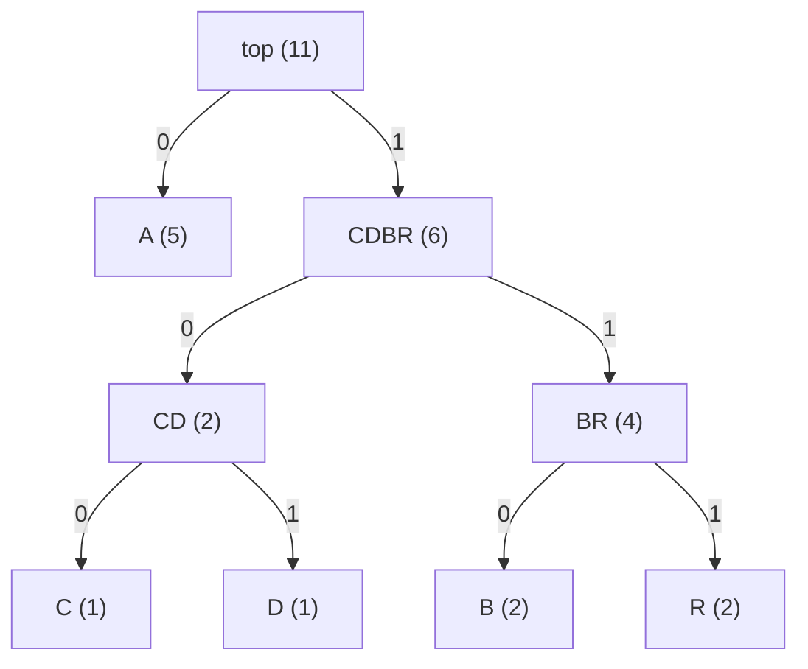
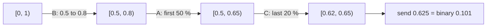
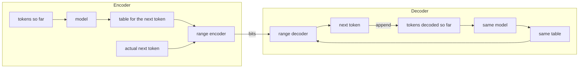
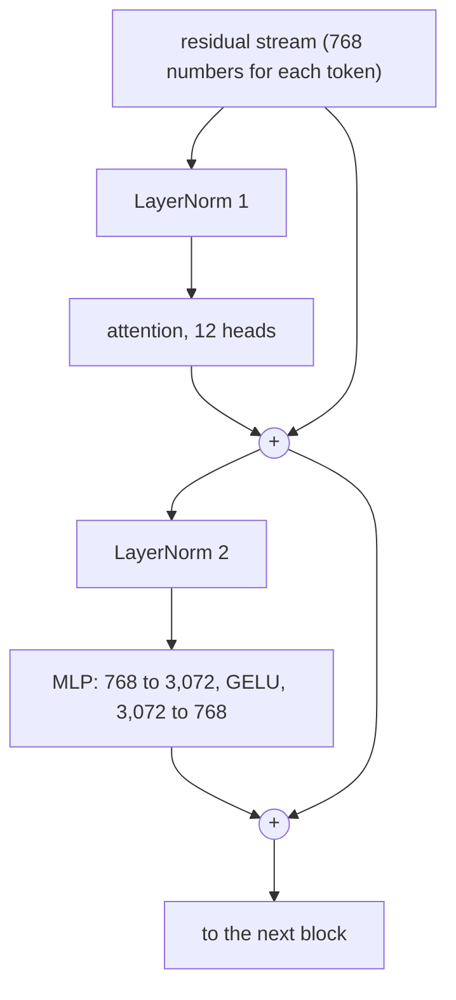
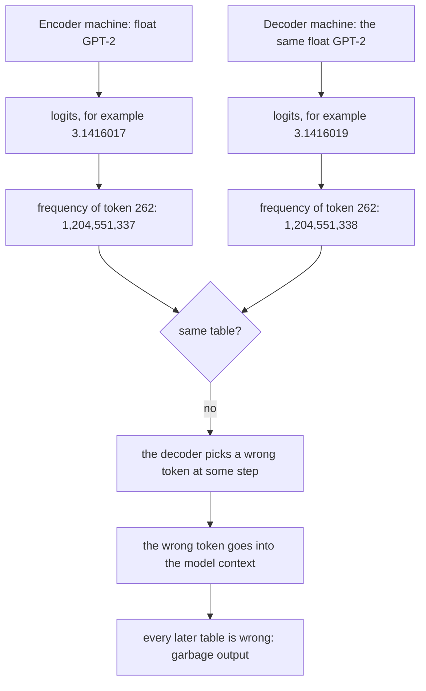
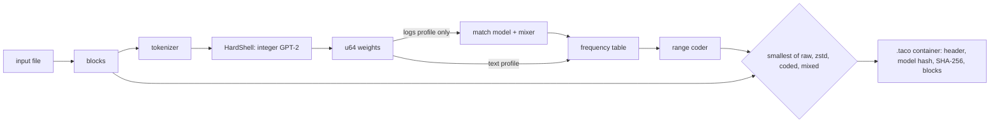

# Taco primer: the ideas behind Taco, from first principles

Date: 2026-10-19. Status: alpha (proof of concept), version 0.1.0. Companion of
[`core-architecture.md`](core-architecture.md), which explains how Taco works, end to end.

> **How this document was written.** Most of the code, the tests and the documents of this
> repository were written by Claude (an AI model by Anthropic) with Claude Code, under the
> direction of the author, to get to results faster. The author made the design decisions.
> The tests are the evidence, not the authorship.

**Summary.** Taco is a lossless compressor. A language model (GPT-2 small) predicts the next
piece of the data. A range coder then stores only the part of the data that the model did not
predict. A good prediction costs few bits, so predictable data becomes small. The encoder and
the decoder must calculate exactly the same predictions, bit for bit. Normal machine-learning
code uses floating-point numbers, and floating-point results change from one machine to
another. Thus a file that one machine compresses with a normal model often does not decompress
on another machine. Taco runs the model with integer arithmetic only. Integer results are the
same on every machine, so a Taco file decompresses everywhere. This primer explains every idea
that the [core architecture document](core-architecture.md) uses. It starts at bits and bytes and ends at the parts of Taco. It assumes no
knowledge of machine learning, compression or floating-point arithmetic.

**Reading guide.**

- Read the parts in order the first time. Each part uses the terms of the parts before it.
- Parts 1 to 4 explain compression. Part 4 (the range coder) is the most important part for
  Taco. Its last section shows why the decoder must have exactly the probabilities of the
  encoder.
- Parts 5 and 6 explain machine learning and language models. They give only what Taco needs.
- Part 7 explains how computers store numbers, and why floating-point results differ between
  machines. Part 8 joins parts 4 and 7: it shows the failure and the integer fix.
- Part 9 explains the other parts of Taco in simple words. Part 10 is a glossary.
- Every number has a label. **measured** means that the project measured it (the source is in
  [`docs/research/`](research/) or [`docs/adr/`](adr/)). **published** means that another person published it (the
  source is given). **est.** means an estimate. A number in a worked example that you can
  calculate by hand has no label: it is arithmetic, not a result.
- The words "fold" and "unfold" are the Taco names for compress and decompress.

---

## 1. Bits, bytes and information

### 1.1 A bit

A **bit** is the smallest unit of information. It has one of two values: 0 or 1. A computer
stores a bit as one of two physical states, for example a high or a low voltage.

One bit can tell you the result of one choice between two equal possibilities, for example
"heads or tails". Two bits can give 4 different values: 00, 01, 10, 11. Each added bit
doubles the number of values. Thus `n` bits give `2^n` different values.

| Bits | Different values |
|---:|---:|
| 1 | 2 |
| 2 | 4 |
| 8 | 256 |
| 16 | 65,536 |
| 32 | 4,294,967,296 |
| 64 | about 1.8 × 10^19 |

### 1.2 Binary numbers

Normal numbers are **decimal** (base 10). Each position has a value 10 times the value of the
position on its right: 305 = 3 × 100 + 0 × 10 + 5 × 1.

**Binary** numbers (base 2) use the same idea with 2. Each position has a value 2 times the
value of the position on its right.

Worked example: the binary number `1101`.

| Position value | 8 | 4 | 2 | 1 |
|---|---:|---:|---:|---:|
| Digit | 1 | 1 | 0 | 1 |
| Product | 8 | 4 | 0 | 1 |

The sum is 8 + 4 + 0 + 1 = 13. Thus binary `1101` is decimal 13.

Programmers also use **hexadecimal** (base 16), because one hexadecimal digit holds exactly 4
bits. The digits are 0 to 9 and A to F (A = 10, F = 15). `0xFF` is 15 × 16 + 15 = 255, which is
binary `11111111`. The prefix `0x` marks a hexadecimal number.

### 1.3 A byte

A **byte** is 8 bits. It has 2^8 = 256 values: 0 to 255. Almost all computers read and write
data in bytes. A file size is a number of bytes.

| Unit | Bytes |
|---|---:|
| 1 KB (kilobyte) | 1,000 |
| 1 KiB (kibibyte) | 1,024 |
| 1 MB | 1,000,000 |
| 1 MiB | 1,048,576 |

Taco uses both kinds. A block of "16 KiB" is 16,384 bytes. A speed of "2 KB/s" is 2,000
bytes each second.

### 1.4 Text encoding: ASCII

A computer stores only numbers. To store text, it gives each character a number. This mapping
is a **character encoding**.

**ASCII** (1963) is the oldest common encoding. It gives numbers 0 to 127 to the English
letters, the digits, punctuation and some control characters. One ASCII character uses one
byte.

| Character | ASCII number | Binary |
|---|---:|---|
| `A` | 65 | `01000001` |
| `a` | 97 | `01100001` |
| `0` | 48 | `00110000` |
| space | 32 | `00100000` |
| tab (`\t`) | 9 | `00001001` |
| line feed (`\n`) | 10 | `00001010` |
| carriage return (`\r`) | 13 | `00001101` |

Worked example: the word `Hi` is two bytes, 72 and 105.

Tab and carriage return are important later. GPT-2 gives them a very low probability in some
contexts, and that costs bits (part 9).

### 1.5 Text encoding: Unicode and UTF-8

ASCII has no Chinese, Hindi, Arabic or emoji characters. **Unicode** gives a number, a **code
point**, to more than 100,000 characters of all languages. A code point is written `U+` and a
hexadecimal number. `A` is U+0041. The Chinese character 你 ("you") is U+4F60.

A code point can be larger than 255, so it does not fit in one byte. **UTF-8** is the most
common way to store code points as bytes. It uses 1 to 4 bytes for each character
(published, RFC 3629, <https://www.rfc-editor.org/rfc/rfc3629>):

| Code points | Bytes | Bit pattern | Examples |
|---|---:|---|---|
| U+0000 to U+007F | 1 | `0xxxxxxx` | ASCII: English letters, digits |
| U+0080 to U+07FF | 2 | `110xxxxx 10xxxxxx` | é, ñ, Greek, Arabic, Hebrew |
| U+0800 to U+FFFF | 3 | `1110xxxx 10xxxxxx 10xxxxxx` | Chinese, Japanese, Hindi (Devanagari) |
| U+10000 to U+10FFFF | 4 | `11110xxx 10xxxxxx 10xxxxxx 10xxxxxx` | emoji |

The `x` positions hold the bits of the code point. The other bits mark the length.

**Why a Chinese character uses 3 bytes.** The common Chinese characters are at U+4E00 to
U+9FFF. This range is above U+07FF, so 2 bytes are not enough. It is below U+FFFF, so 3 bytes
are sufficient.

Worked example: 你 = U+4F60.

1. U+4F60 in binary (16 bits) is `0100 1111 0110 0000`.
2. Divide the bits into groups of 4, 6 and 6: `0100`, `111101`, `100000`.
3. Put the groups into the 3-byte pattern: `1110 0100`, `10 111101`, `10 100000`.
4. The bytes are `0xE4 0xBD 0xA0`.

The GPT-2 tokenizer of the project gives exactly these bytes for 你 (measured: tokens `E4 BD`
and `A0`, see section 6.2).

Two facts follow:

- An English text and a Chinese text with the same meaning have very different byte counts.
  Thus "bits per byte" (part 3) is a fair measure only for data of the same kind.
- Some byte sequences are not valid UTF-8, for example a cut in the middle of a character.
  A compressor must accept them too. Taco does (section 6.2).

### 1.6 What a file is

A **file** is a sequence of bytes with a length. The file system does not know what the bytes
mean. A text file, a photo and a program are all sequences of bytes. Only the program that
reads the file gives the bytes a meaning.

This fact is important for a compressor. A **lossless** compressor (part 2) must give back the
exact sequence of bytes, with the exact length. It must work for any sequence of bytes, also
for a sequence that is not valid text.

---

## 2. Compression from zero

### 2.1 What compression is

**Compression** changes a sequence of bytes into a shorter sequence. **Decompression** changes
it back. The program that does both is a **compressor**. Taco calls the two steps **fold** and
**unfold**.

The **compression ratio** compares the sizes. This primer uses two forms:

- the compressed size as a percentage of the original size (smaller is better);
- **bits per byte** (bpb): the number of compressed bits for each original byte. An
  uncompressed file has 8 bits per byte. A file at 2 bits per byte is 4 times smaller.

Worked example: a file of 32,768 bytes compresses to 8,432 bytes. That is 25.7 % of the
original size. In bits per byte: 8,432 × 8 / 32,768 = 2.06 bpb. (These are real Taco sizes
for the first 32 KiB of the English book `alice29.txt`, measured, README section "Results".)

### 2.2 Lossless and lossy

- A **lossless** compressor gives back the exact original bytes. zip, gzip, xz, zstd and Taco
  are lossless. Use lossless compression for text, programs, logs and databases: one wrong
  byte can break them.
- A **lossy** compressor gives back an approximation. JPEG (photos) and MP3 (music) are lossy.
  They remove details that a person does not see or hear.

Taco is lossless. Every claim in this primer and in the core architecture document is about lossless compression.

### 2.3 Redundancy

Compression is possible only when the data has **redundancy**: a part that you can guess from
the other parts. Examples:

- In English, `q` is almost always followed by `u`. The `u` carries almost no new information.
- A log file repeats the same line template thousands of times, with only some fields changed.
- A table of numbers in text uses only 11 of the 256 byte values (digits and a separator).

A compressor finds the redundancy and stores only the information that is not redundant.
Different compressors find different kinds of redundancy. That is the main difference between
them.

### 2.4 Run-length encoding

**Run-length encoding** (RLE) is the simplest compressor. It replaces a run of equal symbols
with a count and the symbol.

Worked example:

```
input:   WWWWWWWWWWWWBWWWWWWWWWWWWBBBWWWWWWWWWWWWWW   (42 characters)
output:  12W1B12W3B14W                                 (13 characters)
```

The decoder reads "12W" and writes 12 W characters, and so on. The output is exact.

RLE works only on long runs. On normal English text, it makes the data larger:
`Hello` becomes `1H1e2l1o` (8 characters from 5). This shows a general rule: each compressor
expects a kind of redundancy. When the data does not have it, the compressor loses.

### 2.5 Why random data cannot be compressed: the pigeonhole argument

No lossless compressor can make every input smaller. The proof is a counting argument (the
**pigeonhole principle**: if you put more pigeons than holes into holes, one hole gets two
pigeons).

1. Take all inputs of exactly `n` bits. There are `2^n` of them.
2. Count all outputs that are shorter than `n` bits: lengths 0, 1, ..., `n - 1`. There are
   `1 + 2 + 4 + ... + 2^(n-1) = 2^n - 1` of them.
3. `2^n` inputs and only `2^n - 1` shorter outputs: at least two inputs must get the same
   output, or at least one input must get an output that is not shorter.
4. If two inputs get the same output, the decoder cannot know which input to give back. That
   is not lossless. Thus at least one input does not become shorter.

Worked example with `n = 2`: there are 4 inputs (00, 01, 10, 11) and only 3 shorter outputs
(the empty output, 0, 1). One input cannot become shorter.

A stronger form of the argument shows that most inputs cannot become much shorter. Random
bytes have no redundancy, so on average no compressor can make them smaller.

**Consequence for Taco.** Some inputs become larger. Taco limits this damage: a block that
does not become smaller is stored raw (unchanged), with a small header (part 9). In the
cross-machine check, 3,000 random bytes became 3,093 bytes (measured,
[`docs/research/2026-10-18-cross-machine.md`](research/2026-10-18-cross-machine.md)): 3,000 bytes of data and 93 bytes of container.

### 2.6 Dictionary methods: LZ77

Many files repeat strings. A **dictionary method** replaces a repeat with a reference to the
earlier copy. **LZ77** (Ziv and Lempel, 1977, published, *IEEE Transactions on Information
Theory* 23(3)) is the base of most general compressors.

LZ77 writes two kinds of items:

- a **literal**: one byte, copied as it is;
- a **match**: "go back `d` bytes and copy `L` bytes". The pair `(d, L)` is the distance and
  the length.

Worked example: the input `abcabcabcabcx` (13 bytes).

| Step | Output item | Text written so far |
|---|---|---|
| 1 | literal `a` | `a` |
| 2 | literal `b` | `ab` |
| 3 | literal `c` | `abc` |
| 4 | match (distance 3, length 9) | `abcabcabcabc` |
| 5 | literal `x` | `abcabcabcabcx` |

Step 4 copies one byte at a time from 3 bytes back. The copy reads bytes that it wrote itself
in the same step. That is permitted, and it makes long repeats cheap. The output has 5 items
for 13 bytes.

The compressors in the benchmark use LZ77 with different additions:

| Compressor | Method (published) |
|---|---|
| gzip | DEFLATE: LZ77 with a window of 32 KiB, then Huffman codes (RFC 1951) |
| zstd | LZ77 with a large window, then Huffman codes and finite-state entropy codes (RFC 8878) |
| xz | LZMA2: LZ77 with a large window, then a range coder with context models |
| brotli | LZ77, Huffman codes, context models and a built-in dictionary of common strings |

### 2.7 Huffman coding

ASCII gives every character 8 bits. But some characters are much more common than others. A
**Huffman code** (Huffman, 1952, published, *Proceedings of the IRE* 40(9)) gives a short code
to a common symbol and a long code to a rare symbol.

The algorithm:

1. Count each symbol.
2. Put each symbol in a list as a tree with one node.
3. Take the two trees with the smallest counts. Join them under a new node. The count of the
   new node is the sum.
4. Do step 3 again until one tree remains.
5. The code of a symbol is the path from the top: 0 for left, 1 for right.

Worked example: the word `ABRACADABRA` (11 letters). The counts are A 5, B 2, R 2, C 1, D 1.

1. Join C (1) and D (1) into CD (2).
2. Join B (2) and R (2) into BR (4).
3. Join CD (2) and BR (4) into CDBR (6).
4. Join A (5) and CDBR (6) into the top (11).



| Symbol | Count | Code | Bits |
|---|---:|---|---:|
| A | 5 | `0` | 5 × 1 = 5 |
| B | 2 | `110` | 2 × 3 = 6 |
| R | 2 | `111` | 2 × 3 = 6 |
| C | 1 | `100` | 1 × 3 = 3 |
| D | 1 | `101` | 1 × 3 = 3 |
| **Total** | 11 | | **23 bits** |

ASCII needs 11 × 8 = 88 bits. Huffman needs 23 bits. No code is the start of another code
(a **prefix code**), so the decoder can read the bits from left to right with no separators.

A Huffman code has one limit. Each symbol costs a whole number of bits: at least 1 bit. A
symbol with a probability of 99 % still costs 1 bit, but its information is only about 0.015
bits (part 3). Arithmetic and range coding (part 4) remove this limit. That is why Taco uses a
range coder.

### 2.8 Context models and context mixing

LZ77 and Huffman look at repeats and at symbol counts. A stronger method predicts each symbol
from the symbols before it (its **context**). This is a **context model**. Example: after
`th`, the letter `e` is very likely.

**PPM** (prediction by partial matching) uses the last few symbols as context. 7-Zip has a PPM
compressor (PPMd). **Context mixing** (CM) runs many models at the same time and mixes their
predictions with learned weights. **paq8px** and **cmix** are strong CM compressors. They are
very slow.

Taco belongs to this family. Its main model is a neural network (GPT-2), and the `logs`
profile mixes it with a match model (part 9).

### 2.9 The speed and ratio trade-off

A compressor that looks harder for redundancy gives smaller files, but it takes more time.
The project measured this on 23 whole files (8,001,310 bytes) on devbox (measured,
[`docs/research/2026-10-19-benchmark.md`](research/2026-10-19-benchmark.md) §5.8 and §6.2):

| Compressor | Bits per byte (smaller is better) | Compress speed (KB/s) | Decompress speed (KB/s) | Peak memory (MiB) |
|---|---:|---:|---:|---:|
| gzip -9 | 2.257 | 4,645 | 43,732 | 2 |
| zstd -19 | 1.740 | 662 | 27,324 | 56 |
| xz -9e | 1.685 | 671 | 23,098 | 89 |
| bzip2 -9 | 1.673 | 5,635 | 7,332 | 8 |
| 7z PPMd | 1.588 | 2,204 | 2,028 | 61 |
| paq8px -8 | **1.141** | 5.77 | 6.23 | 2,276 |

paq8px gives files about 32 % smaller than xz, but it is about 116 times slower to compress and
about 3,700 times slower to decompress (calculated from the table).

Taco is at the slow end too. On the 23 samples of 32 KiB, Taco gave 1.667 bpb, brotli 1.783
and paq8px 1.320 (measured, benchmark §4.8). The CPU engine of Taco folded at about 1.09 KB/s
and unfolded at 0.325 KB/s for each process of 2 threads (measured, benchmark §6.1). On an
RTX 3060 Laptop GPU at 95 W, the command folds English text at 85 to 129 KB/s and unfolds it
at 26 to 31 KB/s (measured, [`docs/research/2026-10-19-full-power.md`](research/2026-10-19-full-power.md) §2). Taco is
smaller than paq8px on English, code and HTML samples, and larger on logs, JSON, other
languages and binary data (measured, benchmark §4.9). The [core architecture document](core-architecture.md#82-compression-against-other-compressors) gives the full comparison.

---

## 3. Information theory

### 3.1 Probability

A **probability** is a number from 0 to 1. It says how likely an event is. 0 means "never". 1
means "always". The probabilities of all possible results of one event add up to 1.

- A fair coin: P(heads) = 0.5, P(tails) = 0.5.
- A fair six-sided die: P(each face) = 1/6.
- The next letter in English text after `q`: P(`u`) is near 1.

A **probability distribution** is the list of the probabilities of all possible results. A
language model gives a distribution over 50,257 tokens at each step (part 6).

### 3.2 Surprise: −log2(p)

Shannon (1948, published, "A Mathematical Theory of Communication", *Bell System Technical
Journal* 27) defined the **information** of an event with probability `p` as

```
surprise = −log2(p) bits
```

`log2(x)` is the power of 2 that gives `x`. log2(8) = 3, because 2^3 = 8. log2(0.5) = −1,
because 2^−1 = 0.5.

| Probability `p` | Surprise −log2(p) |
|---:|---:|
| 1 | 0 bits |
| 0.5 | 1 bit |
| 0.25 | 2 bits |
| 0.1 | 3.32 bits |
| 0.01 | 6.64 bits |
| 2^−32 (about 2.3 × 10^−10) | 32 bits |

Read the table like this: an event that is certain gives no information. A rare event gives
much information. Each halving of the probability adds 1 bit.

The key fact for compression: **a symbol with probability `p` can be stored in about
−log2(p) bits.** Part 4 shows how. Thus a good prediction (a high `p` for the actual symbol)
costs few bits.

### 3.3 Entropy

The **entropy** `H` of a distribution is the average surprise:

```
H = sum over all results i of  p(i) × (−log2 p(i))
```

Entropy is the smallest average number of bits for each symbol that any lossless code can
reach, if the symbols come from that distribution (Shannon's source coding theorem, published,
Shannon 1948).

**Worked example 1: a fair coin.** H = 0.5 × 1 + 0.5 × 1 = 1 bit for each toss. You cannot
store fair coin tosses in less than 1 bit each.

**Worked example 2: a biased coin.** P(heads) = 0.9, P(tails) = 0.1.

- Surprise of heads: −log2(0.9) = 0.152 bits.
- Surprise of tails: −log2(0.1) = 3.322 bits.
- H = 0.9 × 0.152 + 0.1 × 3.322 = 0.137 + 0.332 = 0.469 bits.

Thus 1,000 tosses of this coin can be stored in about 469 bits, not 1,000 bits. A Huffman code
cannot do this: it must give each toss at least 1 bit. A range coder can (part 4).

**Worked example 3: `ABRACADABRA`.** The counts are A 5, B 2, R 2, C 1, D 1 (section 2.7).
With p(A) = 5/11 and so on, H = 2.040 bits for each letter, or 22.4 bits for the 11 letters.
The Huffman code used 23 bits, near this limit.

**Worked example 4: English letters.** Shannon measured English in 1951 (published, "Prediction
and Entropy of Printed English", *Bell System Technical Journal* 30, pp. 50 to 64):

| Model of English | Bits for each letter (published, Shannon 1951) |
|---|---:|
| 26 letters, all equally likely (log2 26) | 4.70 |
| Letter frequencies only (`e` is common, `z` is rare) | 4.14 |
| The letter before is known (pairs) | 3.56 |
| The two letters before are known (triples) | 3.3 |
| Long context (up to 100 letters), from people who guessed the next letter | about 1 |

The table shows the main idea of this primer. **The more context a predictor uses, the
smaller the entropy, and the fewer bits the data needs.** People who know English predict the
next letter well, so English needs only about 1 bit for each letter, not 4.7. A language model
is a machine that predicts like this person.

### 3.4 Cross-entropy: the cost of a wrong model

A compressor does not know the true distribution `p` of the data. It uses a model `q`. The
average cost is then the **cross-entropy**:

```
cost = sum over i of  p(i) × (−log2 q(i))
```

The data comes from `p`, but each symbol costs −log2 of the model probability `q`.

Worked example: the biased coin of section 3.3, with P(heads) = 0.9.

| Model `q` of P(heads) | Cost for each toss |
|---:|---:|
| 0.5 (the model knows nothing) | 0.9 × 1 + 0.1 × 1 = 1.000 bits |
| 0.8 (a fair model) | 0.9 × 0.322 + 0.1 × 2.322 = 0.522 bits |
| 0.9 (the true distribution) | 0.469 bits (the entropy) |

The cost is smallest when the model equals the truth. The extra cost of a wrong model is the
**Kullback–Leibler divergence** (KL divergence): here 0.522 − 0.469 = 0.053 bits for each
toss. In short:

```
average size = entropy of the data + KL divergence of the model
```

The project's verification note gives the same formula: expected size = H(p) + KL(p || q)
([`docs/research/2026-10-18-verification.md`](research/2026-10-18-verification.md) §1). A better model has a smaller KL divergence,
so it gives a smaller file. **A better prediction gives a smaller file.** This is the reason to
use a language model for compression.

The HardShell numerics ADR uses KL divergence to measure small errors. Example: the integer
softmax of attention differs from the float softmax by a mean of 8.0 × 10^−7 bits for each row
of 128 scores (measured, [ADR 0004](adr/0004-hardshell-numerics.md) §4).

### 3.5 Bits per byte and bits per token

The results of the project use **bits per byte** (bpb): the total compressed bits divided by
the number of original bytes. This measure is fair between compressors that cut the data into
different pieces.

A language model works on **tokens** (part 6), not bytes. Its loss is often given in bits per
token or in **nats** per token (a nat uses the natural logarithm: 1 nat = 1.443 bits). To get
bits per byte, multiply the bits per token by the number of tokens and divide by the number of
bytes.

Worked example: the integer GPT-2 of Taco gives 1.871 bpb on 16 held-out text files (measured,
[`docs/research/2026-10-18-integer-gpt2.md`](research/2026-10-18-integer-gpt2.md)). 8 / 1.871 = 4.28, so the text becomes about 4.3
times smaller. xz gave 2.508 bpb on similar files in phase 0 (measured), or 3.19 times smaller.

### 3.6 The cost of the model itself

A compressor with a model must have the model at both ends. The model of Taco is
`gpt2.hsm`, 127,237,568 bytes (measured). It is not in the compressed file. The container
stores only its SHA-256 hash (part 9). The cost of the model is paid one time, for all files.

Delétang et al. make the same point (published, "Language Modeling Is Compression", arXiv
2309.10668, 2023, <https://arxiv.org/abs/2309.10668>). Chinchilla 70B compressed enwik9 (1 GB of
Wikipedia) to 8.3 % of its size, against 32.3 % for gzip. With the size of the model counted,
the result was 14,008.3 % (published, Table 1). Thus a model-based compressor is useful only
when many files share one model.

---

## 4. Arithmetic and range coding

### 4.1 The idea: one number for the whole message

An **arithmetic coder** stores a whole message as one number between 0 and 1. It starts with
the interval [0, 1). For each symbol, it divides the current interval into parts. Each part
has a width in proportion to the probability of a symbol. Then the coder keeps only the part
of the actual symbol. At the end, any number inside the last interval identifies the message.

A symbol with a high probability keeps a wide part, so the interval shrinks only a little. A
symbol with a low probability keeps a narrow part. The final width is the product of the
probabilities of all symbols. To name a number inside an interval of width `w`, you need about
−log2(w) bits. That is the sum of the surprises of the symbols. Thus arithmetic coding reaches
the entropy limit of part 3, and it can use less than 1 bit for a symbol.

### 4.2 A worked example by hand

The alphabet has three symbols with fixed probabilities:

| Symbol | Probability | Part of [0, 1) |
|---|---:|---|
| A | 0.5 | [0, 0.5) |
| B | 0.3 | [0.5, 0.8) |
| C | 0.2 | [0.8, 1.0) |

The message is `BAC`. Notation: [low, high). The width is high − low.

**Encoder.**

1. Start: [0, 1). Width 1.
2. Symbol B: B owns [0.5, 0.8) of the interval. New interval [0.5, 0.8). Width 0.3.
3. Symbol A: A owns the first 50 % of the current width. 0.5 + 0.3 × 0 = 0.5, and
   0.5 + 0.3 × 0.5 = 0.65. New interval [0.5, 0.65). Width 0.15.
4. Symbol C: C owns 80 % to 100 % of the current width. 0.5 + 0.15 × 0.8 = 0.62, and
   0.5 + 0.15 × 1.0 = 0.65. New interval [0.62, 0.65). Width 0.03.



The final width is 0.3 × 0.5 × 0.2 = 0.03. Its surprise is −log2(0.03) = 5.06 bits.

The encoder now picks a number in [0.62, 0.65) with few binary digits. 0.625 is binary 0.101
(1/2 + 1/8). It is in the interval, so the encoder sends the 3 bits `101`. (Here the coder was
lucky. In general, it needs about −log2(width) + 1 to 2 bits.)

**Decoder.** It receives 0.625 and knows that the message has 3 symbols. It uses the same
table.

1. 0.625 is in [0.5, 0.8), the part of B. Output B. Rescale into the part:
   (0.625 − 0.5) / 0.3 = 0.4167.
2. 0.4167 is in [0, 0.5), the part of A. Output A. Rescale: (0.4167 − 0) / 0.5 = 0.8333.
3. 0.8333 is in [0.8, 1.0), the part of C. Output C.

The output is `BAC`. The decoder needs two facts from outside the bits: the table at each step,
and the number of symbols. Taco stores the number of tokens in each block ([ADR 0007](adr/0007-coded-block-payload.md)).

### 4.3 A changing table at each step

In the example, the table was the same at every step. That is not necessary. The coder can
use a different table for each symbol, if the decoder can make the same table at the same
step. A context model or a language model gives a new table for each symbol, from the symbols
before it. The decoder has already decoded those symbols, so it can run the same model and get
the same table.

This is the full idea of Taco:



### 4.4 Why real coders use integers: the range coder

The hand example used exact decimal fractions. A real message has millions of symbols. The
interval becomes too narrow for any fixed-size number. A float (part 7) has only about 7 or 16
significant decimal digits. After a few dozen symbols, it cannot tell the ends of the interval
apart.

A **range coder** (Martin, 1979, published) solves this with integers and **renormalisation**:

- It keeps the interval as two integers: `low` (the start) and `range` (the width).
- When `range` becomes small, the top digits of `low` cannot change any more. The coder writes
  them out and multiplies `low` and `range` by the base. This is renormalisation.

Worked example with decimal digits. The state has 3 digits: `range` starts at 1,000. The table
uses integer **frequencies** with the total 10: A = 5, B = 3, C = 2. The **start** of a symbol
is the sum of the frequencies before it: start(A) = 0, start(B) = 5, start(C) = 8.

The encoder rule for a symbol `s` (total `T`):

1. `r = range / T` (integer division).
2. `low = low + r × start(s)`.
3. `range = r × freq(s)`.

Code `BAC` again:

| Step | `r` | `low` | `range` | Interval |
|---|---:|---:|---:|---|
| start | | 0 | 1,000 | [0, 1000) |
| B: start 5, freq 3 | 100 | 0 + 500 = 500 | 300 | [500, 800) |
| A: start 0, freq 5 | 30 | 500 + 0 = 500 | 150 | [500, 650) |
| C: start 8, freq 2 | 15 | 500 + 120 = 620 | 30 | [620, 650) |

Now `range` = 30 is less than 100. Every number in [620, 650) starts with the digit 6. That
digit is final. The coder writes `6`, removes it from `low`, and multiplies by 10: `low` = 200,
`range` = 300. This is renormalisation. The coder can continue with a wide range again.

To finish, the coder writes enough digits to name a number in [200, 500), for example `2`. The
output is `62`, which means 0.62. It is in [0.62, 0.65), the interval of the hand example.

The Taco coder uses the same steps with larger numbers (measured design, [ADR 0003](adr/0003-range-coder.md)):

- the base is 256 (one byte), not 10;
- `range` is a 64-bit integer, and it stays at 2^56 or more after renormalisation;
- `low` holds 64 bits and a **carry** bit. Sometimes an addition to `low` changes a digit that
  the coder thought was final (for example 699 + 1 = 700). The coder holds such digits back
  until the carry is known;
- the table total `T` is 2^32, so `range / T` is a shift by 32 bits.

The integer coder of Taco loses almost nothing against the ideal size. On 270 windows of text,
it wrote 379,340 bytes. The ideal size with the same tables was 379,259.4 bytes. The difference
is 80.6 bytes, or 0.021 % (measured, [`docs/research/2026-10-18-phase0-baseline.md`](research/2026-10-18-phase0-baseline.md) §5).

### 4.5 The frequency table and the rule "every symbol gets at least 1"

The coder needs integer frequencies, not probabilities. Taco converts the model output into a
**frequency table**: one integer for each of the 50,257 tokens, with the total `T = 2^32`
(plan §5.1).

The conversion gives every token a frequency of at least 1:

```
f[i] = 1 + floor(w[i] × (T − V) / W)
```

Here `w[i]` is the weight of token `i` from the model, `W` is the sum of all weights, and `V`
is the number of tokens. The remainder `T − sum(f)` goes to the token with the largest weight.
All steps are integer operations.

Why at least 1? A symbol with frequency 0 has an interval of width 0. The coder cannot code it.
If the model gives a token a probability of 0, and that token then occurs in the data, the
encoder fails. With a minimum of 1, every token can be coded, so **any input can be
compressed**. The worst cost of a token is about −log2(1 / 2^32) = 32 bits.

This rule mattered in practice. GPT-2 gives tab and carriage-return tokens a probability below
2^−32 in some contexts. One tab cost 119 bits in the float model (measured). The minimum
frequency limits it to about 32 bits (phase 0 note §5).

### 4.6 The key fact: the decoder needs exactly the same table

The decoder does not see the symbols. It sees only a number, and it finds the symbol from the
parts of the interval. If the decoder's parts are not exactly the encoder's parts, it can pick
the wrong symbol. Then it feeds the wrong symbol to its model, so the next table is also wrong.
From that point, all output is garbage. The decoder does not notice: it always outputs
something.

**Worked example: a mismatch of one unit.** Take the decimal coder of section 4.4. The encoder
used A = 5, B = 3, C = 2 and sent 0.62. Suppose the decoder computes a slightly different
table: A = 5, B = 2, C = 3. Only one unit of 10 moved from B to C.

| Step | Decoder's parts | Value | Decoded | Correct |
|---|---|---:|---|---|
| 1 | A [0, 0.5), B [0.5, 0.7), C [0.7, 1) | 0.62 | B | B |
| 2 | rescale (0.62 − 0.5) / 0.2 = 0.60 | 0.60 | B (0.5 to 0.7) | A |
| 3 | rescale (0.60 − 0.5) / 0.2 = 0.50 | 0.50 | B | C |

The first symbol is still right, by chance. The second symbol is wrong. In a real system, the
model then sees the wrong symbol, and every later table is different too. The output is `BBB`
instead of `BAC`.

A mismatch does not always break the decode at once. A value far from a border survives a
small change. But over thousands of symbols, one value always lands near a border. The project
saw both cases:

- In a pure-Python test, a change of only 10^−9 in the probabilities broke 13 of 50 decodes.
  In one case the first wrong byte was at byte 5,976 of 8,192 (measured,
  [`docs/research/2026-10-18-verification.md`](research/2026-10-18-verification.md) §2). A short test can miss the failure.
- With the float GPT-2, the Mac and devbox gave different tables in 4,096 of 4,096 steps. The
  first wrong byte was byte 0 or byte 2 in all 16 cross decodes (measured,
  [`docs/research/2026-10-19-float-drift-machines.md`](research/2026-10-19-float-drift-machines.md)).

The size of a mismatch does not matter. The largest probability difference between the two
machines was only 6.2 × 10^−5 (measured). But the table has a total of 2^32, so one count is
2.3 × 10^−10 of probability. A difference much smaller than 10^−5 still changes some counts.
**The decoder needs the same integers, not similar numbers.** Part 7 explains why
floating-point arithmetic cannot give this, and part 8 explains how Taco does.

---

## 5. Machine learning from zero

### 5.1 A model is a function with parameters

In machine learning, a **model** is a function. It takes an input and gives an output. The
function has adjustable numbers inside it: the **parameters**. The parameters decide what the
function does. **Training** is the search for good parameter values.

A simple example: a shop predicts its sales from the temperature. The model is

```
sales = a × temperature + b
```

`a` and `b` are the parameters. With `a` = 3 and `b` = 10, a day at 20 °C gives a prediction of
3 × 20 + 10 = 70 sales. Different values of `a` and `b` give different predictions.

### 5.2 A straight-line fit

Suppose the shop has data from three days:

| Temperature `x` | Sales `y` |
|---:|---:|
| 1 | 2 |
| 2 | 4 |
| 3 | 6 |

We look for the line that fits the data best. To compare two lines, we need a number that says
how bad a line is: the **loss**. A common loss is the **mean squared error**: for each data
point, take the error (prediction − true value), square it, and take the mean.

With the model `y = w × x` (one parameter `w`, no `b`):

- `w` = 1: the predictions are 1, 2, 3. The errors are −1, −2, −3. The loss is
  (1 + 4 + 9) / 3 = 4.67.
- `w` = 2: the predictions are 2, 4, 6. The errors are 0. The loss is 0.

`w` = 2 is the best value. Here you can see it. A real model has millions of parameters, so
you cannot see the best values. You need an algorithm: gradient descent (section 5.5).

### 5.3 A neuron

An artificial **neuron** is a small function:

1. Multiply each input by a **weight**.
2. Add the products and a **bias**.
3. Apply a **non-linear function** (the **activation function**) to the sum.

Worked example: inputs `x` = [1.0, 2.0], weights [0.5, −0.25], bias 0.1.

1. Products: 1.0 × 0.5 = 0.5, and 2.0 × (−0.25) = −0.5.
2. Sum and bias: 0.5 − 0.5 + 0.1 = 0.1.
3. Activation (here ReLU, which is max(0, x)): max(0, 0.1) = 0.1.

The weights and the bias are parameters. A **weight** is the name for a parameter that
multiplies an input. In this primer, "weights" also means "all the parameters of a model", as
in "the GPT-2 weights".

Why the non-linear function? Without it, a chain of neurons is only a chain of multiplications
and additions. That chain is again one straight line (or a flat plane). It cannot learn curved
relations. The non-linear function lets a network bend.

GPT-2 uses the **GELU** function (Hendrycks and Gimpel, 2016, published, arXiv 1606.08415).
GELU(x) = x × Φ(x), where Φ is the normal cumulative distribution function. Its values:
GELU(−1) = −0.159, GELU(0) = 0, GELU(1) = 0.841, and GELU(x) is close to x for a large
positive x. Taco stores GELU as a table (part 8), so you do not need its formula.

### 5.4 A layer: a matrix multiply and a non-linear function

A **layer** is many neurons that see the same inputs. The weights of all neurons together form
a **matrix**: a table of numbers with rows and columns. One row holds the weights of one
neuron. The calculation of all neurons at once is a **matrix–vector product**.

Worked example: a layer with 2 neurons and 3 inputs.

```
weights W = | 1   0   2 |      input x = | 3 |
            | 0  −1   1 |                | 4 |
                                         | 5 |

W × x = | 1×3 + 0×4 + 2×5    |   | 13 |
        | 0×3 + (−1)×4 + 1×5 | = |  1 |
```

Each output is a **dot product**: the sum of the products of a row and the input. Then the
layer adds the biases and applies the activation function to each output.

A layer with `n` inputs and `m` outputs has `n × m` weights and `m` biases. It does `n × m`
multiplications. GPT-2 has layers with 768 inputs and 3,072 outputs: 2,359,296 weights in one
layer. Almost all the time of a language model goes into these dot products. That is why the
precision of a dot product (part 7) matters so much.

A **deep** network has many layers in a chain. The output of one layer is the input of the
next layer. The values between the layers are the **activations**.

### 5.5 Training by gradient descent

**Gradient descent** finds good parameters step by step:

1. Start with some parameter values.
2. Calculate the loss on the training data.
3. Calculate the **gradient**: for each parameter, how fast the loss changes when the
   parameter changes a little. (This is the derivative from calculus.)
4. Move each parameter a small step against its gradient, so that the loss goes down.
5. Do steps 2 to 4 again many times.

The step size is the **learning rate**.

Worked example: the model `y = w × x` and the data of section 5.2. The loss is
L(w) = ((w×1 − 2)^2 + (w×2 − 4)^2 + (w×3 − 6)^2) / 3. Its derivative is

```
dL/dw = (2/3) × (1 + 4 + 9) × (w − 2) = (28/3) × (w − 2)
```

Start with `w` = 0 and a learning rate of 0.05. Each step does `w = w − 0.05 × dL/dw`.

| Step | Gradient at the old `w` | New `w` |
|---:|---:|---:|
| 1 | (28/3) × (0 − 2) = −18.667 | 0 + 0.933 = 0.933 |
| 2 | −9.956 | 1.431 |
| 3 | −5.310 | 1.697 |
| 4 | −2.832 | 1.838 |
| 5 | −1.510 | 1.914 |
| 6 | −0.806 | 1.954 |

`w` moves towards 2, the best value. Each step removes about 47 % of the remaining distance.

A real network does the same with millions of parameters. A method called
**backpropagation** calculates all gradients efficiently. Training uses huge amounts of data
and much compute. Taco never trains GPT-2. It uses the published weights. (The project did
fine-tune a smaller model on logs, "Route A", in `tools/`; see part 9.)

### 5.6 Training and inference

- **Training** changes the parameters. It needs the data, the gradients and much compute. It
  happens one time, before publication.
- **Inference** uses the fixed parameters to calculate outputs for new inputs. It does not
  change the parameters.

Taco does only inference. The encoder and the decoder run inference with the same fixed
parameters. This is important: only inference must be exactly the same on every machine.

### 5.7 Why GPT-2 small has 124 million parameters

**GPT-2 small** (Radford et al., 2019, published, "Language Models are Unsupervised Multitask
Learners", OpenAI) has these sizes (plan §6):

| Size | Value |
|---|---:|
| Vocabulary (tokens) | 50,257 |
| Width (numbers in the vector of one token) | 768 |
| Layers (transformer blocks) | 12 |
| Attention heads in each block | 12 |
| Inner width of the MLP | 3,072 |
| Context (positions) | 1,024 |

Part 6 explains each part. The parameters, counted from the published tensor shapes:

| Part | Calculation | Parameters |
|---|---|---:|
| Token embedding | 50,257 × 768 | 38,597,376 |
| Position embedding | 1,024 × 768 | 786,432 |
| Attention in one block | 768 × 2,304 + 2,304 + 768 × 768 + 768 | 2,362,368 |
| MLP in one block | 768 × 3,072 + 3,072 + 3,072 × 768 + 768 | 4,722,432 |
| Two LayerNorms in one block | 4 × 768 | 3,072 |
| One block (sum of the three rows above) | | 7,087,872 |
| 12 blocks | 12 × 7,087,872 | 85,054,464 |
| Final LayerNorm | 2 × 768 | 1,536 |
| **Total** | | **124,439,808** |

This is the "124M" of the name. The token embedding is also used again at the output (the
weights are **tied**), so it is counted one time. As float32 numbers (4 bytes each), the
weights use about 498 MB; the published file `model.safetensors` has 548,105,171 bytes
(measured, phase 0 note §4). As `i8` numbers (1 byte each), the Taco model file `gpt2.hsm` has
127,237,568 bytes (measured).

---

## 6. Language models

### 6.1 What a language model does

A **language model** gives a probability distribution for the next piece of text, from the
text before it. Example (measured with the float GPT-2, phase 0 note §2): after "The capital
of France is", GPT-2 small gave " the" the probability 0.085 and " Paris" 0.032. After "The
Eiffel Tower is in the city of", " Paris" was the most likely token (0.070).

A language model does not give one answer. It gives a probability to every possible next
token. That is exactly the input that a range coder needs (part 4).

### 6.2 Tokens and byte-level BPE

A model does not read characters. It reads **tokens**: pieces of text from a fixed list, the
**vocabulary**. A common word is often one token. A rare word is several tokens.

GPT-2 uses **byte-level BPE** (byte pair encoding). The vocabulary has 50,257 tokens:

- 256 tokens for the 256 single bytes. Thus any byte sequence can be written as tokens, also
  bytes that are not valid text.
- 50,000 tokens that are **merges**: each merge joins two existing tokens into a new token.
  For GPT-2, merge number `i` makes token 256 + `i` (measured, [ADR 0004](adr/0004-hardshell-numerics.md) addendum A).
- 1 special token, `<|endoftext|>` (id 50256). It marks the start of a text. Taco never writes
  it as data.

The tokenizer starts with single bytes. Then it applies the merges in a fixed order of
priority (the **merge rank**) until no merge applies.

Worked examples (measured with the tokenizer of `tools/baseline`):

| Text | Token ids | Token texts |
|---|---|---|
| `Hello world` | 15496, 995 | `Hello`, ` world` |
| `The cat sat on the mat.` | 464, 3797, 3332, 319, 262, 2603, 13 | `The`, ` cat`, ` sat`, ` on`, ` the`, ` mat`, `.` |
| `Taco folds files.` | 51, 10602, 38744, 3696, 13 | `T`, `aco`, ` folds`, ` files`, `.` |
| `unbelievably` | 403, 6667, 11203, 1346 | `un`, `bel`, `iev`, `ably` |
| `你好` (6 bytes of UTF-8) | 19526, 254, 25001, 121 | bytes `E4 BD`, `A0`, `E5 A5`, `BD` |

Note three facts:

- The space before a word is part of the token (` world`, not `world`).
- An English sentence of 23 bytes is 7 tokens: about 3.3 bytes for each token. For English, one
  token is about 3 to 4 bytes (README §1).
- Two Chinese characters use 4 tokens, and the tokens cut the UTF-8 characters in the middle.
  GPT-2 saw mostly English in training, so it has few tokens for Chinese. This is one reason
  why Taco is weaker on Chinese text (benchmark §7.2).

A log line shows the same effect for numbers. `2026-10-19 12:00:01 INFO dfs.DataNode:
Receiving block` (54 bytes) gives 21 tokens, because dates and numbers break into small
pieces (measured).

**Two rules of Taco about tokens (plan §10):**

1. The tokenizer must restore any byte string exactly. Byte-level BPE can, because every byte
   has a token.
2. The decoder never tokenizes. It changes each token id back to its bytes with the vocabulary
   of the model file. Thus the encoder can change its tokenization later, and old files stay
   readable.

### 6.3 Embeddings

A token id is only a number, for example 3797 for ` cat`. The model needs a richer form. An
**embedding** is a vector (a list of numbers) for each token. GPT-2 has a table of 50,257 rows
with 768 numbers each. The model looks up the row of each token.

The values of the table come from training. Tokens with similar use get similar vectors.

GPT-2 also adds a **position embedding**: one learned vector of 768 numbers for each of the
1,024 positions. Thus the same token at position 5 and at position 500 has different inputs.
This fact matters for the context overlap of Taco (part 9).

### 6.4 Attention, simply

The vector of each token passes through the layers. In each layer, **attention** lets each
token collect information from the tokens before it.

For each token, the model calculates three vectors with three matrix products:

- a **query** (q): "what do I look for?";
- a **key** (k): "what do I contain?";
- a **value** (v): "what do I give to a token that looks at me?".

The attention of one token:

1. Calculate a **score** for each earlier token: the dot product of my query with its key. A
   high score means a good match.
2. Change the scores into weights that are positive and add up to 1, with the softmax
   (section 6.6).
3. The output is the weighted sum of the values.

Worked example: a token looks at three earlier tokens. The scores are 2, 0 and 1. The softmax
gives the weights 0.665, 0.090 and 0.245. The values are [1, 0], [0, 1] and [1, 1]. The output
is

```
0.665 × [1, 0] + 0.090 × [0, 1] + 0.245 × [1, 1] = [0.910, 0.335]
```

The output is mostly the value of the first token, because its score was the highest.

A token can look only at itself and at earlier tokens, never at later tokens. This is
**causal** attention. It is necessary for compression: the decoder does not have the later
tokens yet.

GPT-2 runs 12 attention **heads** in parallel in each layer. Each head has its own query, key
and value matrices (64 numbers each), and can look for a different kind of relation.

### 6.5 The transformer block

GPT-2 is a **transformer** (Vaswani et al., 2017, published, "Attention Is All You Need",
arXiv 1706.03762). It is a chain of 12 equal **blocks**. Each block has four parts:

1. **LayerNorm** (Ba et al., 2016, published, arXiv 1607.06450). It rescales the vector of a
   token so that its numbers have the mean 0 and the standard deviation 1. Then it multiplies
   each number by a learned scale (`gamma`) and adds a learned shift (`beta`).
2. **Attention** (section 6.4).
3. A second LayerNorm.
4. An **MLP** (multi-layer perceptron): a layer from 768 to 3,072 numbers, the GELU function,
   and a layer from 3,072 back to 768 numbers.

The **residual** connection adds the output of attention and of the MLP to the input vector,
instead of replacing it. The vector that flows through the blocks is the **residual stream**.



Worked example of LayerNorm (without `gamma` and `beta`): the vector [1, 2, 3, 6].

1. Mean: (1 + 2 + 3 + 6) / 4 = 3.
2. Differences from the mean: [−2, −1, 0, 3].
3. Variance (the mean of the squares): (4 + 1 + 0 + 9) / 4 = 3.5.
4. Standard deviation: √3.5 = 1.871.
5. Result: [−2, −1, 0, 3] / 1.871 = [−1.069, −0.535, 0, 1.604].

LayerNorm needs a division and a square root. Part 8 shows how HardShell does both with
integers.

The full GPT-2 calculation for one token:

1. Look up the token embedding and add the position embedding.
2. Run the 12 blocks.
3. Run a final LayerNorm (`ln_f`).
4. Multiply by the token embedding table (the tied output matrix): one number for each of the
   50,257 tokens. These numbers are the **logits**.

### 6.6 Logits and softmax

The **logits** are scores, one for each token. They can be any real number. A higher logit
means a more likely token. The **softmax** changes logits into probabilities:

```
p(i) = exp(logit(i)) / sum over all j of exp(logit(j))
```

`exp(x)` is e^x, with e = 2.71828. It makes every value positive. The division makes the sum 1.

Worked example: three tokens with the logits 2.0, 1.0 and 0.1.

| Token | Logit | exp(logit) | Probability | Cost if it occurs: −log2(p) |
|---|---:|---:|---:|---:|
| 1 | 2.0 | 7.389 | 7.389 / 11.213 = 0.659 | 0.60 bits |
| 2 | 1.0 | 2.718 | 0.242 | 2.04 bits |
| 3 | 0.1 | 1.105 | 0.099 | 3.34 bits |
| Sum | | 11.213 | 1.000 | |

Programs subtract the largest logit first. exp(2.0 − 2.0) = 1, exp(1.0 − 2.0) = 0.368, and so
on. The probabilities do not change, and the exp values stay small. Taco does the same with
integers (plan §7.5 and §7.6).

GPT-2 does one softmax over 50,257 logits for each token. The attention does one softmax over
the scores of each head, for each token.

### 6.7 The context window

The **context** is the list of tokens that the model can see. GPT-2 has learned position
embeddings for 1,024 positions only, so its context is at most 1,024 tokens.

Taco puts `<|endoftext|>` at position 0 of each block. When the context is full, the context
starts again (plan §7.7). The first tokens after a restart have little context, so they cost
more bits. The context overlap of Taco keeps some old tokens at a restart (part 9).

### 6.8 The KV cache and why decoding is sequential

To predict token `n + 1`, the model needs the keys and the values of all tokens 0 to `n`, in
every layer. A naive program calculates them again for each new token. That repeats a lot of
work.

A **KV cache** keeps the keys and the values of the earlier tokens in memory. For each new
token, the model calculates only the new row, and reads the old keys and values from the cache.
For GPT-2, the cache holds 12 layers × 2 × 768 = 18,432 numbers for each token.

The decoder of a compressor has a hard limit: **it can run token `n + 1` only after it has
decoded token `n`**. The range decoder needs the table of step `n + 1`, the table needs the
model, and the model needs token `n` as input. Thus decoding is **sequential**: one model step
for each token, in order.

### 6.9 Prefill, decode and batching

- **Prefill** runs the model over many known tokens at once. The encoder knows all tokens of a
  block. Thus fold can run many tokens in one pass, as a matrix–matrix product. This uses the
  hardware well. Taco's fold runs chunks of 32 tokens ([ADR 0013](adr/0013-fast-paths-and-the-oracle.md)).
- **Decode** runs one token at a time. The decoder (unfold) must use decode, for the reason
  of section 6.8. One token is a matrix–vector product, which uses the hardware badly.
- **Batching** runs several independent sequences at the same time. Taco's blocks are
  independent, so the decoder can decode several blocks in **lanes**, one token of each block
  in each step. The work becomes a matrix–matrix product again.

The result: unfold is slower than fold. On whole `alice29.txt`, the CPU engine folded at 627
tokens/s and unfolded at 274 tokens/s on 4 processors (measured, benchmark §7.3). On the RTX
3060, the CUDA backend gave 12,012 to 22,355 tokens/s for prefill and 7,229 tokens/s for decode
over a full window of 1,024 tokens at batch 224 (measured, [`docs/research/2026-10-18-gpu-backend.md`](research/2026-10-18-gpu-backend.md);
8,691 to 9,195 tokens/s after the tuning of 2026-10-19 at a 45 W power limit, and 20,472 tokens/s
at 95 W, [`docs/research/2026-10-19-full-power.md`](research/2026-10-19-full-power.md)).

### 6.10 A language model is a predictor, and so a compressor

Put parts 3, 4 and 6 together:

1. A language model gives a probability for every possible next token.
2. A range coder stores a token with probability `p` in about −log2(p) bits.
3. Thus the size of a compressed text is the sum of the surprises of its tokens, under the
   model. This is the **cross-entropy** of the model on the text (section 3.4).
4. Training a language model makes exactly this number small. The training loss of a language
   model is the cross-entropy of the next token.

So **a better language model is a better compressor**, and the reverse. Delétang et al. state
and test this equivalence (published, "Language Modeling Is Compression", arXiv 2309.10668,
2023). In their tests, Chinchilla 70B, trained mainly on text, compressed ImageNet image
patches to 43.4 % of their raw size (PNG: 58.5 %) and LibriSpeech audio to 16.4 % (FLAC:
30.3 %) (published, abstract).

Taco measures the same effect. Float GPT-2 with the Taco coder gave 1.992 bpb on 16 text files,
against 2.508 for xz (measured, phase 0 note §4). The integer GPT-2 gave 1.871 bpb against 1.867
for the float model on the first 1,024 tokens of 16 held-out text files (measured, integer GPT-2
note §1).

---

## 7. Numbers inside computers and IEEE 754

### 7.1 Integers

An **integer** is a whole number: …, −2, −1, 0, 1, 2, …. A computer stores an integer in a
fixed number of bits. Rust names the types by the bit count:

| Type | Bits | Range |
|---|---:|---|
| `u8` | 8 | 0 to 255 |
| `i8` | 8 | −128 to 127 |
| `i16` | 16 | −32,768 to 32,767 |
| `i32` | 32 | −2,147,483,648 to 2,147,483,647 (about ±2.1 × 10^9) |
| `i64` | 64 | about ±9.2 × 10^18 |
| `u64` | 64 | 0 to about 1.8 × 10^19 |
| `i128`, `u128` | 128 | about ±1.7 × 10^38 |

`u` means unsigned (no negative values). `i` means signed.

The key property: **integer addition, subtraction and multiplication are exact, if the result
fits in the type.** Their result does not depend on the order. (2 + 3) + 4 and 2 + (3 + 4) are
both 9, on every machine, with every compiler.

### 7.2 Two's complement

Computers store signed integers in **two's complement**. In 8 bits:

| Bits | Value as `u8` | Value as `i8` |
|---|---:|---:|
| `00000000` | 0 | 0 |
| `00000001` | 1 | 1 |
| `01111111` | 127 | 127 |
| `10000000` | 128 | −128 |
| `11111110` | 254 | −2 |
| `11111111` | 255 | −1 |

The rule: the top bit has the value −128 instead of +128. Thus `11111111` is
−128 + 64 + 32 + 16 + 8 + 4 + 2 + 1 = −1. To negate a number, invert all bits and add 1.

The advantage: the hardware adds signed and unsigned numbers with the same circuit.

### 7.3 Overflow and wrapping

An **overflow** occurs when a result does not fit in its type. Example: in `i8`, 127 + 1 = 128,
but 128 is not in the range. The bits of the sum are `10000000`, which is −128 as `i8`. The
value **wraps** around.

Different languages handle overflow differently:

- In C and C++, overflow of a signed integer is **undefined behaviour** (published, ISO C
  standard). The compiler may assume that it never occurs, and the program can then do
  anything.
- In Rust, every case is defined. `wrapping_add` wraps. `checked_add` returns "no value" on an
  overflow. A plain `+` stops the program in a debug build and wraps in a release build.

Taco requires one defined result for each operation ([`CLAUDE.md`](../CLAUDE.md) §1 rule 2). The code uses
`wrapping_*` or `checked_*`, or a written bound (`INVARIANT:`) that proves that overflow cannot
occur. Example (plan §7.1): an `i8 × i8` product is at most 128 × 128 = 2^14 in absolute value.
A dot product of 3,072 such products is less than 2^26, so it fits in an `i32` with room.

**Integer division** also needs a rule. 7 / 2 = 3.5 is not an integer. Most languages
**truncate** towards 0: 7 / 2 = 3 and −7 / 2 = −3. The **floor** rule rounds down: floor(−3.5)
= −4. Both are valid rules, but the encoder and the decoder must use the same rule. Taco uses
only the floor rule for signed values (`floor_div`, plan §7.2). An **arithmetic shift right**
by `s` bits is a floor division by 2^s: −7 >> 1 = −4.

### 7.4 Fixed-point numbers

A **fixed-point** number is an integer with an agreed scale. Money is the common example: store
$3.25 as the integer 325 cents. The scale is 1/100.

Computers use a scale that is a power of 2, so that a shift changes it. In a "Q8" format, the
scale is 1/256.

Worked example:

1. 3.25 in Q8 is 3.25 × 256 = 832.
2. 2.5 in Q8 is 2.5 × 256 = 640.
3. Product: 832 × 640 = 532,480. This has the scale 1/256 × 1/256 = 1/65,536.
4. Shift right by 8 bits to get Q8 again: 532,480 / 256 = 2,080.
5. 2,080 / 256 = 8.125. And 3.25 × 2.5 = 8.125. Correct.

Fixed-point arithmetic is integer arithmetic, so it is exact and the same on every machine. Its
limit: the scale is fixed. A small value loses precision, and a large value can overflow. The
designer must choose the scale for each quantity. HardShell is a fixed-point engine in this
sense (part 8).

### 7.5 Floating-point numbers: the idea

A **floating-point** number (a **float**) stores a value like scientific notation: a number of
significant digits and a power. In decimal: 6.02 × 10^23 or 1.6 × 10^−19. The "point" moves
("floats") with the power. Thus one format holds very large and very small numbers.

Computers use base 2 and the **IEEE 754** standard (published, IEEE Std 754-2019; first edition
1985). The two common formats:

| Format | Total bits | Sign | Exponent | Fraction (mantissa) | Significant decimal digits |
|---|---:|---:|---:|---:|---:|
| float32 (single) | 32 | 1 | 8 | 23 | about 7 |
| float64 (double) | 64 | 1 | 11 | 52 | about 16 |

Machine learning mostly uses float32, or smaller formats (float16, bfloat16).

### 7.6 The fields of a float32

A float32 has three fields:

```
| sign (1 bit) | exponent (8 bits) | fraction (23 bits) |
```

For a **normal** number, the value is

```
value = (−1)^sign × 1.fraction (binary) × 2^(exponent − 127)
```

- **Sign**: 0 for positive, 1 for negative.
- **Exponent** with a **bias**: the field stores `exponent + 127`. Thus the field 127 means
  2^0, the field 128 means 2^1, and the field 123 means 2^−4. The bias lets the field be an
  unsigned number.
- **Fraction** (also **mantissa**): the bits after the binary point. The leading `1.` is not
  stored, because a normal number always has it. Thus a float32 has 24 significant bits.

Worked example: 1.0 is `1.0 × 2^0`. Sign 0, exponent field 127 (`01111111`), fraction 0. The
bits are `0 01111111 00000000000000000000000` = `0x3F800000`.

Worked example: −6.5. 6.5 = 110.1 in binary = 1.101 × 2^2. Sign 1, exponent field 129
(`10000001`), fraction `101` and 20 zeros.

### 7.7 Special values: zero, subnormal numbers, infinity and NaN

The exponent fields 0 and 255 have special meanings:

| Exponent field | Fraction | Meaning |
|---|---|---|
| 0 | 0 | zero (+0 or −0) |
| 0 | not 0 | **subnormal** number: 0.fraction × 2^−126 |
| 1 to 254 | any | normal number |
| 255 | 0 | +infinity or −infinity |
| 255 | not 0 | NaN ("not a number"), for example 0/0 |

The smallest positive normal float32 is 2^−126 ≈ 1.18 × 10^−38. Below it, **subnormal**
numbers fill the gap to 0. They have no leading 1, so they have fewer significant bits. The
smallest subnormal is 2^−149 ≈ 1.4 × 10^−45. The largest float32 is about 3.40 × 10^38.

Subnormal numbers matter for this primer because some hardware handles them differently. A GPU
or a CPU in a fast mode can "flush" subnormal numbers to 0. Then two machines give different
results for the same very small value.

### 7.8 How 0.1 is stored

0.1 has no exact binary form, as 1/3 has no exact decimal form (0.333…). In binary,
0.1 = 0.000110011001100110011…, with `0011` repeated for ever.

Worked example: float32 0.1.

1. Write 0.1 as 1.6 × 2^−4. The exponent field is −4 + 127 = 123 = `01111011`.
2. 1.6 in binary is 1.1001 1001 1001 1001 1001 1001 1001… .
3. Keep 23 fraction bits: `10011001100110011001100`. The next bits are `11001…`, which is more
   than half of the last kept bit. Round up: `10011001100110011001101`.
4. The bits are `0 01111011 10011001100110011001101` = `0x3DCCCCCD`.

The stored value is not 0.1. It is exactly

```
0.100000001490116119384765625
```

(measured with Python; the error is about 1.5 × 10^−9). In float64, 0.1 is exactly
0.1000000000000000055511151231257827021181583404541015625.

Every float is an exact number. The float32 0.1 is exactly 13,421,773 × 2^−27: the 24-bit
integer `110011001100110011001101` (13,421,773) times a power of 2. This fact is the base of the
exact converter of Taco (part 8).

### 7.9 Rounding: round to nearest, ties to even

The exact result of an operation on two floats usually has more bits than the format holds.
IEEE 754 requires that `+`, `−`, `×`, `/` and the square root give the **correctly rounded**
result: the exact result, rounded to a float by the current rounding rule. The default rule is
**round to nearest, ties to even**:

- Round to the nearest float.
- If the exact result is exactly halfway between two floats (a **tie**), take the float whose
  last bit is 0 (the "even" one).

Ties to even avoids a bias. In decimal, with rounding to whole numbers: 2.5 → 2, 3.5 → 4,
4.5 → 4, 5.5 → 6. Half of the ties go up and half go down. (The rule "round half up" sends all
of them up: 2.5 → 3, 3.5 → 4.)

### 7.10 The ulp

The **ulp** (unit in the last place) is the gap between a float and the next float. It depends
on the size of the number:

| Value (float32) | ulp |
|---|---|
| 1.0 | 2^−23 ≈ 1.19 × 10^−7 |
| 0.1 | 2^−27 ≈ 7.45 × 10^−9 |
| 16,777,216 (2^24) | 2 |

Above 2^24, a float32 cannot hold every integer. 16,777,216 + 1 gives 16,777,216 in float32
(measured with NumPy): the exact result 16,777,217 is a tie, and ties to even selects
16,777,216.

A library function such as `exp` is "accurate to 1 ulp" if its result is at most one gap from
the exact value. Two libraries can both be accurate to 1 ulp and still give different bits.

### 7.11 Why 0.1 + 0.2 is not 0.3

In float64:

- 0.1 is stored as 0.1000000000000000055511151231257827…
- 0.2 is stored as 0.2000000000000000111022302462515654…
- The sum is rounded to 0.3000000000000000444089209850062616…
- But 0.3 is stored as 0.2999999999999999888977697537484345…

The sum and the stored 0.3 are two different floats. Thus `0.1 + 0.2 == 0.3` is false in
float64, and Python prints 0.30000000000000004 (measured).

In float32, the same test is true by chance: both sides round to 0.300000011920928955078125
(measured with NumPy). The lesson is not "float32 is better". The lesson is that a float result
depends on small details, and you cannot predict it without the exact rules.

### 7.12 Why (a + b) + c can differ from a + (b + c)

Each float addition rounds. Two orders give two different sequences of roundings. Thus float
addition is not **associative**.

Worked example in float32, with x = 2^−24 (half of the ulp of 1.0):

- (1 + x) + x: 1 + x is exactly halfway between 1 and 1 + 2^−23. Ties to even gives 1. Then
  1 + x gives 1 again. **Result: 1.0.**
- 1 + (x + x): x + x = 2^−23 exactly. 1 + 2^−23 is a float32. **Result: 1.00000012.**

A second example: a = 10^8, b = −10^8, c = 1, in float32.

- (a + b) + c = 0 + 1 = **1**.
- a + (b + c): b + c = −99,999,999, but the ulp at 10^8 is 8, so the result rounds to −10^8.
  Then a + (−10^8) = **0**.

Both examples were checked with NumPy (measured). A dot product of 768 numbers is a long chain
of additions. A different order of the additions gives a different last bit, often.

### 7.13 Fused multiply-add

A **fused multiply-add** (FMA) calculates a × b + c with one rounding at the end, instead of
two (one after the multiplication, one after the addition). IEEE 754-2008 added it. Modern
CPUs and GPUs have FMA instructions.

Worked example in float32, with a = 1 + 2^−12 and c = −(1 + 2^−11):

- Exact: a × a = 1 + 2^−11 + 2^−24.
- Without FMA: a × a rounds to float32. The 2^−24 part is a tie, and ties to even drops it:
  1 + 2^−11. Then adding c gives **0**.
- With FMA: a × a + c is exact, then rounded one time: 2^−24 = **5.96 × 10^−8**.

(Both values measured with NumPy.) A compiler can decide to use FMA or not, depending on the
target and the options. Thus the same source code can give different bits on two machines.

### 7.14 Why machines give different bits

Each item below changes the order or the rounding of float operations. Each one can change the
last bits of a result.

| Cause | Why it changes the bits |
|---|---|
| CPU type | x86 and ARM have different vector widths, so a library sums in different groups |
| Matrix library | Apple Accelerate, OpenBLAS, MKL and cuBLAS use different kernels and sum orders |
| Thread count | The library divides a sum between threads, and adds the parts in another order |
| Batch size | A library selects a different kernel for 1 row and for 4 rows |
| Compiler | It can use FMA or reorder operations, depending on the options |
| Math library | `exp`, `log`, `sin` and `tanh` are not required to be correctly rounded, so libraries differ by 1 ulp |
| GPU | Thousands of threads add partial sums in an order that depends on the scheduler, often with atomic operations |
| Subnormal handling | Fast modes flush very small values to 0 |

Published support for two of these rows: NVIDIA states that cuBLAS gives the same bits at every
run only on GPUs with the same architecture and the same number of multiprocessors, and that
bitwise reproducibility is not guaranteed across toolkit versions, nor when multiple streams
are active, because atomic operations are used (published, cuBLAS documentation, section
"Results Reproducibility", <https://docs.nvidia.com/cuda/cublas/index.html>).

The project measured these causes (all measured):

- **Math library.** The Mac and devbox gave different last bits for 347 of 200,000 `exp`
  results and for 8,344 of 200,000 `sin` results ([ADR 0002](adr/0002-integer-only-prediction-path.md)).
- **Code path on one machine.** The float GPT-2 on one Mac, with the full-sequence path in the
  encoder and the KV-cache path in the decoder: 269 of 270 windows did not decode (phase 0 note
  §6).
- **Batch size, precision.** KV-cache batch 4 against batch 1, and float32 against float64:
  the tables differed in 100 % of 19,456 steps, and 0 of 19 windows decoded in each direction
  (phase 0 note §8).
- **Machine.** The Mac (Apple M2, Accelerate) against devbox (AMD Ryzen, OpenBLAS): the tables
  differed in 4,096 of 4,096 steps, and 0 of 4 windows decoded in each direction (float drift
  note §4).
- **Thread count.** On devbox, OpenBLAS with the default thread count against 1 thread: the
  tables differed in 4,096 of 4,096 steps, and 0 of 4 windows decoded (float drift note §4).
- **Repeatability.** One path on one machine, run two times, gave the same tables and decoded 4
  of 4 windows (float drift note §7). Floats are not random. They are deterministic for one
  exact setup, and different between setups.

The differences were tiny: the largest logit difference between the machines was 0.034 and the
largest probability difference 6.2 × 10^−5 (measured). The coded sizes differed by 1 byte or
less. **A size test or a quality test does not see this failure. Only a decode on the other
machine sees it.**

---

## 8. Why floats break LLM compression, and the integer fix

### 8.1 The failure in one picture

Part 4 showed that the decoder needs exactly the encoder's frequency table at every step. Part
7 showed that a float model gives slightly different numbers on different machines. Put the
two facts together:



(The logits and frequencies in the picture are illustrations, not measurements.)

The measurements of section 7.14 show that this is the normal case, not a rare case. Across
the Mac and devbox, 0 of 4 windows decoded in each direction, and the first wrong byte was
byte 0 or byte 2 (measured). The compression ratio was the same within 1 byte. Thus a float
language-model compressor can look perfect in every test on one machine, and fail on the first
file that a user sends to another machine.

### 8.2 The possible solutions

| Approach | Idea | Cost |
|---|---|---|
| Same setup only | Decode only on the machine, library, thread count and batch shape of the encoder | Not portable. The float drift measurements show that each of these variables breaks the decode. |
| Controlled floats | Fix the order of every float operation in a custom engine | Every backend must follow the same order. ts_zip states that its results do not depend on the GPU or CPU model or the thread count; it uses an 8-bit RWKV model with BF16 arithmetic (published, <https://bellard.org/ts_zip/>). It is distributed as a program, and we found no written specification of its arithmetic. ts_zip is therefore an earlier compressor with a language model that decodes on other machines, and on the whole `alice29.txt` it makes smaller files than Taco (21,713 bytes, published, against 38,939 bytes, measured). |
| Mismatch-tolerant coding | Accept small differences and spend extra bits so that the decoder can recover | Larger files. PMATIC is an example (published, arXiv 2601.10678). |
| **Integers only (Taco)** | Use only integer arithmetic in the prediction path | A small loss of quality, and integer versions of LayerNorm, GELU and softmax must be written ([ADR 0002](adr/0002-integer-only-prediction-path.md)). |

Taco uses the last approach. It is not the first compressor with a language model that decodes
on other machines (ts_zip is an earlier one). What Taco adds is a combination: a written integer
specification, an exact and repeatable model conversion, several implementations that give the
same bits, and conformance vectors that connect them. The idea is old in other fields: an integer transform in video
coding (H.264) and integer networks for image compression (Ballé, Johnston and Minnen, ICLR
2019) stop decoder drift in the same way (verification note §3). Integer addition and
multiplication have one result in any order (section 7.1). If every step from the model file to
the frequency table is an integer operation with one defined result, every machine computes the
same table.

The rest of this part explains how the model becomes integers (sections 8.3 and 8.4), why the
result is the same everywhere (section 8.5), and how the conversion itself is made exact
(section 8.6).

### 8.3 Quantization: float weights to 8-bit integers

**Quantization** replaces each float weight with a small integer and a scale:

```
weight ≈ q × scale,   with q an integer from −127 to 127 (an i8)
```

Taco uses one scale for each row of a matrix (plan §7.1): `scale = max|row| / 127`. The
largest weight of the row becomes ±127. Each weight becomes `q = round(w / scale)`.

Worked example: a row of 4 weights, [0.423, −1.27, 0.051, 0.897].

1. max|row| = 1.27, so scale = 1.27 / 127 = 0.01.
2. q = [round(42.3), round(−127), round(5.1), round(89.7)] = [42, −127, 5, 90].
3. The integer weights mean [0.42, −1.27, 0.05, 0.90]. The largest error is 0.003.

Now a dot product with an input. The input is also quantized: x = [1.0, 2.0, −0.5, 0.3] with
the scale 0.1 is [10, 20, −5, 3].

- Integer dot product: 42 × 10 + (−127) × 20 + 5 × (−5) + 90 × 3 = 420 − 2,540 − 25 + 270 =
  **−1,875**. This is exact integer arithmetic.
- Its meaning: −1,875 × 0.01 × 0.1 = −1.875.
- The float dot product of the original values: −1.8734.

The integer result is close to the float result (error 0.0016), and it is the same on every
machine. The error changes the size of the compressed file a little. It never makes the output
wrong, because the encoder and the decoder have the same error.

The **calibration** step selects the scales of the activations. A tool runs the float model on
sample text, records the range of the values at each place, and selects a scale from them.
This choice matters. The first rule ("the largest value maps to 127") gave +67 % bits for GPT-2,
because a few **outlier** channels reach 295 while a typical channel used one or two levels.
The `clip` recipe lets the outliers saturate and gave +0.2 % against float (measured, [ADR 0004](adr/0004-hardshell-numerics.md)
§7).

### 8.4 Integer-only inference

HardShell runs GPT-2 with these number types (plan §7.1, ADR 0004):

| Quantity | Type |
|---|---|
| Weights | `i8`, one scale for each output row |
| Activations (the inputs of a matrix product) | `i8` (or `i16` at some places in model-file version 2) |
| Accumulators of dot products | `i32` (bound: 127 × 128 × 3,072 < 2^26) or `i64` |
| Residual stream | `i32`, clamped to ±(2^30 − 1) |
| Weights of the 50,257 tokens for the coder | `u64` |

No float exists anywhere in this path. The scales are not stored as floats either. Each scale
becomes an integer multiplier `m` and a shift `s` (section 8.4.1).

#### 8.4.1 Rescale: round half up with a multiplier and a shift

After a dot product, the result has the scale of the weights times the scale of the input. The
next layer needs another scale. The **rescale** multiplies by the ratio of the scales. A ratio
is a fraction, so HardShell writes it as `m / 2^s` and calculates (plan §7.2):

```
rescale(x, m, s) = (x × m + 2^(s−1)) >> s
```

The `+ 2^(s−1)` adds one half before the floor shift, so the rule is **round half up**.

Worked example: the dot product −1,875 of section 8.3 has the scale 0.001. The next layer wants
the scale 0.05. The ratio is 0.001 / 0.05 = 0.02. With `s` = 16: m = round(0.02 × 65,536) =
round(1,310.72) = 1,311.

1. x × m = −1,875 × 1,311 = −2,458,125.
2. Add 2^15 = 32,768: −2,425,357.
3. Shift right by 16 (floor division by 65,536): floor(−37.008) = **−38**.

The true value is −1.875 / 0.05 = −37.5. The integer rule gives −38, because `m` is a little
larger than the exact ratio. That small error is fixed and the same on every machine. The real
converter selects `s` so that the largest `m` of a tensor is between 2^30 and 2^31 (ADR 0004
§6), so the error of `m` is much smaller than in this example.

#### 8.4.2 Floor division and the integer square root

LayerNorm needs a mean, a variance and a division by the standard deviation (section 6.5). With
integers (plan §7.3):

1. `mean = floor_div(sum(x), n)`.
2. `var = floor_div(sum((x − mean)^2), n)`.
3. `inv = floor_div(2^K, isqrt(var × 2^(2J) + eps))`, with K = 48 and J = 8 (ADR 0004 §2).
4. The output is `rescale((x − mean) × inv × gamma, m, s) + beta`.

`isqrt(x)` is the **integer square root**: the largest integer whose square is at most `x`.
isqrt(50) = 7, because 7^2 = 49 ≤ 50 < 64 = 8^2. An integer algorithm calculates it exactly.
`floor_div` is the floor rule of section 7.3. Both functions have one result on every machine.

The constants matter for quality. With K = 48 and J = 8, the LayerNorm output differs from the
correctly rounded float result for 0.085 % of the outputs at a standard deviation of 2^12 units,
and for none at 2^16 to 2^24 units (measured, ADR 0004 §2).

#### 8.4.3 Tables for GELU and exp

GELU and `exp` are not polynomials. A library calculates them with approximations, and
libraries differ by 1 ulp (section 7.14). HardShell does not calculate them. It looks them up
in **tables** that are data in the model file:

- **GELU.** The input is an `i16`, so there are 65,536 possible inputs. The table has one
  output for each input. Maximum error 0.502 of the last output bit (measured, ADR 0004 §3).
- **exp for attention.** `attn_exp[i] = round(2^30 × exp(−i × 2^−8))`, with 8,192 entries
  (ADR 0004 §4). Examples: entry 0 is 2^30 = 1,073,741,824. Entry 256 is
  round(2^30 × e^−1) = 395,007,542.
- **exp for the output logits.** The same idea with 2^40 and `u64` entries (ADR 0004 §5).

A tool calculates every entry one time, before publication. The decoder only reads the table.
Two machines that read the same table get the same values.

#### 8.4.4 Integer softmax and the frequency table

The integer softmax of attention (plan §7.5):

1. Calculate the scores as `i32` dot products, then rescale them.
2. Subtract the largest score of the row. Now every difference is 0 or negative.
3. Look up `e[j] = attn_exp[−difference]`. Clamp the index at the end of the table.
4. `p[j] = floor_div(e[j] × 2^30, sum(e))`.

The output logits follow the same idea (plan §7.6): the logit differences index the `u64` exp
table, and the results are the **weights** of the 50,257 tokens. The coder makes the frequency
table from them with the integer rule of section 4.5. Every step is integer arithmetic, so the
chain from the model file to the coder has no float in it.

The error of the integer softmax against the float softmax is very small: a mean KL divergence
of 1.5 × 10^−6 bits for a row of 1,024 scores (measured, ADR 0004 §4).

### 8.5 Why every machine then gets the same bits

An integer engine is bit-exact when these conditions hold (verification note §1):

1. **No undefined behaviour.** Rust defines every integer operation, and the code uses
   `wrapping_*`, `checked_*` or a proven bound.
2. **One rounding rule for each operation.** Rescale is round half up. Division is floor
   division. The square root is the integer square root (plan §7.2).
3. **No saturating instructions.** Some vector instructions clamp a result silently when it is
   too large, so a fast path can give a different value from the reference path. HardShell
   forbids them ([ADR 0013](adr/0013-fast-paths-and-the-oracle.md), item 4).
4. **Tables are data.** No library function decides a value.
5. **No float in the prediction path.** A lint and a script refuse `f32` and `f64` in the
   kernel crates ([`CLAUDE.md`](../CLAUDE.md) §3).

Under these conditions, the order of the additions does not matter, and neither does the CPU,
the GPU, the compiler, the thread count or the batch shape.

The guarantee is conditional. It holds only when every operation is fully specified: an
accumulator that is wide enough with a written bound (or a defined wrap), one rounding and
clamp rule, and floor division. Tests check these conditions. Tests cannot prove that the code
obeys them everywhere. The checksum of the container (section 8.7) finds a wrong result; it
cannot repair a fold that was wrong. The project measured the result:

- Mac (ARM) folds, devbox (x86) unfolds: 9 of 9 files restored byte for byte. devbox folds,
  the Mac unfolds: 9 of 9. The `.taco` files of the two machines: 9 of 9 identical (measured,
  cross-machine note).
- Windows (native x86 build): 9 of 9 `.taco` files equal to the Mac's (measured, Windows note).
- The cross-machine check `scripts/xcheck` (Mac and Linux, 12 inputs): 12 of 12 files restored
  each way and 12 of 12 `.taco` files identical (measured, README). GitHub Actions on Linux x86-64
  and Linux ARM64 give the same 50 conformance hashes (measured, [`docs/ci.md`](ci.md)).
- Fuzzing of damaged containers, coder streams and model files: millions of cases, 0 failures
  (measured, [`docs/security.md`](security.md)).
- GPU: the wgpu and CUDA backends gave the CPU weights bit for bit on 7 of 7 windows
  (2,643 steps) (measured, GPU backend note §2).
- Compare the float model: 0 of 4 windows decoded across the same two machines (section 7.14).

The quality cost is small. On 16 held-out text files, the integer GPT-2 gave 1.871 bpb and the
float GPT-2 1.867 bpb: +0.2 % (measured, integer GPT-2 note §1).

### 8.6 Exact conversion (ADR 0014)

One float step remains: the **converter** in `tools/convert`. It reads the published float
weights and writes the integer model file. The decoder never runs it, so it is not part of the
prediction path. But a float converter can give different files on different machines. A weight
near a rounding border (for example a value that is 89.5 minus a tiny amount on one machine
and 89.5 plus a tiny amount on another) rounds to 89 on one machine and to 90 on the other.
The two files are then two different models. The design requires that a person can rebuild the
identical model file from the published weights, on any machine, at any time ([ADR 0014](adr/0014-exact-model-conversion.md)).

The exact converter uses the fact of section 7.8: every float32 is an exact number
`m × 2^e`, with `m` an integer of at most 24 bits.

1. Read the bits of each float32 weight as an integer. Calculate `m` and `e`. No float
   arithmetic occurs.
2. Calculate the quantized weight with exact integer or fraction arithmetic, then round with
   one written rule `R`: the nearest integer, and the even integer on an exact tie (**round
   half to even**, section 7.9).
3. Calculate the tables with 50-digit decimal arithmetic, then round with `R`. Stop with an
   error if an entry is nearer than 10^−30 to a tie.
4. **Self-check:** calculate the SHA-256 of the output file. Compare it with the expected hash
   in `tools/convert/expected.toml`. On a mismatch, stop with an error and do not write the
   file.

Worked example: the float32 weight 0.1 in a row whose largest absolute value is 0.5.

1. The bits give m = 13,421,773 and e = −27: the weight is exactly 13,421,773 / 2^27
   (section 7.8).
2. q = R(127 × weight / 0.5) = R(254 × 13,421,773 / 2^27) = R(1,704,565,171 / 67,108,864)
   = R(25.4000004) = **25**.

The fraction is exact, so the result is the same on every machine. Exact ties do occur: 4 of
124,337,664 GPT-2 weights are exact ties, and `R` rounds them to the even integer (measured,
ADR 0014).

The result: the Mac and devbox both make `gpt2.hsm` with the SHA-256 `aaa03eb9…a5c2`, the same
file as the float converter of version 1 (measured). Thus the published model file can be
rebuilt from the float weights and the committed calibration file.

### 8.7 The checks at run time

Three checks stop a wrong result from becoming a silent wrong output:

1. **Model hash.** The container stores the SHA-256 of the model file. The decoder refuses a
   container whose model it does not have (`CLAUDE.md` §1 rule 3).
2. **Data checksum.** The container stores the SHA-256 of the original data. Unfold calculates
   it again and gives an error on a mismatch (rule 4).
3. **GPU self-test.** Before a GPU backend is used, it runs 6 steps on the GPU and on the CPU
   and compares the results. A GPU that fails is not used ([ADR 0016](adr/0016-backend-selection-and-coded-gpu-path.md) §1).

---

## 9. The parts of Taco

This part explains the other parts of Taco in simple words. The [core architecture document](core-architecture.md) gives the details.



### 9.1 Blocks

Taco cuts the input into **blocks** of a fixed size: 16 KiB by default for the `text` profile,
64 KiB for the `logs` profile ([ADR 0012](adr/0012-two-profiles-text-and-logs.md), addendum). Each block is coded independently: its
model context starts empty.

- **Parallel work.** Different threads, lanes or GPU slots can fold and unfold different blocks
  at the same time.
- **Damage stays local.** A damaged block does not damage the other blocks.
- **Cost.** A block cannot use the data of earlier blocks. Larger blocks give smaller files but
  less parallel work.

### 9.2 The container and its checksum

The `.taco` file is the **container**. In version 2 it has ([ADR 0011](adr/0011-zstd-block-kind.md)):

- a header of 104 bytes: the magic `TACO`, the version, the SHA-256 of the model file (the
  **model hash**), the original length, the SHA-256 of the original data (the **checksum**),
  the block size, the profile, the coding parts and their parameters (for example `K`);
- a block table: for each block, a kind (1 byte) and a stored length (4 bytes);
- the stored bytes of each block.

The **checksum** is the SHA-256 of the whole original file. SHA-256 is a cryptographic hash
(published, FIPS 180-4): a 32-byte fingerprint that changes completely when one input bit
changes. Unfold calculates the SHA-256 of its output and compares it with the stored value. A
difference is an error, never a silent wrong file.

### 9.3 The fallback: raw and zstd blocks

The pigeonhole argument (section 2.5) says that some blocks do not become smaller. GPT-2 is also
bad at binary data: in phase 0, the float GPT-2 needed 22.3 bits per byte on binary files, more
than the 8 bits of the raw data (measured).

For each block, the encoder makes several candidates and keeps the smallest (ADR 0011 §4):

| Kind | Stored bytes |
|---|---|
| 0, raw | the original bytes, unchanged |
| 1, coded | the range-coder bytes from GPT-2 alone |
| 2, zstd | one zstd frame (level 19) |
| 3, mixed | the range-coder bytes from GPT-2, the match model and the mixer (`logs` profile) |

The choice uses only the lengths, so every machine makes the same choice. A zstd block decodes
without the model, thousands of times faster than a coded block. Example: the first 8,192 bytes
of the Excel file `kennedy.xls` gave 8,285 bytes when stored raw in version 1, against 2,097
bytes for zstd (measured, ADR 0011). The zstd block kind closes most of this gap.

The worst case is bounded: a file grows by at most the header and 5 bytes for each block
([`CLAUDE.md`](../CLAUDE.md) §1 rule 6). An empty file becomes 88 bytes in version 1 (measured, cross-machine
note) and 104 bytes in version 2.

**Container version 2 is frozen** (ADR 0011 and [ADR 0006](adr/0006-container-format.md), addenda): later versions of Taco read
the files of this version. The block size is at most 64 MiB, so that one block cannot demand
unbounded work or memory. The mixer rule 2 (the skip rule of [ADR 0017](adr/0017-speculative-decoding-and-the-skip-rule.md)) is reserved: the reader
accepts the value, but this version of Taco does not write it. `taco fold` and `taco unfold`
work as a stream, so a file of 200 MB folds with 254 MiB of memory (file output) or 276 MiB
(pipe), and unfolds with 38 MiB or 35 MiB (measured, [ADR 0018](adr/0018-streaming-fold-and-unfold.md)).

### 9.4 The match model

Logs repeat long strings: the same templates, ids and field values. Often the earlier copy is
more than 1,024 tokens back, so GPT-2 cannot see it.

The **match model** ([ADR 0010](adr/0010-match-model-and-mixer.md) §2) looks at the whole block. At each position, it searches for
the longest earlier place where the last tokens were the same (it tries 32, 16, 8, 4, 2 and 1
tokens, longest first, with hash tables). If it finds one, it predicts that the token after
the earlier copy comes next. It also reports the **match length**: a longer match is usually
more reliable.

Worked example: a log has the line `INFO dfs.DataNode: Receiving block blk_123` and, much later,
`INFO dfs.DataNode: Receiving block blk_` again. The match model finds the earlier copy and
predicts `123`. A hash collision cannot make it wrong: it checks each candidate against the real
tokens before it uses it.

### 9.5 The mixer

The match model and GPT-2 give two different predictions. The **mixer** combines them into one
table (ADR 0010 §3):

1. It reads the GPT-2 probability of the predicted token and the past hit rate of the match
   model for this match length.
2. It combines the two in the logistic domain with learned weights (the idea of the context
   mixing compressors, section 2.8), and gets a probability `q` for the predicted token.
3. The predicted token gets the probability `q`. The other tokens share the rest, in the
   proportions that GPT-2 gave them.
4. After each token, the mixer moves its weights a little towards the result (the
   gradient-descent idea of section 5.5, with integers).

The mixer is pure integer arithmetic, with its own tables (`squash` and `stretch`). It learns
only from tokens that the decoder has already decoded, so the decoder can make exactly the same
updates. Every token keeps a weight of at least 1.

The result on 16 Loghub log files with 1 MiB blocks: 0.489 bpb, against 0.554 for xz and 0.597
for zstd --long (measured, logs profile note §1). With 16 KiB blocks: 0.657 bpb, against 0.966
for xz (measured).

### 9.6 The two profiles

A **profile** is a model file and a set of coding parts (ADR 0012):

| Profile | Coding parts | Default block size and `K` | Target data |
|---|---|---|---|
| `text` | HardShell only | 16 KiB, `K` = 0 | prose, documents, HTML, code |
| `logs` | HardShell, match model, mixer | 64 KiB, `K` = 512 | logs, JSON lines, CSV, telemetry |
| `auto` (default of `taco fold`) | codes as `logs`; writes the `text` container if no block is mixed | as `logs` | any |

The container records the profile and the coding parts. `taco unfold` reads them, so the user
never names a profile to decode.

The project also fine-tuned a smaller model (distilgpt2, 82 million parameters) on logs
("Route A"). On log systems that it saw in training, the `logs` profile with this model gave 53 %
smaller files than with GPT-2. On log systems that it did not see, GPT-2 was 4.6 % better
(measured, Route A note §1). It is not the default model. The owner froze fine-tuned models on
2026-10-19: they get no more work and do not ship in version 1. Taco version 1 is for English
text only.

### 9.7 The context overlap `K`

When the GPT-2 context of 1,024 tokens is full, the context starts again (section 6.7). With
`K` = 0, the first tokens after the restart have almost no context, so they cost many bits.

GPT-2 uses absolute positions (section 6.3), so the cached keys and values cannot simply move
to the left. A true sliding window needs a new prefill for each token. The **context overlap**
is a cheaper rule ([ADR 0015](adr/0015-context-overlap.md)): at a restart, keep the last `K` tokens. The new context is
`<|endoftext|>`, the `K` kept tokens at positions 1 to `K`, and then the new token.

Worked example with `K` = 512: the first window holds 1,023 tokens. Each later window holds
`<|endoftext|>`, the 512 tokens before it, and 1,024 − 1 − 512 = 511 new tokens. Thus the model
runs about 2 rows for each new token: +100 % rows (ADR 0015).

The gain (measured, RTX 3060, 64 KiB blocks, ADR 0015):

| Input | `K` = 0 | `K` = 512 | Change |
|---|---:|---:|---:|
| alice29.txt | 2.037 bpb | 1.995 bpb | −2.0 % |
| cp.html | 1.505 bpb | 1.415 bpb | −6.0 % |
| Chinese text, 512 KiB | 3.688 bpb | 3.539 bpb | −4.0 % |
| Apache log, 1 MiB | 0.934 bpb | 0.742 bpb | −20.6 % |

On the 18 logs of the project, the new `logs` defaults (64 KiB blocks, `K` = 512) gave 363,234
bytes, against 489,113 bytes with the old defaults (16 KiB, `K` = 0): −25.7 % (measured, ADR
0012 addendum). The container stores `K`, so the decoder always uses the encoder's value.

### 9.8 The backends and the "one engine" rule

A **backend** is the hardware and code that runs HardShell. Taco has four:

| Backend | Hardware | Notes |
|---|---|---|
| CPU reference (`ReferenceSession`) | any CPU | simple and slow; the **oracle** that defines the correct weights ([ADR 0013](adr/0013-fast-paths-and-the-oracle.md)) |
| CPU fast paths | any CPU | **SIMD** kernels (one instruction works on many numbers at once): NEON on ARM, AVX2 on x86, selected at run time |
| CUDA (`hardshell-cuda`) | NVIDIA GPUs of compute capability 8.0 or more | the fast GPU path; precompiled kernels, needs only the driver |
| wgpu (`hardshell-gpu`) | NVIDIA, AMD, Intel and Apple GPUs (Vulkan, Metal, DX12, OpenGL) | the portable GPU path |

`taco fold --backend auto` selects the first backend that works and passes the self-test
([ADR 0016](adr/0016-backend-selection-and-coded-gpu-path.md)). The container does not record the backend. Every backend reads every container.

The **one engine** rule (`CLAUDE.md` §1 rule 10): there are no code paths that compute
differently on different machines. A fast path is correct only if it gives the oracle's weights
for every step of the conformance windows. One example of the care that this needs: the fast
paths split each attention probability into four base-256 digits, so that one product becomes
four exact `i8` dot products (ADR 0013, item 3). The result is the same integer as the direct
product, but the GPU and SIMD hardware can compute it fast.

Speed (measured): with the GPU in the command-line tool (RTX 3060 Laptop GPU at 95 W, `text`
profile, English text), fold gives 85 to 129 KB/s and unfold 26 to 31 KB/s, against about 0.3 to
2 KB/s on the CPU ([`docs/research/2026-10-19-full-power.md`](research/2026-10-19-full-power.md) §2, README). At the earlier 45 W power
limit, the same two English files folded at 52 to 59 KB/s and unfolded at 19 to 23 KB/s (measured).

Taco also has a skip rule and speculative decoding, which let the decoder skip or batch the
GPT-2 steps for tokens that the match model predicts well (ADR 0017). They exist in the engine
only. The command does not use them yet. The estimate is an unfold that is 1.8 to 3.7 times
faster, and logs that are 4.8 to 7.3 % smaller (simulated,
[`docs/research/2026-10-19-speculative.md`](research/2026-10-19-speculative.md)).

### 9.9 Conformance vectors and the cross-machine check

A **conformance vector** is an input with the exact outputs that a correct implementation must
give, written as SHA-256 hashes (plan §11). Examples: the coder stream of a fixed input, the
HardShell output of the tiny test model, and the container of a fixed input. A new
implementation (a new GPU, a new language) is correct only when it gives these hashes bit for
bit.

`scripts/xcheck` runs the check on two machines: the Mac folds and devbox unfolds, devbox folds
and the Mac unfolds, and both `.taco` files of each input must be identical. The project runs it
after every change to HardShell, the coder, the tokenizer or the container. GitHub Actions also
runs a smaller conformance program on each push, on Linux x86-64 and Linux ARM64, and compares
the hashes ([`docs/ci.md`](ci.md)).

---

## 10. Glossary

| Term | Meaning |
|---|---|
| Accumulator | An integer that holds the running sum of a dot product. In HardShell, an `i32` or `i64`. |
| Activation | A value between two layers of a network. In HardShell, an `i8` or `i16` with a scale. |
| Activation function | The non-linear function of a neuron, for example GELU or ReLU. |
| Arithmetic coding | A method that codes a whole message as one number in an interval that shrinks with each symbol. It can use less than 1 bit for a symbol. |
| ASCII | A text encoding with 128 characters, one byte each. |
| Associative | An operation is associative when (a + b) + c = a + (b + c). Integer addition is; float addition is not. |
| Attention | The part of a transformer that lets a token take information from earlier tokens, by a weighted sum of their values. |
| Backend | The hardware and code that runs HardShell: CPU, CUDA or wgpu. |
| Batching | Running several independent sequences in one pass, so that the hardware works on a matrix instead of a vector. |
| Bias (exponent) | The constant (127 for float32) that the exponent field adds to the true exponent. |
| Bias (neuron) | A parameter that a neuron adds to its weighted sum. |
| Binary | Base 2. Each digit is 0 or 1. |
| Bit | The smallest unit of information: 0 or 1. |
| Bits per byte (bpb) | Compressed bits divided by original bytes. 8 means no compression. |
| Block | A part of the input that Taco codes independently. |
| BPE (byte pair encoding) | A tokenizer that starts with bytes and joins frequent pairs into tokens with a fixed list of merges. |
| Byte | 8 bits. 256 values. |
| Calibration | The measurement of activation ranges on sample text, to select the integer scales. |
| Carry | In a range coder, an addition to `low` that changes digits that were already held back. |
| Checksum | A value calculated from data, to find damage. Taco uses the SHA-256 of the original data. |
| Coded block | A block stored as range-coder bytes from GPT-2 alone (kind 1). |
| Coding part | An optional part of the prediction path that the container names, for example the match model and mixer, or the context overlap. |
| Conformance vector | An input with the exact output hashes that every correct implementation must give. |
| Container | The `.taco` file: header, block table, block bytes. |
| Context | The tokens that a model can see when it predicts the next token. 1,024 for GPT-2. |
| Context mixing | Compression that combines the predictions of many models with learned weights. |
| Context overlap (`K`) | The number of tokens that Taco keeps when the GPT-2 context starts again. |
| Cross-entropy | The average number of bits for each symbol when data from one distribution is coded with a model of another. |
| CUDA | NVIDIA's programming interface for its GPUs. |
| Decode (model) | Running a model for one new token at a time, with a KV cache. |
| Dictionary method | Compression that replaces a repeat with a reference to an earlier copy (LZ77). |
| Dot product | The sum of the products of two lists of numbers. |
| Embedding | The vector of numbers that represents a token (or a position) inside a model. |
| Entropy | The average surprise of a distribution: the smallest average number of bits for each symbol. |
| est. | A label for an estimate. |
| Exponent | The power of 2 in a float. |
| Fixed-point | An integer with an agreed scale, for example cents for money. |
| Float (floating-point number) | A number stored as a sign, an exponent and a fraction (IEEE 754). |
| Floor division | Division that rounds down: floor(−7 / 2) = −4. |
| Fold | The Taco name for compress. |
| Fraction (mantissa) | The significant bits of a float after the leading 1. |
| Frequency table | One integer for each token, at least 1, with a fixed total (2^32). The coder divides its range with it. |
| FMA (fused multiply-add) | a × b + c with one rounding instead of two. |
| GELU | The smooth activation function of GPT-2. Taco stores it as a table. |
| GPT-2 small | OpenAI's language model of 2019 with 124 million parameters. The model of Taco version 1. |
| Gradient descent | Training by small steps of the parameters against the gradient of the loss. |
| HardShell | The integer inference engine of Taco. |
| Huffman code | A prefix code that gives short codes to common symbols. Each symbol costs a whole number of bits. |
| IEEE 754 | The standard for floating-point numbers. |
| Inference | Running a trained model with fixed parameters. |
| Integer | A whole number. |
| isqrt | The integer square root: the largest integer whose square is at most the input. |
| KL divergence | The extra bits for each symbol that a wrong model costs, against the true distribution. |
| KV cache | The stored keys and values of earlier tokens, so that a new token needs only one new row. |
| Lane | One of several blocks that the decoder runs at the same time in a batch. |
| Language model | A model that gives a probability distribution for the next token. |
| LayerNorm | A step that rescales a vector to mean 0 and standard deviation 1, then applies a learned scale and shift. |
| Logit | The score of one token before the softmax. |
| Loss | A number that says how bad a model's predictions are. Training makes it small. |
| Lossless | Compression that restores the exact original bytes. |
| Lossy | Compression that restores an approximation. |
| LZ77 | The dictionary method of Ziv and Lempel (1977): literals and (distance, length) matches. |
| Match model | The Taco part that predicts the next token from the longest earlier repeat in the block. |
| measured | A label for a number that the project measured. |
| Merge | A BPE rule that joins two tokens into one. GPT-2 has 50,000. |
| Mixed block | A block coded with GPT-2, the match model and the mixer (kind 3). |
| Mixer | The Taco part that combines the GPT-2 prediction and the match prediction with learned integer weights. |
| MLP | The part of a transformer block with two layers and GELU between them. |
| Model | A function with parameters. |
| Model file (`.hsm`) | The published file with the integer weights, tables and vocabulary. |
| Model hash | The SHA-256 of the model file. The container stores it. |
| NaN | "Not a number": the float result of an undefined operation such as 0/0. |
| Neuron | A weighted sum, a bias and an activation function. |
| Oracle | The simple reference path (`ReferenceSession`) whose weights define correct behaviour. |
| Overflow | A result that does not fit in its integer type. |
| Parameter | An adjustable number inside a model. |
| Pigeonhole principle | If there are more items than places, one place gets two items. It proves that no compressor shrinks every input. |
| Prediction path | All code from the model weights to the frequency table. It has no floats in Taco. |
| Prefill | Running a model over many known tokens at once. Fold uses it. |
| Probability | A number from 0 to 1 that says how likely an event is. |
| Profile | A model file and a set of coding parts: `text` or `logs`. |
| published | A label for a number that another person published. |
| Quantization | Replacing float values with small integers and a scale. |
| Range coder | An arithmetic coder with integers and renormalisation. |
| Raw block | A block stored unchanged (kind 0). |
| Redundancy | The part of data that can be predicted from the other parts. |
| Renormalisation | In a range coder, writing out the final top digits and multiplying `low` and `range` by the base. |
| Rescale | Changing the scale of an integer with a multiplier and a shift: (x × m + 2^(s−1)) >> s. |
| Residual stream | The vector of each token that flows through the transformer blocks; each block adds to it. |
| Round half to even | Round to nearest; on an exact tie, select the even number. The IEEE 754 default and the rule of the exact converter. |
| Round half up | Round to nearest; on an exact tie, go up. The rule of the HardShell rescale. |
| Run-length encoding | Compression that replaces a run of equal symbols with a count. |
| SHA-256 | A cryptographic hash with a 32-byte output. |
| SIMD | "Single instruction, multiple data": CPU instructions that work on many numbers at once (NEON, AVX2). |
| Softmax | The function that changes logits into probabilities: exp of each, divided by the sum. |
| Subnormal number | A float smaller than the smallest normal float, with fewer significant bits. |
| Surprise | −log2(p): the information of an event with probability p, in bits. |
| Token | One unit of the model vocabulary. GPT-2 has 50,257. |
| Tokenizer | The program that changes bytes into tokens. |
| Training | Changing the parameters of a model to make its loss small. |
| Transformer | The network architecture of GPT-2: embedding, blocks of attention and MLP, and an output layer. |
| Two's complement | The common binary form of signed integers. The top bit has a negative value. |
| ulp | "Unit in the last place": the gap between a float and the next float. |
| Unfold | The Taco name for decompress. |
| UTF-8 | The common byte encoding of Unicode: 1 to 4 bytes for each character. |
| Vocabulary | The fixed list of tokens of a model. |
| Weight | A parameter that multiplies an input. Also: all parameters of a model. In Taco's coder interface, also the `u64` value of each token before the frequency table. |
| Wrapping | Overflow that continues from the other end of the range: 127 + 1 = −128 in `i8`. |
| wgpu | A portable GPU interface for Vulkan, Metal, DX12 and OpenGL. |
| zstd block | A block stored as one zstd frame (kind 2). It decodes without the model. |

---

## Sources outside the project

All were checked on 2026-10-19, except where the text says otherwise.

- Delétang, G. et al. (2023). "Language Modeling Is Compression". arXiv 2309.10668.
  <https://arxiv.org/abs/2309.10668>. Abstract (ImageNet 43.4 % against PNG 58.5 %, LibriSpeech
  16.4 % against FLAC 30.3 %) and Table 1 (enwik9: 8.3 %, gzip 32.3 %, 14,008.3 % with the
  model size).
- Shannon, C. E. (1951). "Prediction and Entropy of Printed English". *Bell System Technical
  Journal* 30, pp. 50 to 64. F0 = 4.7, F1 = 4.14, F2 = 3.56, F3 = 3.3 bits per letter, and about
  1 bit per letter at long range (read in the scanned paper).
- Shannon, C. E. (1948). "A Mathematical Theory of Communication". *Bell System Technical
  Journal* 27.
- NVIDIA. cuBLAS documentation, section "Results Reproducibility".
  <https://docs.nvidia.com/cuda/cublas/index.html>.
- Bellard, F. ts_zip. <https://bellard.org/ts_zip/> (RWKV 169M, 8-bit weights, BF16 arithmetic,
  a statement that the result does not depend on the GPU or CPU model or the thread count).
- PMATIC: "Synchronizing Probabilities in Model-Driven Lossless Compression", arXiv 2601.10678
  (found by a search; only its subject was checked, not its numbers).
- RFC 3629 (UTF-8), RFC 1951 (DEFLATE), RFC 8878 (zstd), FIPS 180-4 (SHA-256), IEEE Std
  754-2019 (floating-point).
- Huffman, D. A. (1952), Ziv, J. and Lempel, A. (1977), Martin, G. N. N. (1979, range coding),
  Radford, A. et al. (2019, GPT-2), Vaswani, A. et al. (2017, the transformer), Ba, J. L. et
  al. (2016, LayerNorm), Hendrycks, D. and Gimpel, K. (2016, GELU), Ballé, J., Johnston, N. and
  Minnen, D. (ICLR 2019, integer networks). These are standard references; this primer uses
  only their basic ideas.
- The float32 and float64 values in part 7 were calculated with Python 3 and NumPy on the Mac
  on 2026-10-19.
